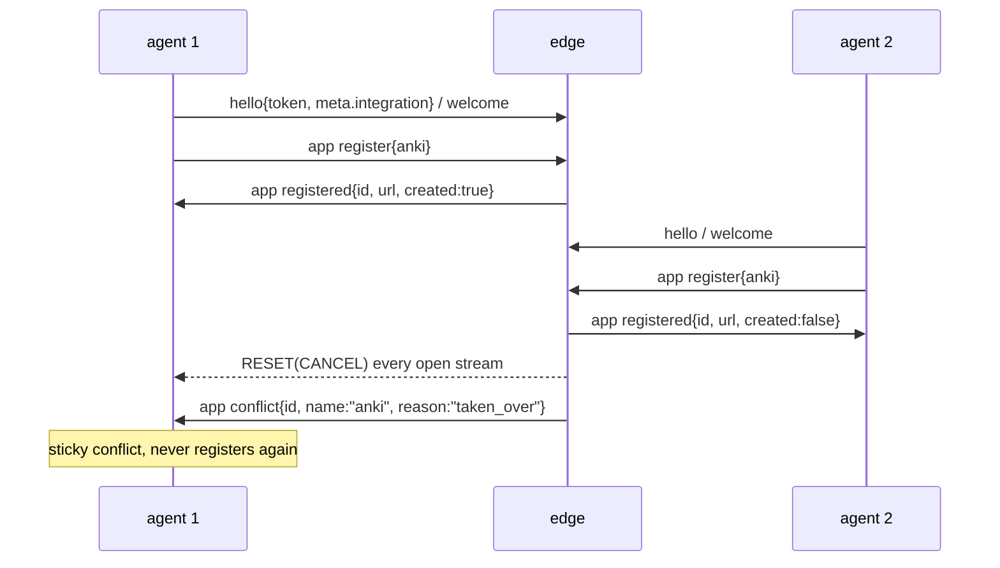

# mcpwarp layer spec

Status: **normative**, in two tiers (§1). This is the specification of the mcpwarp application layer that
rides on `ws-mixer.v1`: the `app.body.mcpwarp` envelope, identity, registration and take-over, HTTP request
bridging over streams, and the SDK profile (`expose()`, the tunnel controller, status text). The carrier —
framing, streams, the `app` message itself — is [`WIRE.md`](./WIRE.md); where the two disagree about the
carrier, WIRE.md wins. The ws-mixer core stays free of mcpwarp types ([`OVERVIEW.md`](./OVERVIEW.md)); this
document is a layer above it, not part of it ([`D-2026-10-14-01`](./DECISIONS.md#2026-10-14)).

Written to the **intended ws-mixer-js 0.11.0 behaviour**. Every point where ws-mixer-js HEAD (`d45d3b4`,
`SDK_VERSION` `"0.10.1"`) behaves differently is listed in §11; ws-mixer-js 0.11.0 implements v0.6.1; §11
rows 18–19 are pending in 0.11.x. `d45d3b4` is the HEAD reviewed for v0.6.0; rows 18–19 were found later
against `467bd5f` (ws-mixer-js 0.11.0), which is their baseline.

Section numbering is frozen once released: never renumber, append. Durations are integer ms and end in
`Ms`/`_ms`; byte counts are plain integers.

Terms: **agent** = the SDK side (ws-mixer client role); **edge** = the mcpwarp server (ws-mixer server
role); **service** = one named MCP endpoint an agent publishes; **tunnel controller** = the SDK's
long-lived `createTunnel()` object (§6).

---

## 1. Scope and tiers

| Tier | Sections | Binds | Strength |
|---|---|---|---|
| 1 — wire layer | §2 Envelope, §3 Identity and registration, §4 Request bridging, §8 Runtime constraints | every agent and every edge | normative |
| 2 — SDK profile | §5 `expose()`, §6 Tunnel controller, §7 Status text, §9 Naming | any SDK that ships the tunnel-controller API (`createTunnel`) | normative for such an SDK; an SDK that ships only `expose()` MUST still satisfy §5 |
| — | §10 Fixtures, §11 Deviations, §12 Checklist | — | informative, except where a row says MUST |

An SDK MAY add API beyond the profile. It MUST NOT change the observable behaviour the profile fixes (status
snapshots, codes, `lastError` strings, `describeStatus` output, bridging responses).

**Upgrade-status mapping.** A standard WebSocket API cannot report the HTTP status of a refused upgrade.
When the status is observable to the SDK (an injected factory reporting the upgrade failure, JS
`WebSocketLike.upgradeFailure.status`; a native client's HTTP response), an SDK MUST map HTTP `401` →
`UNAUTHORIZED` and `403`/`404` → `DISCONNECTED_FATAL` ([CLIENT-SDK.md](./CLIENT-SDK.md)'s Fatal set row;
§5.4, §6.7 T32, T33). When it is not observable, the refused upgrade is indistinguishable from a network
failure: a failed dial, retried with normal backoff (`connecting`/`RETRYING`, T27). The tunnel fixtures model
both through `dial_failed`'s `httpStatus` (§10.4).

---

## 2. Envelope (Tier 1)

### 2.1 Carrier

| Rule | Detail |
|---|---|
| Message | `{"t":"app","body":{"mcpwarp":{…}}}` on stream 0 ([WIRE.md §2.7](./WIRE.md#27-control-channel-stream-0)). `body.mcpwarp` is the **envelope**. |
| Timing | Only after `welcome`; an `app` before it is a connection `PROTOCOL_ERROR` (WIRE.md §2.7). |
| Size | The whole stream-0 payload (`{"t":"app","body":…}` serialized) MUST be ≤ **16 384** bytes, else `ENHANCE_YOUR_CALM` (WIRE.md §2.4). The envelope adds no limit of its own. |
| Rate | Shared stream-0 budget: burst 100, 50/s (WIRE.md §2.7). |
| Version | `v` MUST be the integer `1` (`MCPWARP_V`). |
| One service per message | An agent MUST send exactly one entry in `services[]` per `register` / `unregister`. Zero entries is malformed and MUST NOT be sent (`spec/mcpwarp.schema.json` rejects it, `minItems`). More than one entry MUST NOT be sent either (`maxItems: 1`). An edge MAY answer a multi-entry message with `error{TOO_MANY_SERVICES}` (§2.6); it is not required to, and the deployed edge does so only above its own threshold. |
| Key order | Senders SHOULD write the canonical key order: `v`, `op`, `services`, each service as `name`, `kind`, no whitespace (the bytes of §2.2's first two lines). Receivers MUST NOT depend on key order or whitespace. Byte identity is a fixture-comparison property only (§2.2, §10.2), never a wire requirement. |

### 2.2 Ops

| `op` | Direction | When | Required | Optional |
|---|---|---|---|---|
| `register` | A→E | on every `welcome`; after `enable`; transient-failure retry (§3.2) | `v`, `op`, `services[{name, kind}]` | — |
| `unregister` | A→E | `close()` while registered on the live connection (§5.7) | `v`, `op`, `services[{name}]` | — |
| `registered` | E→A | reply to `register` | `v`, `op` | `services[]`, `errors[]` |
| `unregistered` | E→A | reply to `unregister` (always sent, even for names the connection does not hold) | `v`, `op` | `services[]` |
| `disable` | E→A | unsolicited: service disabled in the dashboard | `v`, `op`, `id` | `reason` |
| `enable` | E→A | unsolicited: service re-enabled | `v`, `op`, `id`, `name` | — |
| `conflict` | E→A | unsolicited: another connection took the name (§3.3) | `v`, `op`, `id`, `name` | `reason` |
| `error` | E→A | envelope-level failure | `v`, `op`, `code` | `message` |

```json
{"mcpwarp":{"v":1,"op":"register","services":[{"name":"anki","kind":"http"}]}}
{"mcpwarp":{"v":1,"op":"unregister","services":[{"name":"anki"}]}}
{"mcpwarp":{"v":1,"op":"registered","services":[{"name":"anki","id":"srv_anki","url":"https://anki-tester.mcpwarp.test/mcp","created":true}],"errors":[]}}
{"mcpwarp":{"v":1,"op":"registered","services":[],"errors":[{"name":"anki","code":"QUOTA_EXCEEDED","message":"quota exceeded"}]}}
{"mcpwarp":{"v":1,"op":"unregistered","services":[{"name":"anki","id":"srv_anki"}]}}
{"mcpwarp":{"v":1,"op":"disable","id":"srv_anki","reason":"disabled"}}
{"mcpwarp":{"v":1,"op":"enable","id":"srv_anki","name":"anki"}}
{"mcpwarp":{"v":1,"op":"conflict","id":"srv_anki","name":"anki","reason":"taken_over"}}
{"mcpwarp":{"v":1,"op":"error","code":"UNKNOWN_OP","message":"unknown op frobnicate"}}
```

The first two lines are the canonical encoding (§2.1 Key order) for `name` `anki`, `kind` `http`. An agent MUST
produce the same JSON value — these keys and values, no others — and SHOULD produce exactly these bytes;
the byte comparison is made only against fixtures (§10.2), and a receiver MUST NOT depend on it (§2.1).

### 2.3 Fields

| Op | Field | Type | Req | Default / rule |
|---|---|---|:--:|---|
| `register` | `services[].name` | string | ✔ | a valid service name (§2.4) |
| `register` | `services[].kind` | `"http"` \| `"stdio"` | ✔ | agents send `"http"` unless configured |
| `unregister` | `services[].name` | string | ✔ | |
| `registered` | `services[].name` | string | ✔ | entries for other names are ignored once the message has decoded; they are still validated (§2.8) |
| `registered` | `services[].id` | string | ✔ | the server id |
| `registered` | `services[].url` | string, non-empty | ✔ | the public URL; missing or `""` in **any** entry → `MALFORMED_ENVELOPE` (§2.8 rule 8) |
| `registered` | `services[].created` | boolean | | absent or `null` → `false`; `true` only when this `register` created the service |
| `registered` | `errors[].name` | string | ✔ | entries for other names are ignored |
| `registered` | `errors[].code` | string | ✔ | §2.5; unknown values allowed |
| `registered` | `errors[].message` | string | | `""` |
| `registered` | `errors[].id` | string | | absent stays absent; carried by `SERVER_DISABLED` |
| `unregistered` | `services[].name` | string | ✔ | |
| `unregistered` | `services[].id` | string | | `""` |
| `disable` | `id` | string | ✔ | |
| `disable` | `reason` | string | | `"disabled"` |
| `enable` | `id`, `name` | string | ✔ | |
| `conflict` | `id`, `name` | string | ✔ | |
| `conflict` | `reason` | string | | `"taken_over"` |
| `error` | `code` | string | ✔ | §2.6; unknown values allowed |
| `error` | `message` | string | | `""` |

### 2.4 Name and integration syntax

| Constant | Value |
|---|---|
| `SERVICE_NAME_RE` | `^[a-z0-9]([a-z0-9-]*[a-z0-9])?$` |
| `SERVICE_NAME_MAX` | `30` (characters) |
| `isValidServiceName(n)` | `n` is a string, `length ≤ 30`, matches `SERVICE_NAME_RE` |
| `INTEGRATION_ID_RE` | `^(?:[0-9a-f]{8}-[0-9a-f]{4}-[1-8][0-9a-f]{3}-[89ab][0-9a-f]{3}-[0-9a-f]{12}\|00000000-0000-0000-0000-000000000000\|ffffffff-ffff-ffff-ffff-ffffffffffff)$`, tested after lowercasing |
| `DEFAULT_URL` | `"wss://connect.mcpwarp.io"` |

### 2.5 `registered.errors[].code`

Each value equals its name. **T** = transient (`TRANSIENT_REGISTER_ERRORS`): retried on the same connection
with backoff (§3.2), never fatal.

| Code | T | Meaning | Agent reaction |
|---|:--:|---|---|
| `SERVER_DISABLED` | | service disabled in the dashboard; carries `id` | adopt `id` as server id; state `disabled`; `message` ignored |
| `INTERNAL`, `NO_RESPONDERS`, `TIMEOUT`, `ABORTED`, `CONNECTION_LOST`, `MALFORMED_REPLY`, `UNAVAILABLE`, `SERVICE_ERROR` | ✔ | RPC / backend hiccup | non-fatal `error` event; re-send `register` after the backoff delay |
| `INVALID_NAME` | | name rejected by the edge | refusal |
| `USERNAME_REQUIRED` | | account has no username | refusal |
| `QUOTA_EXCEEDED` | | service quota used up | refusal |
| `CONFLICT` | | name in use by another server | refusal |
| `BAD_REQUEST`, `UNAUTHENTICATED`, `FORBIDDEN`, `NOT_IMPLEMENTED` | | RPC pass-through | refusal |
| any unknown code | | — | refusal |

**Refusal**: before the agent's first successful registration (on any connection) it is fatal —
`expose()` rejects with that code (§5.4). After it, `expose()` reports a non-fatal `error` event. The tunnel
controller treats every refusal, listed or unknown, as terminal at any time (§6.7 T17–T23, T39–T41): an
unknown code means the edge speaks something newer, so the controller MUST NOT wait at `connecting`.

### 2.6 `error.code`

| Code | Meaning (edge's current threshold, informative) | Agent reaction |
|---|---|---|
| `UNSUPPORTED_VERSION` | `v` not supported | **fatal** |
| `OVERLOADED` | too many `app` messages in flight (> 256) | if a `register` or `unregister` is outstanding: after **1000 ms**, if still connected, re-send it once (`unregister` only while closing); `onRetry` fires for a `register` re-send (§5.9) |
| `CONNECTION_LIMIT` | too many connections per owner and pod (> 10); the edge then closes with `APPLICATION_CLOSE` 4014 | non-fatal `error` event |
| `TOO_MANY_SERVICES` | too many entries in `services[]`; an edge MAY send it for any message with more than one (§2.1); the deployed edge's threshold is currently > 100 | non-fatal `error` event |
| `UNKNOWN_OP` | unknown `op` | non-fatal `error` event |
| `BAD_REQUEST` | malformed envelope | non-fatal `error` event |
| any unknown code | — | non-fatal `error` event |

### 2.7 Inbound acceptance

Agent states (§5.5): `connecting`, `registering`, `registered`, `disabled`, `conflict`, `closing`, `closed`.

| Op | Accepted in | Match | Effect |
|---|---|---|---|
| `registered` | any except `closing`, `closed`, `conflict` | `services[]` / `errors[]` entry whose `name` equals the agent's | `services` entry → state `registered`, url/id/created updated, backoff counter reset; `errors` entry → §2.5 |
| `unregistered` | `closing`, while an `unregister` is outstanding | any `unregistered`, or one naming the agent's service | ends the close wait (§5.7) |
| `disable` | any except `closing`, `closed`, `conflict` | `id` equals the agent's server id, or no server id known yet | state `disabled`, adopt `id`, `disabled` event |
| `enable` | any except `closing`, `closed`, `conflict` | `name` equals the agent's; `id` not compared, then adopted | `enabled` event, state `registering`, `register` sent (if disconnected, the next `welcome` sends it) |
| `conflict` | any except `closing`, `closed`; once per agent lifetime | `name` equals the agent's **or** `id` equals the agent's server id | §3.3 |
| `error` | any while connected | — | §2.6 |

A `registered`, `disable`, `enable` or `conflict` arriving on a superseded connection — a drained connection
once its replacement has received `welcome` (§5.9) — is ignored in every state: no state change, no event, no
`register` sent, so the tunnel controller never sees it (§6.8 Drain, T38).

### 2.8 Decode rules

1. `body.mcpwarp` absent, not an object, or an array → not this layer's message; ignored.
2. `v !== 1` → `unknown`; ignored by the agent.
3. Unknown `op` → `unknown`; ignored by the agent.
4. Unknown fields inside a known op → ignored.
5. Required string: present and a string. Optional string: absent → default (§2.3); **any non-string,
   including `null` → `MALFORMED_ENVELOPE`**.
6. Lists (`services`, `errors`): absent or `null` → `[]`; otherwise an array of objects (not arrays), else
   `MALFORMED_ENVELOPE`.
7. `registered.services[].created`: boolean, absent or `null` (→ `false`); anything else → `MALFORMED_ENVELOPE`.
8. `registered.services[].url`: missing or `""` → `MALFORMED_ENVELOPE`. Like rules 5–7 it applies to
   **every** entry, including entries for other service names that §2.3 ignores: validation is syntactic
   over the whole message and runs before entries are matched by name, so one bad entry makes the whole
   message `MALFORMED_ENVELOPE`, the agent's own valid entry included.
9. A `MALFORMED_ENVELOPE` is a **non-fatal** `error` event; the message is dropped. JS messages:
   `"<where>.<key> must be a string"`, `"<where>.<key> must be an array of objects"`,
   `"registered.services[].created must be a boolean"`, `"registered.services[].url must be a non-empty string"`.
   Envelope fixtures' `message_contains` is a substring match against the error message (the checker uses
   `includes`); fixtures use a prefix of these messages (e.g. `registered.services[].url`).
10. **Check order (normative).** A message with several defects reports the first in this order, so every SDK
    reports the same one: top-level fields in §2.3's row order; for `registered`, the `services` list (rule 6),
    then each `services[]` entry in array order, then the `errors` list, then each `errors[]` entry; within a
    `registered.services[]` entry `name`, then `id`, then `url`, then `created`; within a `registered.errors[]`
    entry `name`, `code`, `message`, `id`; within an `unregistered.services[]` entry `name`, `id`. This is
    `check-fixtures.mjs`'s order (`envelope/invalid/registered_multiple_defects.json`).

Edge side: an edge receiving `v !== 1` MUST answer `error{UNSUPPORTED_VERSION}`; an unknown `op`,
`error{UNKNOWN_OP}`.

---

## 3. Identity, registration, take-over (Tier 1)

### 3.1 Identity on every dial

| Item | Rule |
|---|---|
| Credential | `hello.token` is the authority (WIRE.md §2.1, [`D-2026-10-13-01`](./DECISIONS.md#2026-10-13)). `Authorization: Bearer <token>` on the upgrade is OPTIONAL; agents SHOULD send it when the runtime can set headers. A token provider MUST be called on every dial ([CLIENT-SDK.md](./CLIENT-SDK.md)'s Token provider row). |
| Integration id | `hello.meta.integration` MUST carry the integration's RFC 4122 UUID in text form, **lowercased**, matching `INTEGRATION_ID_RE`. Agents SHOULD also send it as `X-Mcpwarp-Integration: <uuid>` when headers are possible; the two MUST be equal. An edge ignores a value that is not a valid UUID (no error). |
| `hello.meta` | `{client, version, os, integration}`: `client` is `"sdk-<lang>"` — `"sdk-js"`, `"sdk-go"`, `"sdk-rust"`, `"sdk-python"`; `version` is the version of the mcpwarp layer's own package (JS: `SDK_VERSION`, since the layer ships inside `@mcpwarp/ws-mixer`; Rust: the `ws-mixer-mcpwarp` crate's version); `os` as in `hello.agent.os`. `hello.agent` stays the transport's (row below). |
| `hello.agent` | `{sdk, sdk_version, runtime, os}` per WIRE.md §2.7; `runtime`/`os` overridable by the `agent` option (each `^[\x20-\x7e]{1,64}$`); `sdk`/`sdk_version` never. |
| `User-Agent` | `<sdk>/<sdk_version> (<runtime> <os>)`, e.g. `ws-mixer-js/0.10.1 (node/22.4.0 darwin/arm64)`, when headers are possible. |
| Subprotocol | `ws-mixer.v1`. |
| URL | default `wss://connect.mcpwarp.io`; the edge routes by `Host`, the path is ignored. |
| `Origin` | An edge MUST accept any `Origin`, including `null` (WIRE.md §2.1 Origin row). |
| Service identity | **(token subject, service name)**. The edge keeps no registration state across connections. |

A header-less runtime (browser `WebSocket`, Electron renderer, Zotero) loses `Authorization`,
`X-Mcpwarp-Integration` and `User-Agent`; the `hello` fields carry everything the edge needs.

### 3.2 Registration lifecycle

| Rule | Detail |
|---|---|
| Register on every `welcome` | An agent MUST send `register` after **every** `welcome`, including a drain replacement's, unless taken over (§3.3) or closing. |
| Result | `registered` with a `services[]` entry for the agent's name: the service is live at `url`; `id` is the server id; `created` is `true` only when this `register` created it. |
| Transient retry | On a transient code (§2.5) the agent re-sends `register` on the same connection after `min(1000 × 2^n, 30000)` ms (1 s, 2 s, 4 s … capped 30 s), `n` = consecutive transient failures. `n` resets **only** on a successful `registered`, so it carries across reconnects. A disconnect cancels a pending retry; the next `welcome` registers anyway. |
| `OVERLOADED` | §2.6. |
| Unregister | On `close()`, if this connection sent `register` and is still connected: send `unregister`, wait for `unregistered` (§2.7) or **2000 ms**, whichever first; a failed send ends the wait at once. Then close ws-mixer gracefully (`drain{client_requested}`, ≤ 5 s grace, close `1000`). No `unregister` after a take-over, or when `register` never went out on the live connection. |
| Disabled | `disable` or `SERVER_DISABLED` → state `disabled`; the agent keeps the connection and answers `/mcp` with `503` (§4.4). `enable` → `register` again. |

### 3.3 Conflict and take-over

| Rule | Detail |
|---|---|
| Last `register` wins | A `register` for an identity held by another connection takes it over. The edge MUST RESET the old holder's open streams, then send it `{"mcpwarp":{"v":1,"op":"conflict","id":"<serverId>","name":"<name>","reason":"taken_over"}}` — at register time on the same pod, at the next presence heartbeat (up to ~30 s) on another pod. A connection being drained never receives `conflict`. |
| Sticky | On a matching `conflict` (§2.7) the agent enters `conflict` for the rest of its lifetime: it MUST NOT send `register` again (not on `welcome`, not on `enable`), ignores `registered`/`disable`/`enable`/`conflict`, RESETs every inbound stream with `CANCEL` `"service taken over by another connection"`, and sends no `unregister` on close. The connection is closed immediately, exactly as on a `drain` with `reason:"replaced"` (§6.8 Take-over close): the agent sends `error{NO_ERROR}` on stream 0 and WS close `1000` at once, skipping the `drain{client_requested}` and grace of a graceful close (WIRE.md §2.10 item 14), and never closes with `APPLICATION_CLOSE`; nothing reconnects; the tunnel controller stays in `conflict` until the next `configure()` (§6.8 Sticky conflict). |
| No ping-pong | An agent MUST NOT re-register to win a name back. Restart is a human or application decision (a new `configure()`, §6). |
| Drain `replaced` | A ws-mixer `drain` with `reason:"replaced"` on the agent's connection MUST be treated as a take-over (`TAKEN_OVER`), never as a hand-over: the agent MUST NOT dial a replacement or reconnect, and closes its ws-mixer client (Sticky row's take-over close), so no later `welcome` arrives and it never registers again. The agent MUST abandon any replacement dial that has not yet completed its upgrade; a replacement that has already sent `hello` (the transport sends it in the same poll as the `101`) MUST be closed with `error{NO_ERROR}` + WS close `1000` before any `welcome` handling, MUST NOT be reported as connected and MUST NOT `register`; the edge MUST tolerate a `hello` followed by an immediate close. `onRetry` does not fire for the abandoned dial in either case. Before `expose()` settles it rejects `TAKEN_OVER` (§5.4); after, the handle enters `conflict` and emits the `conflict` event (§5.6), sticky for the rest of the agent's lifetime — the tunnel's T45 (§6.7), sticky until the next `configure()`. Accepted in the same states as `conflict` (§2.7); after a `conflict` it changes nothing, and a `conflict` after it changes nothing. Any other drain `reason` is an ordinary hand-over (§5.9, §6.7 T31, T43). |
| Before first registration | `expose()` rejects with `TAKEN_OVER` (§5.4); no handle, no `conflict` event. |
| Last values | `url`, server id and registration keep their last values (now the new holder's). |

Take-over is last-`register`-wins plus `conflict`, as above. An edge MAY instead drain the old holder's
connection with `reason:"replaced"` as a deployment policy (WIRE.md describes mcpwarp doing so for free-tier
users: [§2.9 `Conn.Drain`](./WIRE.md#29-sequences) and its "Connection replacement is not ws-mixer's
business" note); this document does not require an edge to use that policy, but every agent MUST handle such
a `drain` as a take-over (Drain `replaced` row above; §5.4, §5.6, §6.7 T45), never as a hand-over: an agent that
re-registered on the replacement's `welcome` would take the name back, and two installs of the same name would
take it from each other forever.



---

## 4. Request bridging (Tier 1)

### 4.1 Framing

| Rule | Detail |
|---|---|
| One stream per request | The edge opens one stream per inbound public HTTP request (WIRE.md §2.5: only the server opens). The agent never opens streams and MUST serve streams concurrently. |
| Request bytes | Raw HTTP/1.1 in Go `Request.Write` shape: request line, `Host` = public host, headers, then a body framed by `Content-Length`, `Transfer-Encoding: chunked`, or nothing; then the edge sends `CLOSE` (half-close). |
| Edge header rules | The edge MUST strip hop-by-hop headers and `Authorization`; it MUST forward `Expect` unchanged. |
| OAuth metadata | The edge serves the OAuth protected-resource metadata (RFC 9728) for the public host itself; those requests never reach the agent. |
| Response bytes | `HTTP/1.1 <status> <reason>`, headers, body, then `CLOSE`. The agent MUST NOT send any `1xx`; it removes `Expect` and never sends `100 Continue`. |
| Response framing | Bodyless for `HEAD`, `1xx`, `204`, `304`. Else `Content-Length: N` when the response declares a valid one (`0` for a null body); otherwise `Transfer-Encoding: chunked`, one chunk per body read written immediately (SSE flushes per event), then `0\r\n\r\n`. |
| Response failures | Body shorter than `Content-Length` → RESET `INTERNAL_ERROR` `"response body shorter than Content-Length"`. Body read failure → RESET `INTERNAL_ERROR` `"response body failed"` + `error` event. |
| Edge cancel | Stream ends before the response finished → the agent aborts the handler's request / the target fetch (when the runtime has a cancel signal). |

Example (bytes inside DATA frames of one stream), edge → agent, then `CLOSE`:

```http
POST /mcp HTTP/1.1
Host: notes-tester.mcpwarp.test
accept: application/json, text/event-stream
content-type: application/json
mcp-session-id: abc
user-agent: Go-http-client/1.1
Content-Length: 40

{"jsonrpc":"2.0","id":1,"method":"ping"}
```

Agent → edge, then `CLOSE` (handler returned a body with no length):

```http
HTTP/1.1 200 OK
content-type: application/json
Transfer-Encoding: chunked

b
{"ok":true}
0

```

Lines end `\r\n`. Header order and casing on the request side vary; parsing is order- and case-insensitive.

### 4.2 Parsing limits

| Limit | Value | On violation |
|---|---|---|
| Request head | **65 536** bytes (`64 KiB`) | `431` `"request head too large"` |
| Head deadline | **10 000 ms** from stream open | RESET `CANCEL` `"request head deadline exceeded"`, no response |
| Request line | `^([^ ]+) ([^ ]+) HTTP/1\.([01])$`, method an RFC 9110 token | `400` `"malformed request line"` |
| Target | origin-form as-is; absolute-form `http(s)://…` cut to path + query (fragment dropped, not normalised); `*` and authority-form | `400` `"unsupported request target form"` |
| `Host` | exactly one, non-empty | `400` `"missing or duplicate Host header"` |
| Framing | `Transfer-Encoding` + `Content-Length` together; TE other than exactly `chunked`; differing CL values | `400` `"both Transfer-Encoding and Content-Length"` / `"unsupported Transfer-Encoding"` / `"conflicting Content-Length values"` |
| Chunk-size line | ≤ 4096 bytes; extensions ignored; trailers read and dropped | `400` `"line too long"` / `"malformed chunk size"` |
| Request body | `maxRequestBodyBytes`, default **4 194 304** (`4 MiB`); `Content-Length` checked before reading, chunked cumulatively; body buffered whole before the app is called, unless the adapter streams it (below) | `413` `"request body too large"`; a streaming adapter with the response head written but the response unfinished: RESET `CANCEL`; response already complete: CLOSE |
| EOF before end of head | — | `400` `"incomplete request"` |

Body cap: an agent MUST answer `413` once the body exceeds the cap, unless the streaming table below
applies (a response already begun). It MAY have consumed more than the
cap before detecting it, bounded by one transport chunk.

Streaming adapters: an adapter MAY stream the request body to the app instead of buffering it whole. The body
cap still applies, counted cumulatively over what has been read, and MAY overshoot by one transport chunk
(≤ **65 536** bytes). When it trips, the outcome depends on how far the response got:

| Response so far | The agent MUST |
|---|---|
| no response byte written | answer `413` `"request body too large"` as above |
| head written, response unfinished | RESET the stream with `CANCEL` (`0x07`) — a `413` can no longer be sent (`bridging/body_413_streamed_reset.json`) |
| response complete | CLOSE with the response intact, never RESET: a RESET after a complete response can make the edge drop bytes it has not forwarded yet (as §4.4's rule that a refused stream ends with CLOSE) |

A `Content-Length` over the cap is still refused before the app is called, so only a chunked body reaches the
second and third rows.

Other `400` messages (verbatim): `"malformed request target"`, `"obsolete header line folding"`,
`"malformed header line"`, `invalid header name "<n>"`, `"malformed Content-Length"`,
`"missing CRLF after chunk data"`, `"stream ended inside the request body"`.

### 4.3 Path rule

Only `/mcp` is forwarded. `requestPath(target)`: strip `scheme://authority` if present, cut at the first
`?` or `#`, compare **exactly and case-sensitively** with `"/mcp"`.

| Target | Forwarded |
|---|:--:|
| `/mcp`, `/mcp?x=1`, `https://h.example/mcp?x=1` | ✔ |
| `/mcp/`, `/MCP`, `/`, `/healthz`, `/a/../mcp`, `\mcp` | — (`404`) |

### 4.4 Precedence

Evaluated in this order; the first match answers. Rationale: never read a body that will be refused
([`D-2026-10-14-03`](./DECISIONS.md#2026-10-14)).

| # | Condition | Response | Body read |
|---|---|---|---|
| 0 | agent in `conflict` | RESET `CANCEL` `"service taken over by another connection"` | no |
| 1 | head invalid / too large / deadline | `400` / `431` / RESET (§4.2) | no |
| 2 | path ≠ `/mcp` | `404` `{"error":"not_found"}` | discarded |
| 3 | agent `disabled` | `503` `{"error":"service disabled"}` | discarded |
| 3 | agent `closing` / `closed` | `503` `{"error":"service closing"}` | discarded |
| 3 | agent unavailable in any other way (fallback) | `503` `{"error":"service unavailable"}` | discarded |
| 4 | body over the cap | `413` `{"error":"request body too large"}` | up to the cap (§4.2) |
| 5 | body malformed | `400` (§4.2) | partly |
| 6 | — | the application (handler or target) | whole |

An agent MUST follow this order, so `404` beats `503` beats `413`. An edge MAY answer a disabled service's
requests with `503` `{"error":"service disabled"}` itself.

**Ending a refused stream.** After writing any refusal the SDK generates — `404`, `503`, `413` or `500` —
while request body bytes are still unread, the agent drains the rest of the body — reads and drops it,
granting stream window as it goes — and then `CLOSE`s ("discarded" in the table). It MUST NOT RESET the
stream to avoid the drain; the edge's own request body cap bounds how much it drains. A body that turns out
malformed after any refusal has been written changes nothing: the stream still ends with `CLOSE`, not RESET
(the `400` of row 5 applies only before a response was written). The exception is a streaming adapter (§4.2)
whose app has already written its own response head: a body that then turns out malformed, like one that
trips the cap, ends with RESET `CANCEL` while the response is unfinished and with `CLOSE` once it is
complete, as in §4.2's streaming table.

### 4.5 Responses the agent generates

Error reply format (MUST, byte-exact):
`HTTP/1.1 <status> <reason>\r\nContent-Type: application/json\r\nContent-Length: <n>\r\n\r\n{"error":"<message>"}`,
then `CLOSE`; to `HEAD` the same head and no body. `<reason>` is the RFC 9110 phrase — `413` is
**`Content Too Large`**, `431` `Request Header Fields Too Large`, an unknown status `Unknown`.

| Situation | Status | `error` message |
|---|---|---|
| §4.2 / §4.4 rows | as listed | as listed |
| handler: request cannot be built | `400` | `request cannot be represented as a web Request` |
| handler throws, or returns something that is not a response | `500` | `handler error` (+ `error` event) |
| unexpected failure before any byte written | `500` | `internal error` (after a write: RESET `INTERNAL_ERROR` `"internal error"`) |
| target: no response headers within `targetTimeoutMs` (default **30 000**) | `504` | `local server timed out` |
| target: connection failed | `502` | `local server unreachable (<cause code>)`, or `local server unreachable` without a code |
| target: opaque / unpassable redirect | `502` | `local server sent a redirect this runtime cannot pass through` |

Target timeout: an agent MUST answer `504` at `targetTimeoutMs`; it SHOULD abort the upstream fetch when
the runtime offers a cancel signal and MAY let it settle otherwise. `targetTimeoutMs` bounds only the wait for
response headers; a body may stream past it.

### 4.6 Headers

| Direction | Rule |
|---|---|
| Request → handler | URL `https://<Host><target>`; headers minus hop-by-hop, `Connection`-listed names, `expect`, `content-length`; no body for `GET`/`HEAD` or when unframed. |
| Request → target URL | target URL with the incoming query parameters appended after its own; headers as for the handler minus `host`; set `accept-encoding: identity`, `x-forwarded-host: <public Host>`, `x-forwarded-proto: https`; redirects not followed. A response the runtime already decoded (`content-encoding` present) is re-served without `content-encoding`/`Content-Length`, chunked. |
| Response → edge | all headers except the hop-by-hop set (`connection`, `keep-alive`, `proxy-connection`, `proxy-authenticate`, `proxy-authorization`, `te`, `trailer`, `transfer-encoding`, `upgrade`), `Connection`-listed names and `content-length` (re-derived, §4.1); each `set-cookie` on its own line. |

### 4.7 MCP semantics belong to the handler

The agent is MCP-agnostic transport ([`D-2026-10-14-02`](./DECISIONS.md#2026-10-14)). It MUST forward method,
path, headers (including `mcp-session-id`) and body unchanged, and copy response headers back unchanged. It
MUST NOT inject, strip or generate `Mcp-Session-Id`, and MUST NOT special-case `GET`, `DELETE` or JSON-RPC
notifications. Session-id generation, `405` + `Allow: POST` for a `GET` without an SSE `Accept`, and `202`
for a notification are the MCP Streamable HTTP transport's job — the application's handler. An earlier task
list attributed them to the SDK because they are visible on `/mcp`; they are not the SDK's to generate.

---

## 5. SDK profile: `expose()` (Tier 2)

### 5.1 Options

| Option | Type | Req | Default / rule |
|---|---|:--:|---|
| `url` | string | | `DEFAULT_URL` |
| `token` | string, or provider `() → string \| Promise<string>` | ✔ | provider called on every dial; empty → validation error |
| `name` | string | ✔ | `isValidServiceName` |
| `kind` | `"http"` \| `"stdio"` | | `"http"` |
| `integration` | string | ✔ | `INTEGRATION_ID_RE` after lowercasing; sent lowercased; not trimmed |
| `webSocket` | WebSocket factory `(url, {protocols, headers}) → WebSocketLike` | | runtime default |
| `agent` | `{runtime?, os?}` | | each `^[\x20-\x7e]{1,64}$`; other keys ignored |
| `reconnect` | `{base=1000, cap=60000, connectTimeout=10000, maxAttempts=unbounded, stableAfter=10000}` | | ws-mixer client reconnect (WIRE.md §2.9); `maxAttempts` also bounds attempts before the first registration |
| `maxRequestBodyBytes` | integer | | `4194304` |
| `signal` | abort signal | | §5.8 |
| `onRetry` | `(info: {attempt, delayMs, reason}) → void` | | §5.9; throws reported as `error` events |
| `handler` | `(request) → response` (sync or async) | one of | |
| `target` | URL string | one of | must parse as a URL |
| `targetTimeoutMs` | number `> 0` and `≤ 2147483647` (fractions accepted) | | `30000`; only with `target` |

Language-specific adapters (JS `./node`'s `server`) MAY exist; they MUST follow §4.

### 5.2 Validation

Synchronous, before anything is dialed (JS: a thrown `TypeError`, not a rejection). First failure wins. A
message MUST NOT echo the offending value.

| # | Check | JS message |
|---|---|---|
| 1 | exactly one of `handler` (a function) / `target` | ``mcpwarp: pass exactly one of `handler` or `target` `` |
| 2 | `targetTimeoutMs` only with `target` | ``mcpwarp: `targetTimeoutMs` applies only to `target` `` |
| 3 | `target` parses; its scheme is supported: `http:` MUST be, `https:` is OPTIONAL. An SDK without `https:` support MUST reject the option synchronously as a configuration error, here for `expose()` and in `createTunnel()`'s up-front validation for the tunnel (§6.1) — never as a tunnel status, never at request time | ``mcpwarp: `target` is not a valid URL`` (JS supports both schemes; another SDK's unsupported-scheme message is its own, without the URL) |
| 4 | `targetTimeoutMs` range | ``mcpwarp: targetTimeoutMs must be a positive number of at most 2147483647 ms, got <n or type>`` |
| 5 | `name` | ``mcpwarp: invalid service `name`: lowercase letters, digits and inner dashes, at most 30 characters`` |
| 6 | `integration` present | ``mcpwarp: `integration` (your integration's registration UUID) is required`` |
| 7 | `integration` syntax | ``mcpwarp: `integration` must be an RFC 4122 UUID in text form; the server silently ignores anything else`` |
| 8 | `kind` | ``mcpwarp: `kind` must be "http" or "stdio"`` |
| 9 | `token` | ``mcpwarp: `token` is required`` |
| 10 | `agent` | ``mcpwarp: `agent` must be an object`` / ``mcpwarp: `agent.runtime` must be 1-64 printable ASCII characters`` (same for `agent.os`) |
| 11 | `reconnect` fields (`stableAfter` finite ≥ 0, …) | validation error of the same kind as rows 1–10 |
| 12 | `signal` already aborted | rejected result with `AbortError`; nothing dialed |

### 5.3 Wire per dial

§3.1. Every dial calls the token provider, sends `hello` with `token`, `agent`, `meta`, and (headers
permitting) `Authorization`, `User-Agent`, `X-Mcpwarp-Integration`.

### 5.4 Resolution

`expose()` returns a pending result that settles exactly once.

| First of | Result |
|---|---|
| `registered` for the agent's name | resolve with the handle (state `registered`) |
| `disable` or `SERVER_DISABLED` | resolve with the handle (state `disabled`, `registration` absent) |
| non-transient register refusal (§2.5) | reject `McpwarpError{code: <register code>, message: <server message>, fatal: true}` |
| `error{UNSUPPORTED_VERSION}` | reject `UNSUPPORTED_VERSION` |
| token rejected: close `4011`, or HTTP `401` reported by the factory | reject `UNAUTHORIZED`, `cause` = the transport error |
| any other fatal transport outcome ([CLIENT-SDK.md](./CLIENT-SDK.md)'s Fatal set row, incl. `reconnect.maxAttempts` exhausted) | reject `DISCONNECTED_FATAL`, `cause` = the transport error / disconnect reason; a fatal close's own code wins over the exhaustion |
| matching `conflict`, or `drain` with `reason:"replaced"` (§3.3) | reject `TAKEN_OVER` `mcpwarp: service "<name>" was taken over by another connection before it registered`; client closed; nothing redialed. A `drain{replaced}` carries no server id: if none is known, nothing attached to the rejection carries `serverId: ""` (omitted, as in §5.6) |
| `close()` | reject `CLOSED` `mcpwarp: closed before the service was registered` |
| `signal` aborted | reject `AbortError` (§5.8) |

Dial failures, refused upgrades seen as `1006`, and transient register errors are not outcomes: they retry
without limit unless `reconnect.maxAttempts` is set.

`McpwarpError`: `name` `"McpwarpError"`, `code` (any §2.5 / §2.6 code, `MALFORMED_ENVELOPE`, `CLOSED`,
`UNAUTHORIZED`, `TAKEN_OVER`, `DISCONNECTED_FATAL`), `message`, `fatal` (default `false`), `serviceName`
(optional), `cause` (only when given).

### 5.5 Handle

| Member | Rule |
|---|---|
| `url` | latest registered public URL; never `""`; absent only when resolved `disabled` and never registered |
| `serverId` | latest server id from `registered`, `disable`, `enable` or `SERVER_DISABLED.id` |
| `registration` | frozen `{url, serverId, created}` of the latest `registered` |
| `path` | `"/mcp"` |
| `state` | `"connecting"` \| `"registering"` \| `"registered"` \| `"disabled"` \| `"conflict"` \| `"closing"` \| `"closed"`; initial `"connecting"` |
| `client` | the underlying ws-mixer client (escape hatch) |
| `on` / `once` / `off` | event subscription |
| `close()` | §5.7; idempotent (same result every call) |

### 5.6 Events

| Event | Payload | When |
|---|---|---|
| `registered` | `{url, serverId, created}` (frozen) | every successful `register` (each `welcome`, after `enable`) |
| `disabled` | `{serverId, reason}` | `disable` (its `reason`) or `SERVER_DISABLED` (`"disabled"`) |
| `enabled` | `{serverId}` | matching `enable`; `register` follows |
| `conflict` | `{serverId, name, reason}` (frozen) | matching `conflict` after settle (its fields); or `drain` with `reason:"replaced"` after settle (§3.3): `{serverId: <the handle's serverId>, name: <the agent's name>, reason: "replaced"}`, where `serverId` is **omitted** (absent / `undefined`) when no server id is known — never `""`; state `conflict` either way |
| `error` | error value | non-fatal: transient register errors, refusals after the first registration, `error` ops other than `UNSUPPORTED_VERSION`/`OVERLOADED`, `MALFORMED_ENVELOPE`, handler throws / non-responses, response or target body failures, throws from listeners or `onRetry` |
| `disconnect` | ws-mixer disconnect reason ([CLIENT-SDK.md](./CLIENT-SDK.md)'s Disconnect reason shape row) | every transport disconnect |
| `close` | `{}` after `close()`; `{error}` after a fatal | once, last |

Every listener is called even when one throws; a throw is re-emitted as `error`; a throw inside an `error`
listener is dropped.

### 5.7 `close()`

1. If already `closing`/`closed`, return the same result. Else state `closing`, timers cancelled.
2. If this connection sent `register` and is connected: `unregister`, wait for `unregistered` or 2000 ms (§3.2).
   Never rejects.
3. Close the ws-mixer client gracefully; errors swallowed.
4. State `closed`, `close {}` emitted.

While `closing`/`closed`, `/mcp` gets `503` `service closing`.

### 5.8 `signal`

Abort before settle: the client is closed and `expose()` rejects with `signal.reason` if it is an error named
`AbortError`, else a new `AbortError` `mcpwarp: expose() aborted before the service was registered` (JS:
`DOMException` when available, else `Error` with `name = "AbortError"`). Abort after settle = `handle.close()`.

### 5.9 Reconnect interaction

| Rule | Detail |
|---|---|
| Welcome | every `welcome` (incl. a drain replacement) → `register` (§3.2), unless taken over (§3.3). |
| Drain | `reason:"replaced"` → take-over (§3.3), as the tunnel's T45: `TAKEN_OVER` rejection before settle (§5.4), state `conflict` and the `conflict` event after (§5.6); either way no replacement dial, no reconnect, the client is closed immediately (§6.8 Take-over close). Any other reason → hand-over: the client dials a replacement, the drained connection keeps serving until it ends. |
| Disconnect | Same rule as the tunnel's (§6.8 Drain, T38, T44). The end of a drained connection is ignored only once its replacement has received `welcome`, including while the replacement is still registering: the state does not change. Before that (replacement dial pending or failing) it is an ordinary lost connection: state `connecting`, the replacement's dial being the pending reconnect. Any other connection's end → `connecting`. Decide by connection identity, never by the handle's state; `conflict` stays `conflict` (§3.3). A non-fatal `disconnect` is emitted in every case. |
| Superseded messages | Once the replacement has received `welcome`, `registered`, `disable`, `enable` and `conflict` arriving on the drained connection are ignored by the handle (§2.7): no state change, no event, no `register` sent, so the tunnel never sees them (§6.8 Drain, T38). |
| `onRetry` | MUST fire **before every** scheduled reconnect and every `register` retry — including zero-delay redials, drain-caused redials, the token-refresh redial and `OVERLOADED` re-sends — with `{attempt, delayMs, reason}`. `reason` is the transport's disconnect cause for a redial, `"register failed: <CODE>: <message>"` for a transient register retry, `"register failed: OVERLOADED: <message>"` for an `OVERLOADED` re-send. |
| `onRetry` special cases | **`OVERLOADED` re-send**: `attempt` is `1` for the first re-send after the refusal and increments on each consecutive re-send; a successful `registered` resets it. **Drain replacement dial** (a hand-over, not a failure): `{attempt: 0, delayMs: <delay>, reason: "drain"}`, where `delayMs` is the actual delay before the replacement dial, whichever produced it: WIRE.md §2.9's `0–2000 ms` drain jitter, or the drain's `retry_after_ms` hint when the transport honours it; the client's own backoff counter is not consulted. **Token-refresh redial** (the one immediate redial after a rejected token, [CLIENT-SDK.md](./CLIENT-SDK.md)'s Rejected token row): it is a scheduled reconnect, so `onRetry` fires with exactly `{attempt: 1, delayMs: 0, reason: "token-refresh"}`. **Take-over**: `onRetry` does not fire for a replacement dial that `drain{replaced}` abandons (no retry is scheduled, §3.3). |

---

## 6. SDK profile: tunnel controller (Tier 2)

A long-lived object for hosts with a settings UI: configure it any number of times, read one status.

### 6.1 `createTunnel(options)`

`options` = §5.1's `integration`, `agent`, `webSocket`, `maxRequestBodyBytes`, `reconnect`, `onRetry`,
`handler` / `target` / `targetTimeoutMs`, plus `logger(level, message)`, `level` ∈ `"info"`, `"warn"`,
`"error"`. `integration`, `agent` and the handler/target options (§5.2 rows 1–4, including an unsupported
`target` scheme) are validated up front (thrown, §5.2 messages; JS `createTunnel` → `adapterServer`);
everything else at start (§6.7 T7–T9). Initial status `{state: "off"}`.

### 6.2 `configure(config)`

`config` = `{enabled: boolean, token: string, name: string, url?: string, kind?: ServiceKind, webSocket?}`;
`webSocket` overrides the options' factory. `configure()` MUST NOT throw or reject.

1. Disposed → resolve, nothing else.
2. Checks, first match wins:

| # | Check | Status | `lastError` | Log (`error`) |
|---|---|---|---|---|
| 1 | not an object, or `null` | `error`/`INVALID_CONFIG` | `The tunnel settings are invalid.` | ``INVALID_CONFIG: the config must be an object`` |
| 2 | `enabled` not a boolean | `error`/`INVALID_CONFIG` | `The tunnel settings are invalid.` | ``INVALID_CONFIG: `enabled` must be a boolean`` |
| 3 | `!enabled`, or `token` a string that trims to `""` | valid → `off` | — | — |
| 4 | `token` not a string | `error`/`INVALID_CONFIG` | `The token is not set.` | ``INVALID_CONFIG: `token` must be a string`` |
| 5 | `name` not a string | `error`/`INVALID_CONFIG` | `The service name is not set.` | ``INVALID_CONFIG: `name` must be a string`` |
| 6 | `url` present, not a string | `error`/`INVALID_CONFIG` | `The tunnel settings are invalid.` | ``INVALID_CONFIG: `url` must be a string`` |
| 7 | `webSocket` present, not a function | `error`/`INVALID_CONFIG` | `The tunnel settings are invalid.` | ``INVALID_CONFIG: `webSocket` must be a function`` |

   On a failed check: the desired config is cleared, the live connection stopped.
   `name` syntax and `kind` are checked at start (§6.7 T7, T8).
3. **Idempotence**: if a desired config exists and `enabled`, trimmed `token`, `name`, `url`, `kind` and the
   effective factory (`config.webSocket ?? options.webSocket`, by identity) are all equal, return the
   pending/previous result: no new dial, no new snapshot. Absent and `undefined` are equal. The desired
   config is cleared by `stop()`, `dispose()`, a conflict, a fatal error and an invalid config — after which
   the same config starts again.
4. Else it becomes the desired config. Applies are **serialized**: each waits for the previous one and for the
   previous connection's shutdown (unregister ≤ 2000 ms + drain ≤ 5000 ms); a superseded config never dials.
   Only the last of N overlapping `configure()` calls dials.

The result resolves once the previous connection is stopped and the new one has started dialing — not when
`online`.

### 6.3 `stop()` and `dispose()`

| Call | Rule |
|---|---|
| `stop()` | Disposed → resolve. Else clear the desired config, stop the live connection, status `off`; resolves after the queue and the shutdown (no timeout; ~7 s worst case). Reusable: a later `configure()` starts again. **During the raw dial**: resolves only once the dial has settled and its socket is closed; no event from that connection reaches listeners after it resolves. |
| `dispose({timeoutMs})` | Memoized (same result every call). Final: status `off` delivered, listeners cleared; waits for the queue and shutdown or `timeoutMs` (default **5000**), whichever first; on timeout logs `warn` `dispose() gave up waiting after <timeoutMs> ms` and resolves while the old connection closes in the background. `timeoutMs` MUST be a positive finite number, else a synchronous validation error (JS `TypeError`). After dispose: `configure()`/`stop()` resolve and do nothing; `subscribe(l)` calls `l` once with `{state: "off"}` and returns a no-op. |

### 6.4 Status and `subscribe`

| Rule | Detail |
|---|---|
| Shape | `TunnelStatus {state, url?, code?, lastError?}`. Absent keys are absent, never `undefined`/`null`. |
| Snapshot | `status` returns a copy. |
| Dedup | A transition to an identical `(state, url, code, lastError)` delivers nothing. |
| `subscribe(l)` | Calls `l` immediately with the current snapshot, then on every change; returns an unsubscribe function. |
| Isolation | Listeners are called over a copy of the set; a throw is caught, logged `error` `status listener threw: <message>`, and the rest are still called. |

### 6.5 States and codes

`TunnelState`: `off`, `connecting`, `online`, `disabled`, `conflict`, `error`.

`TunnelStatusCode` (13, value = name): `UNAUTHORIZED`, `TAKEN_OVER`, `DISCONNECTED`, `RETRYING`, `DISABLED`,
`INVALID_CONFIG`, `INVALID_NAME`, `USERNAME_REQUIRED`, `QUOTA_EXCEEDED`, `CONFLICT`, `UNSUPPORTED_VERSION`,
`DISCONNECTED_FATAL`, `INTERNAL`.

**Legal (state, code) pairs.** A tunnel MUST NOT produce any other.

| State | Code | `url` | `lastError` |
|---|---|---|---|
| `off` | — | — | — |
| `connecting` | — | — | — |
| `connecting` | `RETRYING`, `DISCONNECTED`, `INTERNAL` | — | ✔ |
| `online` | — | ✔ | — |
| `disabled` | `DISABLED` | — | ✔ |
| `conflict` | `TAKEN_OVER` | — | ✔ |
| `error` | `UNAUTHORIZED`, `INVALID_CONFIG`, `INVALID_NAME`, `USERNAME_REQUIRED`, `QUOTA_EXCEEDED`, `CONFLICT`, `UNSUPPORTED_VERSION`, `DISCONNECTED_FATAL`, `INTERNAL` | — | ✔ |

17 pairs. `code` and `lastError` are always set together.

### 6.6 `lastError`

Constants, verbatim. A `lastError` MUST NOT contain the token, the service name, the URL or a server message,
and has no `mcpwarp: ` prefix.

| Cause | Code | `lastError` |
|---|---|---|
| redial after a failed dial | `RETRYING` | `Can't reach mcpwarp; retrying.` |
| transient register retry, `OVERLOADED` re-send | `RETRYING` | `mcpwarp couldn't register the service; retrying.` |
| live connection lost | `DISCONNECTED` | `Connection lost; retrying.` |
| take-over | `TAKEN_OVER` | `Another connection took over this name.` |
| disabled | `DISABLED` | `This service is disabled in the mcpwarp dashboard.` |
| token rejected (`UNAUTHORIZED`, `UNAUTHENTICATED`) | `UNAUTHORIZED` | `The token was rejected.` |
| `FORBIDDEN` | `UNAUTHORIZED` | `The token is not allowed to publish this service.` |
| invalid name (local or `INVALID_NAME` refusal) | `INVALID_NAME` | `The service name is invalid: use lowercase letters, digits and dashes (not at the start or end), at most 30 characters.` |
| invalid settings | `INVALID_CONFIG` | `The tunnel settings are invalid.` |
| `token` not a string | `INVALID_CONFIG` | `The token is not set.` |
| `name` not a string | `INVALID_CONFIG` | `The service name is not set.` |
| `USERNAME_REQUIRED` | `USERNAME_REQUIRED` | `Choose a username in your mcpwarp account first.` |
| `QUOTA_EXCEEDED` | `QUOTA_EXCEEDED` | `Your mcpwarp account has no services left in its quota.` |
| `CONFLICT` | `CONFLICT` | `The name is in use by another server.` |
| `UNSUPPORTED_VERSION` | `UNSUPPORTED_VERSION` | `This SDK version is no longer supported; please update.` |
| fatal transport outcome | `DISCONNECTED_FATAL` | `The connection to mcpwarp failed.` |
| anything else | `INTERNAL` | `Something went wrong; the log has the details.` |

### 6.7 Transitions

Inputs are the controller calls and the connection events of §10.4 (the tunnel fixtures' vocabulary). Events
of a superseded connection change nothing (T38). `conn/*` = `connecting` with any code or none; **live** =
`conn/*`, `online` or `disabled`/`DISABLED`. "—" in To-code means no code and no `lastError`. Every row with a
code takes its `lastError` from §6.6.

| # | From | Event | To | Code | Notes |
|---|---|---|---|---|---|
| T1 | any | `configure`, a §6.2 check 1, 2, 4–7 fails | `error` | `INVALID_CONFIG` | `lastError` per §6.2; live connection stopped |
| T2 | any | `configure` equal to the desired config (§6.2 step 3) | unchanged | | no snapshot, no dial |
| T3 | any | `configure`, new, `enabled` and token non-blank | `connecting` | — | previous connection stopped first; then start |
| T4 | any | `configure`, new, `!enabled` or blank token | `off` | — | |
| T5 | any | `stop()` | `off` | — | |
| T6 | any | `dispose()` | `off` | — | final; nothing after |
| T7 | `connecting` | start: `name` fails `isValidServiceName` | `error` | `INVALID_NAME` | no dial |
| T8 | `connecting` | start: any other option fails §5.2 (incl. `kind`, `reconnect.*`) | `error` | `INVALID_CONFIG` | `The tunnel settings are invalid.`; no dial |
| T9 | `connecting` | start: any other synchronous failure | `error` | `INTERNAL` | |
| T10 | `conn/*` | `connected`, `welcome` | unchanged | | `register` sent |
| T11 | live | `registered` | `online` | — | `url` = registered url |
| T12 | `conn/*`, `online`, `disabled` | `disabled`, or `register_error{SERVER_DISABLED}` | `disabled` | `DISABLED` | from `disabled`: no new snapshot (§6.4 dedup) |
| T13 | live | `enabled` | `connecting` | — | `register` sent |
| T14 | `conn/*` | `register_error{<transient>}` | `connecting` | `RETRYING` | register text; `onRetry` fires |
| T15 | `conn/*` | `app_error{OVERLOADED}`, `register` outstanding | `connecting` | `RETRYING` | register text; `onRetry` `delayMs` 1000 |
| T16 | `online`, `disabled` | `register_error{<transient>}`, `app_error{OVERLOADED}` | unchanged | | replacement connection; `onRetry` still fires |
| T17 | live | `register_error{UNAUTHENTICATED}` | `error` | `UNAUTHORIZED` | `The token was rejected.`; connection closed |
| T18 | live | `register_error{FORBIDDEN}` | `error` | `UNAUTHORIZED` | `The token is not allowed to publish this service.`; closed |
| T19 | live | `register_error{INVALID_NAME}` | `error` | `INVALID_NAME` | closed |
| T20 | live | `register_error{USERNAME_REQUIRED}` | `error` | `USERNAME_REQUIRED` | closed |
| T21 | live | `register_error{QUOTA_EXCEEDED}` | `error` | `QUOTA_EXCEEDED` | closed |
| T22 | live | `register_error{CONFLICT}` | `error` | `CONFLICT` | closed |
| T23 | live | `register_error{BAD_REQUEST \| NOT_IMPLEMENTED}` | `error` | `INTERNAL` | closed; before **or after** the first registration ([`D-2026-10-14-04`](./DECISIONS.md#2026-10-14)) |
| T24 | live | `app_error{UNSUPPORTED_VERSION}` | `error` | `UNSUPPORTED_VERSION` | closed |
| T25 | `conn/*` | `app_error{<other>}` (`CONNECTION_LIMIT`, `TOO_MANY_SERVICES`, `UNKNOWN_OP`, `BAD_REQUEST`, unknown), or a malformed envelope | `connecting` | `INTERNAL` | logged `warn` |
| T26 | `online`, `disabled` | same as T25 | unchanged | | logged `warn` |
| T27 | `connecting` with no code, `RETRYING` or `INTERNAL` | `dial_failed` (no HTTP status observable, or one the reconnect rules retry, e.g. `503`), or a pre-`welcome` failure | `connecting` | `RETRYING` | dial text; redial scheduled, `onRetry` fires |
| T28 | `connecting`/`DISCONNECTED` | `dial_failed` (no HTTP status observable, or one the reconnect rules retry), or a pre-`welcome` failure | unchanged | | `onRetry` fires; an observable `401`/`403`/`404` is T32/T33 |
| T29 | `online`, `disabled` | `dial_failed` (no HTTP status observable, or one the reconnect rules retry), or a pre-`welcome` failure, of a drain replacement | unchanged | | `onRetry` fires; an observable `401`/`403`/`404` is T32/T33 |
| T30 | live | `disconnect{fatal:false}` of a connection that received `welcome` | `connecting` | `DISCONNECTED` | reconnect pending |
| T31 | `online`, `disabled` | `drain`, reason not `replaced` | unchanged | | replacement dialed; the drained connection keeps serving until it ends; its end changes nothing once the replacement has received `welcome` (T38), else T44 |
| T32 | live | `disconnect{fatal:true, code:"UNAUTHORIZED"}`, or a refused upgrade with HTTP `401` when the status is observable (`dial_failed{httpStatus:401}`: `httpStatus` 401 in the disconnect reason, no `errorName`) | `error` | `UNAUTHORIZED` | `The token was rejected.`; an unobservable `401` is a plain failed dial (T27–T29 by state, §1 Upgrade-status mapping) |
| T33 | live | `disconnect{fatal:true}`, any other code; or `dial_failed{httpStatus:403 \| 404}` (observable) | `error` | `DISCONNECTED_FATAL` | incl. `reconnect.maxAttempts` exhausted |
| T34 | live | `conflict` | `conflict` | `TAKEN_OVER` | desired config cleared; connection closed immediately; no redial (§6.8) |
| T35 | `conflict`/`TAKEN_OVER` | any connection event | unchanged | | sticky until `configure` (T3) |
| T36 | live | connection closed with no error, not by the controller | `error` | `INTERNAL` | |
| T37 | `error`/* | `configure` identical to the failed one | `connecting` | — | T3: the desired config was cleared |
| T38 | any | any event from a superseded connection (an ended generation, or a drained connection once its replacement has received `welcome`) — including its `disconnect` while the replacement is still registering, and its `registered`, `disabled`, `enabled`, `conflict` | unchanged | | §6.8; before the replacement's `welcome` the drained connection's end is T44 |
| T39 | `conn/*`, before the first registration | `register_error{<unknown code>}` | `error` | `INTERNAL` | closed (`expose()` rejected) |
| T40 | `conn/*`, after a registration | `register_error{<unknown code>}` | `error` | `INTERNAL` | closed; as T23 ([`D-2026-10-14-04`](./DECISIONS.md#2026-10-14)) |
| T41 | `online`, `disabled` | `register_error{<unknown code>}` on a replacement | `error` | `INTERNAL` | closed; as T23 |
| T42 | `online`, `disabled` | `connected`, `welcome` of a drain replacement | unchanged | | `register` sent on `welcome`; from then on the drained connection is superseded (T38) |
| T43 | `conn/*` | `drain`, reason not `replaced` | unchanged | | as T31: replacement dialed, the drained connection keeps serving until it ends |
| T44 | `conn/*`, `online`, `disabled` | `disconnect{fatal:false}` of a drained connection whose replacement has not received `welcome` (dial pending or failing, T29) | `connecting` | `DISCONNECTED` | as T30; the replacement's dial is the pending reconnect (T28) |
| T45 | live | `drain` with `reason:"replaced"` | `conflict` | `TAKEN_OVER` | as T34 (§3.3 Drain `replaced`): desired config cleared; connection closed immediately; no redial, the replacement never registers (§6.8) |

Timer events (`retry`, `tick`) only advance the clock; any status change comes from what the timer then does
(a redial, a re-sent `register`) and that row.

`connecting` codes by cause: `connecting`/`RETRYING` follows a register refusal that will be retried (T14,
T15) or a failed dial (T27); `connecting`/`DISCONNECTED` follows loss of an established connection with a
reconnect pending (T30, T44); `connecting` with no code follows `configure` and `enabled` (T3, T13). The
choice is made by the cause, never by parsing an `onRetry` `reason` string.

**Pre-`welcome` failure.** A non-fatal failure after the upgrade but before `welcome` — a handshake-phase
close or transport death ([CLIENT-SDK.md](./CLIENT-SDK.md)'s Handshake-phase close row), or the client's own
10 s welcome timeout — is a **failed dial**, not a lost connection: T27, T28, T29 apply exactly as for
`dial_failed`, never T30 or T44. In the fixtures it is a `disconnect{fatal:false}` addressed to a connection
that had `connected` but no `welcome` (`34_t27_*`). A fatal one is T32/T33 as usual.

### 6.8 Stale, drain and sticky rules

| Rule | Detail |
|---|---|
| Generations | Every `configure` that applies, `stop`, `dispose`, conflict and fatal error ends the current connection's generation synchronously. Events, `onRetry` calls and `expose()` settlements of an ended generation MUST NOT change status. A handle that resolves for an ended generation is closed and never shown. |
| Drain | Once the replacement has received `welcome`, the drained connection is superseded: its end MUST NOT change status, including while the replacement is still registering, and is logged `info` `the superseded connection ended: <message>`; only the replacement's events move status. Before that — the replacement's dial still pending or failing (T29) — the drained connection's end is a lost connection: `connecting`/`DISCONNECTED`, `lastError` per §6.6 (T44). Decide by connection identity, never by the handle's state. Application messages on the superseded connection — `registered`, `disable`, `enable`, `conflict` — arriving after the replacement's `welcome` are stale too: the handle already ignores them (§2.7, §5.9), so they never reach the controller; no status change, no `register` sent (T38). This rule is for a hand-over; a `drain` with `reason:"replaced"` is a take-over (T45). |
| Sticky conflict | After T34 or T45 nothing redials until the next `configure()`, identical or not. A `TAKEN_OVER` rejection of `expose()` is the same transition. |
| Take-over close | On a `conflict` (T34) and on a `drain` with `reason:"replaced"` (T45) alike, the agent closes the taken-over connection **immediately**: no `unregister`, no wait for in-flight streams — they are cut, since `TAKEN_OVER` means another holder owns the name (§3.3 Sticky). On the wire: `error{NO_ERROR}` on stream 0, then WS close `1000`, with no `drain{client_requested}` and no grace (WIRE.md §2.10 item 14 is skipped); never `APPLICATION_CLOSE`. On a `drain{replaced}` a replacement dial that has not yet completed its upgrade is abandoned; one that has already sent `hello` is closed the same way (`error{NO_ERROR}` + WS close `1000`) before any `welcome` handling, is never reported as connected and never sends `register`, and the edge tolerates the `hello` followed by an immediate close. `onRetry` does not fire for the abandoned dial in either case (§3.3 Drain `replaced`). |
| Fatal | Every `error` transition clears the desired config and closes the connection; no automatic redial. |
| `onRetry` | Every current-generation retry is logged `warn` and forwarded to `options.onRetry`, whatever the state; status changes only per T14, T15, T27, T28. |
| Errors | Handler errors (not `McpwarpError`) never change status. |

### 6.9 Logging

SHOULD-level. Messages have no `mcpwarp: ` prefix. The token MUST NOT be logged. The service name and URL MAY
appear in logs (never in `lastError`, §6.6). Logger exceptions are swallowed.

| Level | Messages |
|---|---|
| `info` | `connecting as "<name>"[ via <url>]`; `online at <url>`; `off`; `stopping`; `the service was enabled, registering again`; `the superseded connection ended: <message>` |
| `warn` | `retry #<attempt> in <delayMs> ms: <reason>`; `disconnected: <message>`; non-fatal errors as `<CODE>: <message>` (handler errors: message only); `the service is disabled in the mcpwarp dashboard`; `the service was disabled (<reason>)`; `another connection took over the name "<name>"; not reconnecting until configure() is called again`; `error while closing: <message>`; `dispose() gave up waiting after <n> ms` |
| `error` | every transition to `error`, as `<CODE>: <message>` — including `INVALID_CONFIG: <detail>` and `INVALID_NAME: <detail>` for local validation failures (§6.2, T7, T8); `status listener threw: <message>`; an internal queue failure |

In every `<CODE>: <message>` line (`warn` and `error`), `<CODE>` is the failure's `McpwarpError` `code` (§5.4) when
it carries one — e.g. `UNAUTHENTICATED`, `MALFORMED_ENVELOPE`, `TAKEN_OVER` — and otherwise the
`TunnelStatusCode` of the resulting status (§6.5).

---

## 7. Status text (Tier 2)

`describeStatus(status, {locale?, messages?}) → {label, detail?}` turns a `TunnelStatus` into UI text. Plain
lookup tables, no locale library; never throws. The tables are normative data
([`D-2026-10-14-05`](./DECISIONS.md#2026-10-14)): an SDK MUST ship them string-identical to
`spec/fixtures/mcpwarp/status-text/<locale>.json` — every label and detail the same string; the SDK's own
file format is free — and changing a string is a spec release.

| # | Rule |
|---|---|
| 1 | **Locales** (`statusLocales`, resolution order): `en`, `de`, `es`, `fr`, `ja`, `zh-CN`. |
| 2 | **Resolution**: non-string → `en`. `tag = locale.trim()`, `_` → `-`, lowercased. Exact match against `statusLocales` (case-insensitive); else the first locale whose language subtag equals `tag`'s (`zh`, `zh-TW`, `zh-Hant` → `zh-CN`; `de-AT` → `de`); else `en`. |
| 3 | **Overrides** `messages: {states?, codes?}`: per call only, for keys of the resolved table only, own properties with string values; anything else ignored. |
| 4 | `label` = the state's string if `state` is a known state, else `String(state)`. |
| 5 | `sentence` = the code's string if `code` is a known code, else none. |
| 6 | `detail`: no sentence → `lastError` (may be absent). `code` = `INVALID_CONFIG` and `lastError` non-empty → if `lastError` is `The tunnel settings are invalid.` → sentence; else if `lastError` starts with the sentence → `lastError`; else `sentence + joiner + lastError'`, where `lastError'` replaces every match of `/:\s+/g` with `"; "`. Otherwise → sentence. |
| 7 | **Joiner**: `fr` `" : "` (U+00A0, colon, space); `ja` and `zh-CN` `"："` (U+FF1A); every other locale `": "`. |
| 8 | `detail` is included only when non-empty and different from `label` (so `disabled`/`DISABLED` and `conflict`/`TAKEN_OVER` have no detail in any locale). |

**Host-side "off" pattern.** Before a host can configure the tunnel (e.g. no account linked) it shows its
own status `{state: "off", lastError: "<host text>"}` with no code; rule 6 yields
`{label: <off label>, detail: "<host text>"}`.

**Data files** (`spec/fixtures/mcpwarp/status-text/`):

| File | Content |
|---|---|
| `rules.json` | the rules above in machine-readable form: `keyFormat`, `locales`, `localeResolution`, `zhAlias` (`"zh-CN"`), `colonJoiner` per locale, `detailOmittedWhenEqualLabel`, `detailOmittedWhenEmpty`, `lastErrorColonRewrite` (`{"pattern": ":\\s+", "flags": "g", "replacement": "; "}`), `invalidConfigComposition`, `hostOffPattern`, `lint`, `newInSpec` (the six `error.INVALID_NAME` strings new in this spec) |
| `en.json`, `de.json`, `es.json`, `fr.json`, `ja.json`, `zh-CN.json` | one key per legal (state, code) pair of §6.5 — 17 keys, the same key set in every locale — value `{label, detail?}` = `describeStatus({state, code})` with no `lastError` |
| `cases.json` | `describeStatus` inputs (status, locale) → expected `{label, detail?}`, incl. `INVALID_CONFIG` with `lastError`, code-less statuses, locale fallbacks and `"zh"` |

Key format: `"<state>.<CODE>"`, with the literal `none` for a code-less pair. Example rows from `en.json`:

```json
{
  "connecting.none": { "label": "Connecting…" },
  "connecting.RETRYING": { "label": "Connecting…", "detail": "Connection failed, retrying" },
  "error.INVALID_NAME": { "label": "Error", "detail": "Invalid service name (lowercase letters, digits and inner dashes, at most 30 characters)" }
}
```

An SDK derives its tables from these files: a state's string is the `label` of any key with that state; a
code's sentence is the `detail` of any key with that code, or the `label` when `detail` is absent — the same
string for every pair of that code (`INTERNAL` has two: `connecting` and `error`). `INVALID_NAME` shows
its sentence only (rule 6), which carries the name rule itself.

---

## 8. Runtime constraints (Tier 1)

| Requirement | Rule |
|---|---|
| Socket injection (runtime-specific) | A runtime with a WebSocket API (JS) MUST accept an injected WebSocket constructor or factory `(url, {protocols: ["ws-mixer.v1"], headers}) → WebSocketLike`, per `expose()` and per `configure()`; a factory MAY drop `headers`, §3.1 still holds. A native SDK (Go, Rust, Python) MUST expose an equivalent connector hook, at minimum the TLS configuration, at the same two places. |
| Header-less runtimes | Identity MUST survive a factory that sends no headers: `hello.token` and `hello.meta.integration` carry it (§3.1). |
| Optional globals | An agent MUST work without an abort-controller primitive, `DOMException`, `structuredClone` and `queueMicrotask` (JS names). Without a cancel primitive, edge cancellation is not propagated, and target mode still answers `504` on time (§4.5). |
| Required globals (JS) | `setTimeout`/`clearTimeout`, `Promise`, `URL`, `TextEncoder`/`TextDecoder`; `Request`/`Response`/`Headers` for handler/target; `fetch` for target. Read at call time, never cached at import. |
| Cross-realm values | Byte buffers, errors and handler responses MUST be recognised by shape, not by realm-bound identity (JS: `Object.prototype.toString` for `ArrayBuffer`/`SharedArrayBuffer`; a response is anything with a numeric `status`, a `headers.forEach` function and a `body` key). |
| Agent identity | `hello.agent.runtime`/`os` detected per runtime (each ≤ 64 chars), overridable by `agent`. JS: Deno `deno/<v>` `<os>/<arch>`; Bun `bun/<v>`; Node `node/<v>`; Electron renderer `electron/<v>`; other with a user agent `browser`/`unknown`; else `unknown`/`unknown`. |
| Refused upgrade without status | A runtime that reports a refused upgrade (e.g. `429`/`503`) as a plain failure retries it with normal backoff (§1). |

---

## 9. Naming (Tier 2)

JS names are canonical: fixtures, logs and status values use them. Other SDKs SHOULD use the idiomatic
spellings below for the public surface; enum **values** on the wire and in fixtures stay the JS strings
(`"online"`, `"INVALID_NAME"`). Go: exported CamelCase, options structs, `context.Context` for cancellation.
Rust: snake_case, builder or `Config` struct, `async`. Python: snake_case, dataclasses / keyword arguments,
`asyncio`.

| JS (canonical) | Go | Rust | Python |
|---|---|---|---|
| `expose(options)` | `Expose(ctx, ExposeOptions) (*Handle, error)` | `expose(ExposeConfig).await -> Result<ExposeHandle, McpwarpError>` | `await expose(**options) -> ExposeHandle` |
| `ExposeOptions` | `ExposeOptions` | `ExposeConfig` (`ExposeConfig::builder()`) | `ExposeOptions` (dataclass) |
| `url`, `token`, `name`, `kind`, `integration` | `URL`, `Token`, `Name`, `Kind`, `Integration` | `url`, `token`, `name`, `kind`, `integration` | same as Rust |
| `webSocket` | `WebSocket` (factory func) | `web_socket` | `web_socket` |
| `agent {runtime, os}` | `Agent{Runtime, OS}` | `agent: Agent {runtime, os}` | `agent: Agent(runtime, os)` |
| `reconnect` | `Reconnect ReconnectOptions` | `reconnect: ReconnectConfig` | `reconnect: ReconnectOptions` |
| `maxRequestBodyBytes` | `MaxRequestBodyBytes` | `max_request_body_bytes` | `max_request_body_bytes` |
| `signal` | `ctx` | dropping the future | task cancellation |
| `onRetry({attempt, delayMs, reason})` | `OnRetry func(RetryInfo{Attempt, Delay, Reason})` | `on_retry: Fn(RetryInfo {attempt, delay, reason})` | `on_retry(RetryInfo(attempt, delay_ms, reason))` |
| `handler` | `Handler http.Handler` | `handler` (`http::Request` → `http::Response` service) | `handler` (ASGI app) |
| `target`, `targetTimeoutMs` | `Target`, `TargetTimeout time.Duration` | `target`, `target_timeout: Duration` | `target`, `target_timeout_ms` |
| `ExposeHandle` | `*Handle` | `ExposeHandle` | `ExposeHandle` |
| `.url`, `.serverId`, `.registration`, `.path`, `.state`, `.client` | `URL()`, `ServerID()`, `Registration()`, `Path()`, `State()`, `Client()` | `url()`, `server_id()`, `registration()`, `path()`, `state()`, `client()` | `.url`, `.server_id`, `.registration`, `.path`, `.state`, `.client` |
| `.on` / `.once` / `.off` | `Events() <-chan Event` | `events() -> broadcast::Receiver<ExposeEvent>` | `on(event, cb)` / `once` / `off` |
| events `registered` … `close` | `EventRegistered` … `EventClose` | `ExposeEvent::Registered` … `::Close` | `"registered"` … `"close"` |
| `.close()` | `Close(ctx) error` | `close().await` | `await close()` |
| `ExposeRegistration {url, serverId, created}` | `Registration{URL, ServerID, Created}` | `Registration {url, server_id, created}` | `Registration(url, server_id, created)` |
| `ExposeConflict {serverId, name, reason}` | `Conflict{ServerID, Name, Reason}` | `Conflict {server_id, name, reason}` | `Conflict(server_id, name, reason)` |
| `createTunnel(options)` | `NewTunnel(TunnelOptions) (*Tunnel, error)` | `Tunnel::new(TunnelOptions)` | `create_tunnel(**options) -> Tunnel` |
| `TunnelOptions` (+ `logger`) | `TunnelOptions` (+ `Logger *slog.Logger`) | `TunnelOptions` (logs via `tracing`, target `mcpwarp`) | `TunnelOptions` (logs via `logging.getLogger("mcpwarp")`) |
| `TunnelConfig {enabled, token, name, url, kind, webSocket}` | `TunnelConfig{Enabled, Token, Name, URL, Kind, WebSocket}` | `TunnelConfig {enabled, token, name, url, kind, web_socket}` | `TunnelConfig(enabled, token, name, url, kind, web_socket)` |
| `.configure(config)` | `Configure(ctx, TunnelConfig)` | `configure(TunnelConfig).await` | `await configure(config)` |
| `.stop()` | `Stop(ctx)` | `stop().await` | `await stop()` |
| `.dispose({timeoutMs})` | `Dispose(ctx)` (timeout from `ctx`) | `dispose(timeout: Duration).await` | `await dispose(timeout_ms=5000)` |
| `.status` | `Status() TunnelStatus` | `status() -> TunnelStatus` | `.status` |
| `.subscribe(l)` → unsubscribe | `Subscribe(func(TunnelStatus)) (unsubscribe func())` | `subscribe(Fn) -> Subscription` (drop = unsubscribe) | `subscribe(cb) -> Callable[[], None]` |
| `TunnelStatus {state, url, code, lastError}` | `TunnelStatus{State, URL, Code, LastError}` | `TunnelStatus {state, url, code, last_error}` | `TunnelStatus(state, url, code, last_error)` |
| `TunnelState` | `TunnelState` (`StateOff` …) | `enum TunnelState` | `TunnelState` (`str` Enum) |
| `TunnelStatusCode` | `StatusCode` (`CodeInvalidName` …) | `enum TunnelStatusCode` | `TunnelStatusCode` (`str` Enum) |
| `describeStatus(status, {locale, messages})` | `DescribeStatus(TunnelStatus, DescribeOptions{Locale, Messages})` | `describe_status(&TunnelStatus, &DescribeOptions)` | `describe_status(status, locale=None, messages=None)` |
| `StatusText {label, detail}` | `StatusText{Label, Detail}` | `StatusText {label, detail: Option<String>}` | `StatusText(label, detail)` |
| `statusLocales` | `StatusLocales` | `STATUS_LOCALES` | `STATUS_LOCALES` |
| `McpwarpError {code, fatal, serviceName, cause}` | `*Error{Code, Fatal, ServiceName}` + `Unwrap()` | `McpwarpError {code, fatal, service_name, source}` | `McpwarpError(Exception)` `.code`, `.fatal`, `.service_name`, `__cause__` |
| `RegisterErrorCode`, `AppErrorCode`, `TRANSIENT_REGISTER_ERRORS` | `RegisterErrorCode`, `AppErrorCode`, `IsTransientRegisterError(code)` | `RegisterErrorCode`, `AppErrorCode`, `TRANSIENT_REGISTER_ERRORS` | `RegisterErrorCode`, `AppErrorCode`, `TRANSIENT_REGISTER_ERRORS` |
| `DEFAULT_URL` | `DefaultURL` | `DEFAULT_URL` | `DEFAULT_URL` |
| `SERVICE_NAME_RE`, `SERVICE_NAME_MAX`, `isValidServiceName` | `ServiceNameRE`, `ServiceNameMax`, `IsValidServiceName` | `SERVICE_NAME_RE`, `SERVICE_NAME_MAX`, `is_valid_service_name` | `SERVICE_NAME_RE`, `SERVICE_NAME_MAX`, `is_valid_service_name` |
| `encodeRegister`, `encodeUnregister`, `decodeEnvelope` | `EncodeRegister`, `EncodeUnregister`, `DecodeEnvelope` | `encode_register`, `encode_unregister`, `decode_envelope` | `encode_register`, `encode_unregister`, `decode_envelope` |
| `webSocketFactory(ctor, {headers})` | n/a (JS realm helper) | n/a | n/a |

---

## 10. Fixtures

### 10.1 Where and who runs them

All under `spec/fixtures/mcpwarp/`; envelope schema `spec/mcpwarp.schema.json`. `spec/tools/check-fixtures.mjs`
checks them **structurally** in this repo's CI. They are **data**: each SDK runs them in its own CI, pinned
by its `spec.pin` ([`REPOS.md`](./REPOS.md)). The Go conformance runner never reads them
([`CONFORMANCE.md`](./CONFORMANCE.md) §1.4). Field-level detail: [`../spec/README.md`](../spec/README.md).

| Set | Path | Tier | An SDK runner… |
|---|---|---|---|
| Envelope | `envelope/valid/*.json`, `envelope/invalid/*.json` | 1 | decodes `message` (§10.2) |
| Bridging | `bridging/*.json` | 1 | feeds the request bytes into one stream, compares the response bytes (§10.3) |
| Tunnel | `tunnel/*.json` | 2 | drives a tunnel controller over a fake connection layer, compares snapshots (§10.4) |
| Status text | `status-text/*.json` | 2 | compares its tables and `describeStatus` output (§10.5) |

### 10.2 Envelope

Shaped like the control fixtures (`spec/README.md` "Control message fixtures"): one file per case,
`{description, op, message, schema_valid, wire_valid, expect?}`. `op` names the op the case is about;
`message` is the envelope object `{v, op, …}` (the value of `app.body.mcpwarp`). At least one valid file per
op and three invalid ones. `schema_valid` is the verdict of the strict `spec/mcpwarp.schema.json`;
`wire_valid` is the runtime verdict. `expect` (only when `schema_valid` is `false`) is
`{error_code, message_contains?}`: a schema keyword name (`SCHEMA_…`) when `wire_valid` is `true`; else, for
edge→agent ops, the agent decoder's outcome — `MALFORMED_ENVELOPE` (§2.8), or `UNSUPPORTED_VERSION` /
`UNKNOWN_OP` for `v`/`op` cases; for agent→edge ops, the edge's answer where §2 fixes one (`INVALID_NAME`
§2.5; `UNKNOWN_OP`, `UNSUPPORTED_VERSION` §2.8; `TOO_MANY_SERVICES` only as §2.1 allows, and since that is a
MAY no fixture expects it), else a `SCHEMA_…` hint, which edge runners skip.

Agent runner: for an edge→agent op, `wire_valid: true` → decodes without error (unknown fields ignored,
defaults per §2.3); `MALFORMED_ENVELOPE` → the decoder fails with it; `UNSUPPORTED_VERSION` / `UNKNOWN_OP` →
decodes as unknown and is ignored. For `register`/`unregister`, the encoder's output for a valid case MUST
equal `message` as a JSON value, and SHOULD equal it byte for byte once `message` is serialized in §2.1's
canonical key order with no whitespace; for the envelope, this fixture comparison is the only place byte
identity is checked (§4.5's bridging error replies are byte-exact too, a MUST, §10.3).
A `MALFORMED_ENVELOPE` case's `message_contains` names the first defect in §2.8 rule 10's order.
Edge runner: agent→edge cases with `wire_valid: false` and a non-`SCHEMA_…` `error_code` get
`error{<error_code>}` or a `registered.errors[]` entry with that code; cases with a `SCHEMA_…` hint are
skipped.

### 10.3 Bridging

One file per rule: `mcp_post_ok`, `non_mcp_404`, `disabled_503`, `body_413`, `target_504`,
`handler_throw_500`, `head_431`, `notification_passthrough`, `expect_continue_200` (`Expect` is on the stream
but not in what the app receives; no 1xx is sent), plus the precedence cases
`precedence_disabled_unknown_path_404` and `precedence_closing_over_cap_503`, the disabled cases
`disabled_chunked_body_503` (a chunked body is never read for the app) and `head_mcp_503` (`HEAD` gets the
head only), and `body_413_streamed_reset` (§4.2 streaming adapters: head out, response unfinished → RESET
`CANCEL`). Every `*_reset` fixture (an `outReset` key) applies only to an adapter that streams the request
body; a buffering adapter skips them and is covered by `body_413`, and an SDK whose bridging runner only drives
a buffering path MAY skip them with a note in its run output.

| Key | Content |
|---|---|
| `sdkState` | agent state the stream arrives in: `online` (= registered), `disabled`, `closing` (how to reach each: below) |
| `mode` | `handler` or `target` |
| `target` | target URL (`mode: "target"` only) |
| `limits` | `{maxRequestBodyBytes, targetTimeoutMs?}` |
| `handler` | `{behaviour}`: `echo` (answer `200`, `content-type: application/json`, the request body, no length), `throw`, `hang` (target never sends headers) |
| `in` | raw HTTP/1.1 text the edge writes on the stream, then `CLOSE` |
| `inExpand` | optional `{"<marker>": {repeat, count}}`: replace each marker in `in` before writing it |
| `inRest` | optional: more request bytes the edge writes only once the agent's response head has arrived, then `CLOSE`; the request is `in` + `inRest` |
| `upstream` | what the application must receive (`{method, url, headers, body}`), or `null` when it must not be called; with `outReset`, `body` is absent (the app reads a body stream that fails) |
| `out` | raw HTTP/1.1 text the agent MUST write back before `CLOSE`; chunk boundaries are not normative. With `outReset`: the response head only, and the stream bytes MUST start with it (body bytes after it are not compared) |
| `outReset` | optional `{code}`: the stream ends with RESET of this WIRE.md §2.8 code (`7` = `CANCEL`) instead of `CLOSE` |
| `notes` | runner caveats (cap overshoot, deadline) |

Runner: put the agent in `sdkState`, open one stream, write `in` (then `inRest`, once the response head has
arrived), compare the application call with `upstream` and the stream bytes with `out`, and the stream's end
with `CLOSE` or `outReset`. `notification_passthrough` shows the agent forwarding a JSON-RPC notification
unchanged and returning the handler's answer — it does not generate `202` (§4.7).

Reaching `sdkState`:

| `sdkState` | How the runner gets there |
|---|---|
| `online` | the agent has received `registered` for its name on the live connection (state `registered`) |
| `disabled` | after a matching `disable` op on the live connection (§2.7), before or after a registration; no `enable` since |
| `closing` | after `close()` was called and before the socket closed: the fake edge withholds `unregistered` and the close (as the tunnel fixtures' `hold`), and the stream is opened inside that window |

### 10.4 Tunnel

```json
{"description": "…", "config": {…}, "events": […], "expect": […]}
```

| Key | Content |
|---|---|
| `config` | the base `TunnelConfig` (token always `"t"`); every `configure` payload is merged over it, shallow, `null` = absent |
| `events` | ordered inputs, each an object with exactly one key (the event name) whose value is its payload |
| `expect` | every `TunnelStatus` snapshot the primary listener receives, in order, starting with the immediate one from `subscribe`; compared exactly (an unlisted key MUST be absent) |
| `expectDials` | number of dials (upgrade attempts) started during the fixture |

| Event | Payload | Input |
|---|---|---|
| `configure` | partial `TunnelConfig` | `configure(merged)` |
| `burst` | array of `configure` / `stop` events | those calls back to back, no yield between them |
| `stop` | `{}` | `stop()` |
| `dispose` | `{timeoutMs?}` | `dispose({timeoutMs})`; absent → `dispose()` |
| `subscribe` | `{}` | a second listener; its one immediate snapshot is appended to `expect` here; then unsubscribed |
| `connected` | `{conn?}` | the pending dial succeeds (upgrade done, `hello` sent) |
| `dial_failed` | `{httpStatus?, conn?}` | the pending dial fails before an upgrade; a redial is scheduled unless `httpStatus` is an observable `401`/`403`/`404` (fatal). `httpStatus`: the upgrade was refused with this HTTP status and the SDK can observe it (§1 Upgrade-status mapping): `401` → T32, `403`/`404` → T33, others retried; absent: no observable status, a plain failed dial |
| `welcome` | `{conn?}` | `welcome`; the agent sends `register` |
| `registered` | `{services: [{url, id, created}], conn?}` | `registered` for the agent's name |
| `register_error` | `{code, message?, id?, conn?}` | one `registered.errors[]` entry for the agent's name |
| `app_error` | `{code, message?, conn?}` | `op:"error"` |
| `disabled` | `{reason?, conn?}` | `disable` for the agent's server id (`reason` absent → omitted on the wire) |
| `enabled` | `{conn?}` | `enable` for the agent's name |
| `conflict` | `{reason?, conn?}` | `conflict` for the agent's name and server id |
| `disconnect` | `{fatal, code?, wsCode?, conn?}` | the transport closes; `code` is the WIRE.md §2.8 name, `fatal` whether the ws-mixer reconnect rules give up. On a connection that had `connected` but no `welcome` it is a pre-`welcome` failure (§6.7): a failed dial |
| `drain` | `{reason?, conn?}` | `drain` (`reason` default `rollout`); the agent dials a replacement and keeps serving on the drained connection until it ends. `reason` `replaced` is a take-over instead, handled like `conflict` (no replacement dial) |
| `hold` | `{conn?}` | the fake edge withholds `unregistered` and the close until a `disconnect` addresses that connection |
| `retry` | `{delayMs, cause}` | advance the clock until the scheduled retry fired; `cause` ∈ `dial`, `lost`, `register`, `overloaded`, `drain` |
| `tick` | `{ms}` | advance the clock |

`conn` is the 1-based dial ordinal; absent = the most recent dial. After each event the runner lets the SDK run
until quiescent; only `retry` and `tick` move the (fake) clock. Full runner contract, including how a runner
observes `onRetry`, drives `disconnect.fatal` and compares snapshots ("Running the fixtures"):
`spec/fixtures/mcpwarp/tunnel/README.md`.

Coverage: every §6.7 row except T9 and T36 — including T43 (a `drain` while `connecting`,
`31_t43_*`), T45 (a `drain` with `reason:"replaced"`, `32_t45_*`), pre-`welcome` failures as failed dials
(T27–T29, `34_t27_*`), refused upgrades with an observable HTTP status (T32, T33, `36_t32_*`) and without
one (T27, `37_t27_*`) — all 13 codes, sticky conflict, stale events from a superseded
connection, including its app messages after the replacement's `welcome` (`35_t38_*`), a drained connection's end not changing status after the replacement's `welcome` (T38) and
changing it while the replacement's dial is still failing (T44), refusals after a success (T23, T40, T41), a
transient error on a replacement (T16), `connecting` codes by cause (T14, T15, T27, T30), `configure`
idempotence (same trimmed token → no dial, no snapshot) and serialization (only the last config dials).

**Not fixture-covered** — exactly T9, T25's and T26's malformed-envelope input, T36 and the `AbortError` rejection below
(no event in the vocabulary reaches them; per-SDK unit tests): T9 (a synchronous
non-validation failure at start), T25 and T26 driven by a malformed envelope (`MALFORMED_ENVELOPE`, §2.8;
every fixture event sends a well-formed one, so only their `app_error` inputs are covered), T36 (the connection
closing with no error, including an `expose()` that resolves with a `closing`/`closed` handle), and an `AbortError`
rejection of `expose()` on the live generation (→ `error`/`INTERNAL`; aborts normally come from the controller
itself and are stale, T38).

### 10.5 Status text

§7's data files. Runner: the SDK's shipped tables equal the locale files; every `cases.json` input gives
exactly its expected `{label, detail?}`; `rules.json` matches the SDK's resolution and joiner constants.

---

## 11. Deviations from ws-mixer-js HEAD

HEAD = `d45d3b4` (`SDK_VERSION` `"0.10.1"`). Each row is a change ws-mixer-js 0.11.0 makes. Rows 18–19 were
found later, against `467bd5f` (`SDK_VERSION` `"0.11.0"`); their action is for a 0.11.x release.

| # | Item | HEAD behaviour | Spec behaviour | 0.11.0 action |
|---|---|---|---|---|
| 1 | Register refusal after a success (D-2026-10-14-04) | `BAD_REQUEST`, `NOT_IMPLEMENTED` or unknown code after the first registration: tunnel stays `connecting`/`INTERNAL`, nothing retries | `error`/`INTERNAL`, connection closed (§6.7 T23, T40, T41) | make `BAD_REQUEST`, `NOT_IMPLEMENTED` and unknown codes terminal refusals for the tunnel at any time |
| 2 | `INVALID_NAME` code (D-2026-10-14-04) | invalid name (local or refusal) → `INVALID_CONFIG`; 12 codes | own code `INVALID_NAME`; 13 codes; `error/INVALID_NAME` text pair in every locale | add the code, map local and refused names to it, add the six locale strings |
| 3 | `connecting` codes by cause (§6.7) | `RETRYING` chosen by the `onRetry` reason prefix `register failed`; an `OVERLOADED` re-send leaves the code unchanged | §6.7 T14, T15, T27, T30; `OVERLOADED` re-send → `RETRYING` | classify by origin, not by string |
| 4 | `onRetry` coverage (§5.9) | silent for zero-delay redials, drain-caused redials and `OVERLOADED` re-sends | fires before every scheduled reconnect and register retry (§5.9); an `OVERLOADED` re-send's `reason` is the new string `"register failed: OVERLOADED: <message>"` | emit for all three |
| 5 | `/mcp` precedence (D-2026-10-14-03) | `handler`/`target` read the body first: `413` beats `503` | `404` > `503` > `413` > handler (§4.4) | check availability before reading the body |
| 6 | `413` reason phrase (D-2026-10-14-03) | `node/server.ts`: `Payload Too Large` | `Content Too Large` | change the `server` adapter's phrase |
| 7 | `registered.services[].url` (§2.8) | optional, default `""`; `handle.url` and the `online` status can be `""` | required, non-empty, else `MALFORMED_ENVELOPE` | tighten the decoder |
| 8 | Export surface (§9) | `SERVICE_NAME_MAX`, `isValidServiceName` not exported; `webSocketFactory` only from the root entry | all three exported from `./mcpwarp` | add the exports |
| 9 | `reconnect.stableAfter` (§5.2) | `RangeError` from the client; tunnel maps it to `INTERNAL` | validation error; tunnel `INVALID_CONFIG` (T8) | validate with the other options |
| 10 | `dispose({timeoutMs})` (§6.3) | unvalidated; `NaN`/negative resolve almost at once | positive finite number, else `TypeError` | validate |
| 11 | Validation log lines (§6.9) | sync validation failures logged as the bare `TypeError` message | `INVALID_NAME: <detail>` / `INVALID_CONFIG: <detail>` at `error` | prefix the code |
| 12 | Aliases (§9) | `TunnelBase` type and `close()` alias, deprecated | not part of the profile (§9 lists canonical names only) | remove as planned |
| 13 | Status-text test data (§2.4) | test fixture text says "at most 63 characters" | 30 (`SERVICE_NAME_MAX`) | fix the test |
| 14 | Drained connection ending (§6.8) | the drained connection's `disconnect` while the replacement is still registering (handle not yet `registered`/`disabled`) flips status to `connecting`/`DISCONNECTED` | the drained connection's end changes nothing once the replacement has received `welcome` (T38); before that it is `connecting`/`DISCONNECTED` (T44) | decide by connection identity, and only after the replacement's `welcome`, not by `handle.state` |
| 15 | `drain` with `reason:"replaced"` (§3.3, D-2026-10-14-04) | the mcpwarp layer never reads the drain reason: every `drain` is a hand-over, the replacement re-registers on `welcome` and takes the name back | take-over: `TAKEN_OVER` rejection or `conflict` event, sticky; no replacement dial, no reconnect, client closed (§3.3, §5.4, §5.6, §5.9, §6.7 T45) | route `drain{replaced}` into the Session's conflict path, in `expose()` and the tunnel, and close the client instead of dialing a replacement |
| 16 | `serverId` of a `drain{replaced}` take-over with no known server id (§5.4, §5.6, D-2026-10-14-06) | the `conflict` event / `TAKEN_OVER` rejection carries `serverId: ""` | `serverId` omitted (absent / `undefined`), never `""` | omit the field when no server id is known |
| 17 | `onRetry` for the token-refresh redial (§5.9, D-2026-10-14-06) | not fired for the one immediate redial after a rejected token | a scheduled reconnect: `onRetry` fires with `{attempt: 1, delayMs: 0, reason: "token-refresh"}` | fire `onRetry` before the token-refresh redial |
| 18 | Take-over close on the wire (§3.3, §6.8, D-2026-10-14-07) | `467bd5f`: a `conflict` (tunnel `conflicted()` → `detach()` → `handle.close()`) and a `drain{replaced}` (`closeClient()`) both call `client.close()` with its defaults: `drain{client_requested}` on stream 0, a grace wait (up to 5 s) only while streams are open, then `error{NO_ERROR}` + close `1000` (`conn.close()` ends with `fail(NO_ERROR)`, `src/conn.ts:1156`); no `unregister`. Only the drain and the grace deviate | `error{NO_ERROR}` + close `1000` at once: no `drain{client_requested}`, no grace, no `unregister`, never `APPLICATION_CLOSE` | 0.11.x: skip the drain and the grace on the take-over path |
| 19 | Envelope check order (§2.8 rule 10, D-2026-10-14-07) | `467bd5f` `decodeEnvelope`: a `registered.services[]` entry checks `created` first, then `name`, `id`, `url`; a multi-defect entry reports the `created` error | `name`, `id`, `url`, `created` (`envelope/invalid/registered_multiple_defects.json`) | 0.11.x: move the `created` check after `url` |

Not deviations (spec = HEAD, where earlier docs were wrong or silent): MCP pass-through (§4.7), inbound
acceptance (§2.7), register backoff across reconnects (§3.2), the `/:\s+/g` colon rewrite (§7), decode defaults
(§2.8), body-cap overshoot (§4.2), target timeout (§4.5), `stop()` during the dial (§6.3), the `onRetry` payload
field name `reason` (kept; an earlier draft said `cause`, D-2026-10-14-04).

---

## 12. Integration checklist

**SDK author (Tier 1)**

- [ ] `hello.token` always; `Authorization` only when headers are possible; token provider called per dial.
- [ ] `hello.meta.integration` lowercased UUID; `X-Mcpwarp-Integration` equal to it when headers are possible.
- [ ] `register` equal to §2.2 as a JSON value (canonical bytes SHOULD), one service, on every `welcome`.
- [ ] Decode rules §2.8, including `url` required, `null` optional strings rejected, and rule 10's check order.
- [ ] Transient backoff 1 s … 30 s, counter reset only on success; `OVERLOADED` re-send after 1000 ms.
- [ ] Sticky conflict: never re-register; close the connection immediately (`error{NO_ERROR}` + `1000`, no grace); no `unregister`.
- [ ] Only `/mcp`; precedence 404 > 503 > 413; error replies byte-exact; `413 Content Too Large`.
- [ ] Never send `1xx`; flush each chunk; MCP headers passed through untouched.
- [ ] Works header-less and without the optional globals of §8.
- [ ] Envelope and bridging fixtures green in CI, pinned via `spec.pin`.

**SDK author (Tier 2)**

- [ ] `expose()` validation order, resolution table and handle per §5.
- [ ] Tunnel: `configure` never throws; idempotent on trimmed token; serialized, last config wins.
- [ ] Only the 17 legal (state, code) pairs; `lastError` constants verbatim; T1–T45.
- [ ] `stop()` during a dial leaks no event; `dispose()` final and bounded.
- [ ] `onRetry` before every retry; logs prefixed `CODE: `; token never logged.
- [ ] Status-text tables string-identical to the JSON files; tunnel and status-text fixtures green in CI.

**Host application**

- [ ] Call `configure()` on every settings change; never call `expose()` per change.
- [ ] Render status with `describeStatus` in the host's locale; show `url` when `online`.
- [ ] Before the tunnel can be configured, show `{state: "off", lastError: <host text>}`.
- [ ] After `conflict` or `error`, offer a retry that calls `configure()` again.
- [ ] Call `dispose()` on unload.
