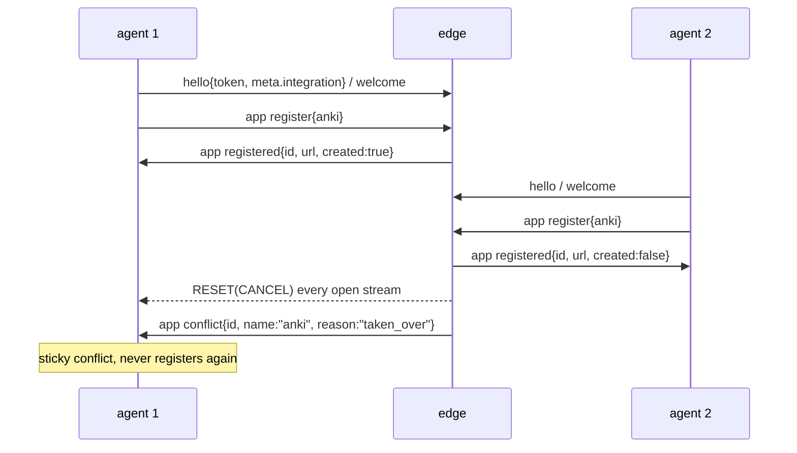

# mcpwarp layer spec

Status: **normative**, in two tiers (§1). This is the specification of the mcpwarp application layer that
rides on `ws-mixer.v1`: the `app.body.mcpwarp` envelope, identity, registration and take-over, HTTP request
bridging over streams, and the SDK profile (`expose()`, the tunnel controller, status text). The carrier —
framing, streams, the `app` message itself — is [`WIRE.md`](./WIRE.md); where the two disagree about the
carrier, WIRE.md wins. The ws-mixer core stays free of mcpwarp types ([`OVERVIEW.md`](./OVERVIEW.md)); this
document is a layer above it, not part of it ([`D-2026-10-14-01`](./DECISIONS.md#2026-10-14)).

Written to the **intended ws-mixer-js 0.11.0 behaviour**. Every point where ws-mixer-js HEAD (`d45d3b4`,
`SDK_VERSION` `"0.10.1"`) behaves differently is listed in §11; ws-mixer-js 0.11.0 implements v0.6.1; 0.11.1
fixes §11 rows 18–19, 0.11.2 most later JS rows, and the JS rows still open are planned for 0.11.3. Rows 20 onward (v0.6.3) list deviations of every SDK, each row naming it. `d45d3b4` is the HEAD reviewed for v0.6.0; rows 18–19 were found later
against `467bd5f` (ws-mixer-js 0.11.0), which is their baseline.

v0.7.0 adds the **multi-service profile** ([`D-2026-10-18-01`](./DECISIONS.md#2026-10-18)…`-04`): one connection
publishing up to 100 services per frame (§2.1 Batch, §2.3, §2.6, §2.7, §3), routing a stream to one of them
(§4.8), and the multi-service controller (§6A). Every single-service rule stays as written; a single-service
agent is a conforming subset of the profile.

Section numbering is frozen once released: never renumber, append. Durations are integer ms and end in
`Ms`/`_ms`; byte counts are plain integers.

Terms: **agent** = the SDK side (ws-mixer client role); **edge** = the mcpwarp server (ws-mixer server
role); **service** = one named MCP endpoint an agent publishes; **tunnel controller** = the SDK's
long-lived `createTunnel()` object (§6).

---

## 1. Scope and tiers

| Tier | Sections | Binds | Strength |
|---|---|---|---|
| 1 — wire layer | §2 Envelope, §3 Identity and registration, §4 Request bridging, §8 Runtime constraints | every agent and every edge | normative |
| 2 — SDK profile | §5 `expose()`, §6 Tunnel controller, §7 Status text, §9 Naming | any SDK that ships the tunnel-controller API (`createTunnel`) | normative for such an SDK; an SDK that ships only `expose()` MUST still satisfy §5 |
| 2 — multi-service profile | §6A Multi-service controller, §4.8, §9.2, the multi-service rows of §2–§3 | any SDK that ships the multi-service controller (`createServiceGroup`) | normative for such an SDK; an SDK without it skips §6A and the multi-service fixtures (§10.6) |
| — | §10 Fixtures, §11 Deviations, §12 Checklist | — | informative, except where a row says MUST |

An SDK MAY add API beyond the profile. It MUST NOT change the observable behaviour the profile fixes (status
snapshots, codes, `lastError` strings, `describeStatus` output, bridging responses).

**Upgrade-status mapping.** A standard WebSocket API cannot report the HTTP status of a refused upgrade.
When the status is observable to the SDK (an injected factory reporting the upgrade failure, JS
`WebSocketLike.upgradeFailure.status`; a native client's HTTP response), an SDK MUST map HTTP `401` →
`UNAUTHORIZED` and `403`/`404` → `DISCONNECTED_FATAL` ([CLIENT-SDK.md](./CLIENT-SDK.md)'s Fatal set row;
§5.4, §6.7 T32, T33). When it is not observable, the refused upgrade is indistinguishable from a network
failure: a failed dial, retried with normal backoff (`connecting`/`RETRYING`, T27). The tunnel fixtures model
both through `dial_failed`'s `httpStatus` (§10.4).

---

## 2. Envelope (Tier 1)

### 2.1 Carrier

| Rule | Detail |
|---|---|
| Message | `{"t":"app","body":{"mcpwarp":{…}}}` on stream 0 ([WIRE.md §2.7](./WIRE.md#27-control-channel-stream-0)). `body.mcpwarp` is the **envelope**. |
| Timing | Only after `welcome`; an `app` before it is a connection `PROTOCOL_ERROR` (WIRE.md §2.7). |
| Size | The whole stream-0 payload (`{"t":"app","body":…}` serialized) MUST be ≤ **16 384** bytes, else `ENHANCE_YOUR_CALM` (WIRE.md §2.4). The envelope adds no limit of its own. |
| Rate | Shared stream-0 budget: burst 100, 50/s (WIRE.md §2.7). |
| Version | `v` MUST be the integer `1` (`MCPWARP_V`). |
| One service per message | A **single-service** agent (`expose()`, the tunnel controller: §5, §6) MUST send exactly one entry in `services[]` per `register` / `unregister`. Zero entries is malformed and no agent may send it (`spec/mcpwarp.schema.json` rejects it, `minItems`). More than one entry is the multi-service profile's (Batch row). |
| Batch (multi-service) | A `register` / `unregister` MAY carry **1..100** entries (`MAX_SERVICES_PER_MESSAGE` = `100`; schema `minItems: 1`, `maxItems: 100`). An edge MUST accept up to 100 and MUST answer a `register` with more with the whole-frame `error{TOO_MANY_SERVICES}` (§2.6); the cap is a `register`-frame rule (the edge's `maxServicesPerRegister`), and `unregister` frames SHOULD also stay ≤ 100. A name MUST appear at most once per frame; the schema cannot express this (no uniqueness by key) and `check-fixtures.mjs` does not check it for envelope fixtures, so it binds the sender alone. The edge does not dedupe: a second copy is processed as a same-session re-register and listed twice in the reply. A larger set goes out as consecutive frames, one in flight (§2.6). 100 entries with 30-character names and `kind` `"stdio"` serialize to under 6 KiB, inside the Size row. |
| Key order | Senders SHOULD write the canonical key order: `v`, `op`, `services`, each service as `name`, `kind`, no whitespace (the bytes of §2.2's first two lines). Receivers MUST NOT depend on key order or whitespace. Byte identity is a fixture-comparison property only (§2.2, §10.2), never a wire requirement. |

### 2.2 Ops

| `op` | Direction | When | Required | Optional |
|---|---|---|---|---|
| `register` | A→E | on every `welcome`; after `enable`; transient-failure retry (§3.2); multi-service: subset add (`addService`, a services-only `configure()`), local `enable(name)` (§6A.2, §6A.3) | `v`, `op`, `services[{name, kind}]` | — |
| `unregister` | A→E | `close()` while registered on the live connection (§5.7); multi-service: `removeService`, a services-only `configure()` removing names, local `disable(name)`, `stop()`/`dispose()` (§6A.2, §6A.3, §6A.8) | `v`, `op`, `services[{name}]` | — |
| `registered` | E→A | reply to `register` | `v`, `op` | `services[]`, `errors[]` |
| `unregistered` | E→A | reply to `unregister` (always sent, even for names the connection does not hold) | `v`, `op` | `services[]` |
| `disable` | E→A | unsolicited: service disabled in the dashboard | `v`, `op`, `id` | `reason` |
| `enable` | E→A | unsolicited: service re-enabled | `v`, `op`, `id`, `name` | — |
| `conflict` | E→A | unsolicited: another connection took the name (§3.3) | `v`, `op`, `id`, `name` | `reason` |
| `error` | E→A | envelope-level failure | `v`, `op`, `code` | `message` |

```json
{"mcpwarp":{"v":1,"op":"register","services":[{"name":"anki","kind":"http"}]}}
{"mcpwarp":{"v":1,"op":"unregister","services":[{"name":"anki"}]}}
{"mcpwarp":{"v":1,"op":"registered","services":[{"name":"anki","id":"srv_anki","url":"https://anki-tester.mcpwarp.test/mcp","created":true}],"errors":[]}}
{"mcpwarp":{"v":1,"op":"registered","services":[],"errors":[{"name":"anki","code":"QUOTA_EXCEEDED","message":"quota exceeded"}]}}
{"mcpwarp":{"v":1,"op":"unregistered","services":[{"name":"anki","id":"srv_anki"}]}}
{"mcpwarp":{"v":1,"op":"disable","id":"srv_anki","reason":"disabled"}}
{"mcpwarp":{"v":1,"op":"enable","id":"srv_anki","name":"anki"}}
{"mcpwarp":{"v":1,"op":"conflict","id":"srv_anki","name":"anki","reason":"taken_over"}}
{"mcpwarp":{"v":1,"op":"error","code":"UNKNOWN_OP","message":"unknown op frobnicate"}}
```

The first two lines are the canonical encoding (§2.1 Key order) for `name` `anki`, `kind` `http`. An agent MUST
produce the same JSON value — these keys and values, no others — and SHOULD produce exactly these bytes;
the byte comparison is made only against fixtures (§10.2), and a receiver MUST NOT depend on it (§2.1).

Multi-service (§2.1 Batch): a batch, a partial reply, a subset `unregister` and its reply. `notes` was refused, so
the connection does not hold it, and the `unregistered` reply leaves it out:

```json
{"mcpwarp":{"v":1,"op":"register","services":[{"name":"anki","kind":"http"},{"name":"notes","kind":"stdio"}]}}
{"mcpwarp":{"v":1,"op":"registered","services":[{"name":"anki","id":"srv_anki","url":"https://anki-tester.mcpwarp.test/mcp","created":false}],"errors":[{"name":"notes","code":"QUOTA_EXCEEDED","message":"quota exceeded"}]}}
{"mcpwarp":{"v":1,"op":"unregister","services":[{"name":"anki"},{"name":"notes"}]}}
{"mcpwarp":{"v":1,"op":"unregistered","services":[{"name":"anki","id":"srv_anki"}]}}
```

### 2.3 Fields

| Op | Field | Type | Req | Default / rule |
|---|---|---|:--:|---|
| `register` | `services[].name` | string | ✔ | a valid service name (§2.4) |
| `register` | `services[].kind` | `"http"` \| `"stdio"` | ✔ | agents send `"http"` unless configured |
| `unregister` | `services[].name` | string | ✔ | |
| `registered` | `services[].name` | string | ✔ | entries for other names are ignored once the message has decoded; they are still validated (§2.8) |
| `registered` | `services[].id` | string | ✔ | the server id |
| `registered` | `services[].url` | string, non-empty | ✔ | the public URL; missing or `""` in **any** entry → `MALFORMED_ENVELOPE` (§2.8 rule 8) |
| `registered` | `services[].created` | boolean | | absent or `null` → `false`; `true` only when this `register` created the service |
| `registered` | `errors[].name` | string | ✔ | entries for other names are ignored |
| `registered` | `errors[].code` | string | ✔ | §2.5; unknown values allowed |
| `registered` | `errors[].message` | string | | `""` |
| `registered` | `errors[].id` | string | | absent stays absent; carried by `SERVER_DISABLED` |
| `unregistered` | `services[].name` | string | ✔ | |
| `unregistered` | `services[].id` | string | | `""` |
| `disable` | `id` | string | ✔ | |
| `disable` | `reason` | string | | `"disabled"` |
| `enable` | `id`, `name` | string | ✔ | |
| `conflict` | `id`, `name` | string | ✔ | |
| `conflict` | `reason` | string | | `"taken_over"` |
| `error` | `code` | string | ✔ | §2.6; unknown values allowed |
| `error` | `message` | string | | `""` |

**Multi-service replies.** The field table holds for every entry of a batch; these rules add what a batch
changes:

| Rule | Detail |
|---|---|
| One reply per frame | Each `registered` answers exactly one `register` and lists exactly that frame's entries, each in `services[]` (`{name, id, url, created}`) or in `errors[]` (`{name, code, message, id?}`). Partial success is normal. Replies are correlated with frames by order on one connection, which one in flight makes unambiguous (§2.6). |
| Empty reply | A `registered` that lists none of the frame's names — including one with no `services` and no `errors` — answers the outstanding `register`: it frees the in-flight slot and resets the `OVERLOADED` counter (§2.6), and counts as an all-transient reply. Every unlisted name stays `pending` (§6A.5) and the frame is re-sent for those names after §3.2's transient backoff `min(1000 × 2^(n−1), 30000)` ms (§3.2 Transient retry), the same as any transient entry; nothing waits for the next `welcome` (§6A.7 Correlation). For a single-service agent such a reply changes no handle state and is re-sent after §3.2's transient backoff. Informative: the deployed edge never sends such a reply today. |
| Additive | A later `register` on a live connection affects only its own names; nothing already held is removed. |
| `errors[].id` | Present only on `SERVER_DISABLED`. |
| `unregistered` | `{v, op, services: [{name, id}]}`, never `errors`. A name the connection does not hold is skipped silently and absent from the reply; names not listed in the `unregister` stay live. |
| Matching | A multi-service controller applies entries by `name` (§6A.4); an entry for a name it has not configured is ignored. A single-service agent keeps §2.3's rule: entries for other names are ignored. |

### 2.4 Name and integration syntax

| Constant | Value |
|---|---|
| `SERVICE_NAME_RE` | `^[a-z0-9]([a-z0-9-]*[a-z0-9])?$` |
| `SERVICE_NAME_MAX` | `30` (characters) |
| `isValidServiceName(n)` | `n` is a string, `length ≤ 30`, matches `SERVICE_NAME_RE` |
| `INTEGRATION_ID_RE` | `^(?:[0-9a-f]{8}-[0-9a-f]{4}-[1-8][0-9a-f]{3}-[89ab][0-9a-f]{3}-[0-9a-f]{12}\|00000000-0000-0000-0000-000000000000\|ffffffff-ffff-ffff-ffff-ffffffffffff)$`, tested after lowercasing |
| `DEFAULT_URL` | `"wss://connect.mcpwarp.io"` |

The integration id identifies the integration **product**: one constant UUID per product, assigned to it and
shipped with it (e.g. built into mcpwarp desktop), the same on every install and device. An SDK or host MUST
NOT generate it per install, per device or per run. A per-install identity, if one is ever needed, gets its own
named field; it never reuses `hello.meta.integration` / `X-Mcpwarp-Integration` (§3.1).

### 2.5 `registered.errors[].code`

Each value equals its name. **T** = transient (`TRANSIENT_REGISTER_ERRORS`): retried on the same connection
with backoff (§3.2), never fatal.

| Code | T | Meaning | Agent reaction |
|---|:--:|---|---|
| `SERVER_DISABLED` | | service disabled in the dashboard; carries `id` | adopt `id` as server id; state `disabled`; `message` ignored |
| `INTERNAL`, `NO_RESPONDERS`, `TIMEOUT`, `ABORTED`, `CONNECTION_LOST`, `MALFORMED_REPLY`, `UNAVAILABLE`, `SERVICE_ERROR` | ✔ | RPC / backend hiccup | non-fatal `error` event; re-send `register` after the backoff delay |
| `INVALID_NAME` | | name rejected by the edge | refusal |
| `USERNAME_REQUIRED` | | account has no username | refusal |
| `QUOTA_EXCEEDED` | | service quota used up | refusal |
| `CONFLICT` | | name in use by another server | refusal |
| `BAD_REQUEST`, `UNAUTHENTICATED`, `FORBIDDEN`, `NOT_IMPLEMENTED` | | RPC pass-through | refusal |
| any unknown code | | — | refusal |

**Refusal**: before the agent's first successful registration (on any connection) it is fatal —
`expose()` rejects with that code (§5.4). After it, `expose()` reports a non-fatal `error` event. The tunnel
controller treats every refusal, listed or unknown, as terminal at any time (§6.7 T17–T23, T39–T41): an
unknown code means the edge speaks something newer, so the controller MUST NOT wait at `connecting`.

### 2.6 `error.code`

| Code | Meaning (edge's current threshold, informative) | Agent reaction |
|---|---|---|
| `UNSUPPORTED_VERSION` | `v` not supported | **fatal** |
| `OVERLOADED` | too many `app` messages in flight (> 256) | if a `register` or `unregister` is outstanding: re-send it after `min(1000 × 2^(n−1), 30000)` ms, if still connected, for every consecutive `OVERLOADED` (Frames in flight below, `OVERLOADED` re-send row); `onRetry` fires for a `register` re-send (§5.9) |
| `CONNECTION_LIMIT` | too many connections per owner and pod (> 10, counted per pod, not cluster-wide); the edge then closes with `APPLICATION_CLOSE`, WS close **4014** with a reason starting `CONNECTION_LIMIT:` (never `4009`, WIRE.md §2.8) | non-fatal `error` event |
| `TOO_MANY_SERVICES` | too many entries in `services[]`: a **whole-frame** error — the edge rejects the entire `register` and sends no `registered` reply, not a per-service `errors[]` entry. An edge sends it for a message with more than 100 entries, never for 1..100 (§2.1 Batch) | non-fatal `error` event; it answers the outstanding frame (One in flight below): a single-service agent re-sends nothing (§6.7 T25), a multi-service controller marks the frame's names `rejected` (§6A.6 G7) |
| `UNKNOWN_OP` | unknown `op` | non-fatal `error` event |
| `BAD_REQUEST` | malformed envelope | non-fatal `error` event |
| any unknown code | — | non-fatal `error` event |

**Frames in flight.** These rules bind every agent; a single-service agent meets them with its one frame.

| Rule | Detail |
|---|---|
| One in flight | An agent MUST keep at most **one** `register`/`unregister` outstanding per connection. It sends the next only after the outstanding one was answered (`registered` / `unregistered`), answered by a whole-frame `error` op with any code other than `OVERLOADED` and `CONNECTION_LIMIT` (e.g. `TOO_MANY_SERVICES`, `UNKNOWN_OP`, `BAD_REQUEST`, unknown codes included), or its connection ended. `OVERLOADED` and the other whole-frame `error` ops name no frame; one in flight makes the outstanding frame the one they answer. `CONNECTION_LIMIT` answers no frame: the edge's `4014` close follows, and the connection's end frees the slot. An agent MAY instead treat `OVERLOADED` as "re-send every unanswered frame"; the spec recommends one in flight. The rule applies in normal operation: a trigger (`enable`, a subset add or remove, a re-register) arriving while a frame is outstanding queues until the reply, and a `register` MUST NOT be sent while a frame is outstanding; only `close()` MAY send its `unregister` while a `register` is outstanding (§3.2 Unregister). After `OVERLOADED` the slot stays **reserved** for the scheduled re-send: the frame is re-queued, not released. A `register` trigger arriving during the pause (an `enable`, a subset add, a re-register) folds into the re-send of a dropped `register`, within 100 names (§2.1 Batch), the dropped frame's names first in their order and then the folded-in names in trigger order; a name removed or locally disabled during the pause is left out of the re-send, and if the connection may hold it an `unregister` for it queues behind the re-send. A re-send with no names left (every name of the dropped frame removed or locally disabled during the pause and nothing folded in) is not sent; the slot is freed (status per §6A.6). Any other trigger queues behind the re-send (§6A.7). No second frame goes out. Any reply that settles the outstanding frame MUST cancel every pending re-send timer for it. A whole-frame `error` op that answers the frame frees the slot and resets the `OVERLOADED` counter; `UNSUPPORTED_VERSION` is then fatal (§6.7 T24). Single-service: §6.7 T25; the handle stays `registering`, nothing is re-sent, and the next `welcome` or `enable` registers again; multi-service: G7 (the frame's names `rejected`). |
| `OVERLOADED` re-send | Per-pod backpressure (256 in-flight app messages per pod, shared by every connection on it; informative): the frame was **dropped unprocessed** and no reply follows. Every agent, single- or multi-service, MUST re-send the dropped frame (`register` or `unregister`) after `min(1000 × 2^(n−1), 30000)` ms (1 s, 2 s, 4 s … capped 30 s), where `n` is the number of consecutive `OVERLOADED` replies on this connection, this one included. This counter is its own: it resets on any non-`OVERLOADED` reply (a `registered`, an `unregistered`, or a whole-frame `error` op answering the frame). Transient refusals use §3.2's separate register backoff (§3.2 Transient retry). Not terminal; there is no "re-send once". |
| Resolve deadline | Informative: the edge resolves a batch's entries one after another under one deadline (the edge's resolve timeout plus 1 s), so tail entries of a large batch MAY fail `INTERNAL`. `INTERNAL` is transient (§2.5): the agent re-sends those names after the backoff (§3.2 Transient per name). |

### 2.7 Inbound acceptance

Agent states (§5.5): `connecting`, `registering`, `registered`, `disabled`, `conflict`, `closing`, `closed`.

| Op | Accepted in | Match | Effect |
|---|---|---|---|
| `registered` | any except `closed`, `conflict` (in `closing`: settles only, see Effect) | `services[]` / `errors[]` entry whose `name` equals the agent's | `services` entry → state `registered`, url/id/created updated, transient backoff counter reset (§3.2); `errors` entry → §2.5; either resets the `OVERLOADED` counter (§2.6). In `closing` it changes no state, but a `registered` answering an outstanding `register` still settles that frame (§3.2 Unregister). |
| `unregistered` | `closing`, while an `unregister` is outstanding | any `unregistered`, or one naming the agent's service | ends the close wait (§5.7); so does a whole-frame `error` op whose turn it is, i.e. no earlier frame outstanding (§3.2 Unregister) |
| `disable` | any except `closing`, `closed`, `conflict` | `id` equals the agent's server id; an unknown `id` is **held** (below) | state `disabled`, `disabled` event |
| `enable` | any except `closing`, `closed`, `conflict` | `name` equals the agent's, or `id` equals the agent's server id; `id` then adopted | `enabled` event, state `registering`, `register` sent: queued behind an outstanding frame, or folded into a pending `OVERLOADED` re-send (§2.6 One in flight); if disconnected, the next `welcome` sends it |
| `conflict` | any except `closing`, `closed`; once per agent lifetime | `name` equals the agent's **or** `id` equals the agent's server id | §3.3 |
| `error` | any while connected | — | §2.6 |

| Rule | Detail |
|---|---|
| Superseded connection | **Every** mcpwarp op arriving on a superseded connection — a drained connection once its replacement has received `welcome` (§5.9) — is ignored in every state, `error` ops included: no state change, no event, no `register` sent, so the tunnel controller never sees it (§6.8 Drain, T38). |
| Ended connection | A `registered`, `disable` or `enable` received on a connection that has since ended — queued `app` messages delivered after the disconnect ([CLIENT-SDK.md](./CLIENT-SDK.md)'s Handler delivery row) — MUST be ignored. `conflict` and `error` from that connection are still applied: `conflict` is sticky and an `error` code may be fatal. A superseded connection's ops stay ignored (row above, T38), its `conflict` and `error` included. Tunnel fixture `44_stale_disable_after_disconnect_ignored` assumes exactly this ordering: ops the connection received before it ended, delivered to the layer after the disconnect notification (§10.4 `flush_after`); a runner that cannot force post-disconnect delivery MUST skip 44 with a note in its run output; the fixture carries `runnerRequirement` `"post-disconnect-delivery"` (`spec/fixtures/mcpwarp/tunnel/README.md`). |
| Unknown `disable` id | A `disable` whose `id` the handle does not know — including one before any `registered` — is **held**, not adopted: the edge fans `disable` out to every connection of the owner, so an unknown id may belong to another service. When a later `registered` brings that id, the registration **is** recorded — the handle learns url and id and emits `registered` — and the held `disable` then applies (state `disabled`, `disabled` event), back to back; the tunnel collapses the pair into one `disabled`/`DISABLED` snapshot (§5.9 Held `disable`, §6.7 T50). A held id that never arrives changes nothing. Tunnel fixture `42_disable_unknown_id_held`. |
| Held `disable` lifetime | [`D-2026-10-18-01`](./DECISIONS.md#2026-10-18), [`D-2026-10-19-02`](./DECISIONS.md#2026-10-19). A hold belongs to the connection that received the `disable`. It is cleared by a matching `enable` (by `name` or `id`), by a take-over of that name (`conflict`, `drain{replaced}`), by a replacement connection's `welcome` (drain hand-over), or when the connection ends. It never survives a reconnect: the new connection needs none, since the edge answers each re-register of a disabled service with `errors[]` `SERVER_DISABLED` carrying its `id` (§2.5). |

**Op shapes the deployed edge sends** (informative; the schema stays as §2.3):

| Op | Shape | Key |
|---|---|---|
| `conflict` | `{v, op, id, name, reason: "taken_over"}` — `name` always present; `taken_over` is the only `reason` value today | `name` or `id` |
| `disable` | `{v, op, id, reason}` — no `name`; `reason` is `"disabled"` | `id` only |
| `enable` | `{v, op, id, name}` — no `reason`; `name` is there for an agent whose `register` was refused `SERVER_DISABLED` and so never learned the `id` | `name` or `id` |
| `error{TOO_MANY_SERVICES}` | whole-frame `error` op, cap 100 entries; no `registered` reply (§2.6) | — |

A single-service agent keeps exactly one service per message (§2.1) and the tables above. A multi-service
controller (§6A) accepts ops except in group state `conflict` and while `stop()`/`dispose()`/restart is shutting the group down (§6A.4), applies the
Superseded connection and Ended connection rows per connection unchanged, and matches per service:

| Op | Match | Effect |
|---|---|---|
| `registered` | answers the outstanding `register`; each entry by `name` among the configured names | per entry: `services[]` → `active`, `id`/`url` adopted; `errors[]` → §2.5 per name: `SERVER_DISABLED` → `disabled`, its `id` adopted; transient → re-sent (§3.2 Transient per name); any other code → `rejected` |
| `unregistered` | answers the outstanding `unregister` | ends it; the frame's names leave the controller's held set whether listed or absent; a whole-frame `error` op answering the `unregister` settles it the same way, logged `warn` |
| `disable` | `id` among the ids this connection learned (`registered`, `SERVER_DISABLED.id`, `enable`) | that one service → `disabled`; others unchanged. An `id` this connection does not know is **held per connection** until a `registered` on this connection brings it (Unknown `disable` id row, per connection); a held id that never arrives changes nothing; the hold's lifetime is the Held `disable` lifetime row |
| `enable` | `name` among the configured names, or `id` | that one service is registered again (`pending`), unless it is locally disabled or `taken_over`, which ignore it; an unconfigured name is ignored |
| `conflict` | `name` (or `id`) of a service this connection holds: this connection received a `services[]` entry for the name | that name only → `taken_over`; the edge has already reset its streams; other names stay live; the agent MUST NOT register that name again until its `taken_over` mark is cleared (§6A.3). A `conflict` for a name this connection never held is ignored (`ms_05_conflict_per_name`: a refused name), including a name only sent in an outstanding `register` (that `register`'s own reply says what happened) or known only through `SERVER_DISABLED.id` or `enable`. Informative: the agent MAY also reset that service's in-flight streams locally, in addition to the edge's reset |
| `error` | `OVERLOADED`, and every code other than `CONNECTION_LIMIT` (e.g. `TOO_MANY_SERVICES`): the outstanding frame (§2.6 One in flight) | §2.6; other codes as §6A.6; one answering an outstanding `unregister` settles it like an `unregistered`: the frame's names leave the controller's held set, logged `warn` |

### 2.8 Decode rules

1. `body.mcpwarp` absent, not an object, or an array → not this layer's message; ignored.
2. `v !== 1` → `unknown`; ignored by the agent.
3. Unknown `op` → `unknown`; ignored by the agent.
4. Unknown fields inside a known op → ignored.
5. Required string: present and a string. Optional string: absent → default (§2.3); **any non-string,
   including `null` → `MALFORMED_ENVELOPE`**.
6. Lists (`services`, `errors`): absent or `null` → `[]`; otherwise an array of objects (not arrays), else
   `MALFORMED_ENVELOPE`.
7. `registered.services[].created`: boolean, absent or `null` (→ `false`); anything else → `MALFORMED_ENVELOPE`.
8. `registered.services[].url`: missing or `""` → `MALFORMED_ENVELOPE`. Like rules 5–7 it applies to
   **every** entry, including entries for other service names that §2.3 ignores: validation is syntactic
   over the whole message and runs before entries are matched by name, so one bad entry makes the whole
   message `MALFORMED_ENVELOPE`, the agent's own valid entry included.
9. A `MALFORMED_ENVELOPE` is a **non-fatal** `error` event; the message is dropped. JS messages:
   `"<where>.<key> must be a string"`, `"<where>.<key> must be an array of objects"`,
   `"registered.services[].created must be a boolean"`, `"registered.services[].url must be a non-empty string"`.
   Envelope fixtures' `message_contains` is a substring match against the error message (the checker uses
   `includes`); fixtures use a prefix of these messages (e.g. `registered.services[].url`).
10. **Check order (normative).** A message with several defects reports the first in this order, so every SDK
    reports the same one: top-level fields in §2.3's row order; for `registered`, the `services` list (rule 6),
    then each `services[]` entry in array order, then the `errors` list, then each `errors[]` entry; within a
    `registered.services[]` entry `name`, then `id`, then `url`, then `created`; within a `registered.errors[]`
    entry `name`, `code`, `message`, `id`; within an `unregistered.services[]` entry `name`, `id`. This is
    `check-fixtures.mjs`'s order (`envelope/invalid/registered_multiple_defects.json`).

Edge side: an edge receiving `v !== 1` MUST answer `error{UNSUPPORTED_VERSION}`; an unknown `op`,
`error{UNKNOWN_OP}`.

---

## 3. Identity, registration, take-over (Tier 1)

### 3.1 Identity on every dial

| Item | Rule |
|---|---|
| Credential | `hello.token` is the authority (WIRE.md §2.1, [`D-2026-10-13-01`](./DECISIONS.md#2026-10-13)). `Authorization: Bearer <token>` on the upgrade is OPTIONAL; agents SHOULD send it when the runtime can set headers. A token provider MUST be called on every dial ([CLIENT-SDK.md](./CLIENT-SDK.md)'s Token provider row). |
| Integration id | `hello.meta.integration` MUST carry the integration product's RFC 4122 UUID (§2.4: one constant per product, never per install or device) in text form, **lowercased**, matching `INTEGRATION_ID_RE`. Agents SHOULD also send it as `X-Mcpwarp-Integration: <uuid>` when headers are possible; the two MUST be equal. An edge ignores a value that is not a valid UUID (no error). |
| `hello.meta` | `{client, version, os, integration}`: `client` is `"sdk-<lang>"` — `"sdk-js"`, `"sdk-go"`, `"sdk-rust"`, `"sdk-python"`; `version` is the version of the mcpwarp layer's own package (JS: `SDK_VERSION`, since the layer ships inside `@mcpwarp/ws-mixer`; Rust: the `ws-mixer-mcpwarp` crate's version), at most **100 bytes** (the edge truncates longer values); `os` as in `hello.agent.os`. The `client` set is exactly `sdk-js`, `sdk-go`, `sdk-rust`, `sdk-python` (not `sdk-py`); the edge keeps no allowlist and uses it only for logs and storage. `hello.agent` stays the transport's (row below). |
| `hello.agent` | `{sdk, sdk_version, runtime, os}` per WIRE.md §2.7; `runtime`/`os` overridable by the `agent` option (each `^[\x20-\x7e]{1,64}$`); `sdk`/`sdk_version` never. |
| `User-Agent` | `<sdk>/<sdk_version> (<runtime> <os>)`, e.g. `ws-mixer-js/0.10.1 (node/22.4.0 darwin/arm64)`, when headers are possible. |
| Subprotocol | `ws-mixer.v1`. |
| URL | default `wss://connect.mcpwarp.io`; the edge routes by `Host`, the path is ignored. |
| `Origin` | An edge MUST accept any `Origin`, including `null` (WIRE.md §2.1 Origin row). |
| Service identity | **(token subject, service name)**. The edge keeps no registration state across connections. |
| Multi-service identity | Each service of a batch is its own identity (token subject, its name); the edge resolves it to a server id (`registered.services[].id`), which survives renames. One connection MAY hold any number of identities; each is registered, refused, disabled and taken over on its own. |

A header-less runtime (browser `WebSocket`, Electron renderer, Zotero) loses `Authorization`,
`X-Mcpwarp-Integration` and `User-Agent`; the `hello` fields carry everything the edge needs.

### 3.2 Registration lifecycle

| Rule | Detail |
|---|---|
| Register on every `welcome` | An agent MUST send `register` after **every** `welcome`, including a drain replacement's, unless taken over (§3.3) or closing. |
| Result | `registered` with a `services[]` entry for the agent's name: the service is live at `url`; `id` is the server id; `created` is `true` only when this `register` created it. |
| Transient retry | On a transient code (§2.5) the agent re-sends `register` on the same connection after `min(1000 × 2^(n−1), 30000)` ms (1 s, 2 s, 4 s … capped 30 s), where `n` is the number of consecutive all-transient replies since the last successful reply, this one included. `n` resets **only** on a successful reply — a `registered` with at least one non-transient entry, or an `unregistered` — so it carries across reconnects (a restart through `configure()` or a `stop()` starts a new counter). After a reply that lists both transient and non-transient entries the counter is reset and the transient names' re-send waits the n = 1 delay (1000 ms). This register backoff is separate from the `OVERLOADED` counter (§2.6 `OVERLOADED` re-send). A disconnect cancels a pending retry; the next `welcome` registers anyway. |
| `OVERLOADED` | §2.6: its own counter, and the slot stays reserved for the re-send (One in flight). |
| One controller per connection | The profile assumes one controller owns a connection's mcpwarp ops: one in flight is per connection and replies correlate by frame order (§2.3), never by name; a host that multiplexes several controllers or handles on one connection MUST itself serialize their frames and route each reply to the controller whose frame it answers. A single-service handle, having one name, accepts a `registered` naming its service even when no frame is outstanding (§2.7 `registered` row); this is not matching by name across controllers. |
| Unregister | On `close()`, if this connection sent `register` and is still connected: send `unregister`, wait for its reply (below) or **2000 ms**, whichever first; a failed send ends the wait at once. Then close ws-mixer gracefully (`drain{client_requested}`, ≤ 5 s grace, close `1000`). No `unregister` after a take-over, or when `register` never went out on the live connection. `close()` MAY send its `unregister` while a `register` is outstanding (the connection is ending). The wait ends on the reply to the `unregister` itself, by frame order (§2.3): an `unregistered`, or a whole-frame `error` op whose turn it is (no earlier frame outstanding), or the 2000 ms cap; a `registered` (or an `error` op) answering the earlier `register` settles that `register` and the wait continues. While `closing`, a `register` dropped by `OVERLOADED` is abandoned: the agent MUST NOT re-send it (a `register` sent while closing could re-hold the name); the `unregister` behind it stays outstanding (the edge drops one frame, not the queue). An `OVERLOADED` answering the `unregister` re-sends it after the pause if the 2000 ms budget allows; an early re-send of the `unregister` is tolerated, since duplicate `unregister`s are harmless (§2.3: names not held are silently absent). |
| Disabled | `disable` or `SERVER_DISABLED` → state `disabled`; the agent keeps the connection and answers `/mcp` with `503` (§4.4). `enable` → `register` again. |
| Re-register on every `welcome` (multi-service) | On every `welcome` the agent MUST register its **full configured list** minus the names it unregistered locally (removed, or locally disabled) and the names taken over (§3.3 Per name). Dashboard-disabled and refused names are included: the edge answers `SERVER_DISABLED` or the refusal again. Batches per §2.1, one frame in flight (§2.6). |
| Same-session re-register | A `register` for a name this connection already holds is idempotent on the edge: the existing server is found again (`created: false`), the hold is replaced, no stream is reset and no `conflict` is sent. |
| New session after a reconnect | A reconnect is a new session: the new connection's `register` takes over whatever the old connection still holds. If the old connection is still alive on the edge it receives `conflict{taken_over}` per name, which the agent ignores as superseded (§2.7 Superseded connection); if it is gone, the edge has already dropped its holds. |
| Additive and subset | A later `register` adds only its names; an `unregister` removes only its names, the rest stay live (§2.3 Multi-service replies). |
| Transient per name | A transient `errors[]` entry (§2.5) is retried **for that name alone**: the agent re-sends `register` for the transient-failed names of a reply after the Transient retry row's delay, with that row's counter; the reply's other names keep their outcome. |

### 3.3 Conflict and take-over

| Rule | Detail |
|---|---|
| Last `register` wins | A `register` for an identity held by another connection takes it over. The edge MUST RESET the old holder's open streams, then send it `{"mcpwarp":{"v":1,"op":"conflict","id":"<serverId>","name":"<name>","reason":"taken_over"}}` — at register time on the same pod, at the next presence heartbeat (up to ~30 s) on another pod. A connection being drained never receives `conflict`. |
| Sticky | On a matching `conflict` (§2.7) the agent enters `conflict` for the rest of its lifetime: it MUST NOT send `register` again (not on `welcome`, not on `enable`), ignores `registered`/`disable`/`enable`/`conflict`, RESETs every inbound stream with `CANCEL` `"service taken over by another connection"`, and sends no `unregister` on close. The connection is closed immediately, exactly as on a `drain` with `reason:"replaced"` (§6.8 Take-over close): the agent sends `error{NO_ERROR}` on stream 0 and WS close `1000` at once, skipping the `drain{client_requested}` and grace of a graceful close (WIRE.md §2.10 item 14), and never closes with `APPLICATION_CLOSE`; nothing reconnects; the tunnel controller stays in `conflict` until the next `configure()` (§6.8 Sticky conflict). |
| No ping-pong | An agent MUST NOT re-register to win a name back. Restart is a human or application decision (a new `configure()`, §6). |
| Drain `replaced` | **Not sent by the deployed edge** (future-proofing, paragraph below). A ws-mixer `drain` with `reason:"replaced"` on the agent's connection MUST be treated as a take-over (`TAKEN_OVER`), never as a hand-over: the agent MUST NOT dial a replacement or reconnect, and closes its ws-mixer client (Sticky row's take-over close), so no later `welcome` arrives and it never registers again. The agent MUST abandon any replacement dial that has not yet completed its upgrade; a replacement that has already sent `hello` (the transport sends it in the same poll as the `101`) MUST be closed with `error{NO_ERROR}` + WS close `1000` before any `welcome` handling, MUST NOT be reported as connected and MUST NOT `register`; the edge MUST tolerate a `hello` followed by an immediate close. `onRetry` does not fire for the abandoned dial in either case. Before `expose()` settles it rejects `TAKEN_OVER` (§5.4); after, the handle enters `conflict` and emits the `conflict` event (§5.6), sticky for the rest of the agent's lifetime — the tunnel's T45 (§6.7), sticky until the next `configure()`. Accepted in the same states as `conflict` (§2.7); after a `conflict` it changes nothing, and a `conflict` after it changes nothing. Any other drain `reason` is an ordinary hand-over (§5.9, §6.7 T31, T43). |
| Before first registration | `expose()` rejects with `TAKEN_OVER` (§5.4); no handle, no `conflict` event. |
| Last values | `url`, server id and registration keep their last values (now the new holder's). |
| Per name (multi-service) | A `register` from another session of the same owner for a name this connection holds takes over **that name only**: the edge resets this connection's streams for that server and sends `conflict{id, name, reason:"taken_over"}` (cross-pod: at the next presence heartbeat). The agent marks the name `taken_over` (§6A.5), RESETs any further inbound stream routed to it with `CANCEL` `"service taken over by another connection"` (§4.8), never sends `unregister` for it, and MUST NOT register it again — not on `welcome`, not on a dashboard `enable` — until its `taken_over` mark is cleared (§6A.3). Every other name stays live and the connection stays open. "Holds" means this connection received a `services[]` entry for the name; a `conflict` for any other name is ignored (§2.7 multi-service `conflict` row). Informative: the agent MAY also reset that service's in-flight streams locally, in addition to the edge's reset. A draining connection hands its names over silently: no `conflict`, no stream reset. |
| Whole-connection take-over (multi-service) | A `drain{replaced}` (never sent today, row Drain `replaced`) takes over every name of the connection: all services `taken_over`, the group `conflict`/`TAKEN_OVER`, sticky as in the Sticky row (§6A.6 G6). |

Take-over is last-`register`-wins plus `conflict`, as above, and it is **per name**: the losing connection
loses only that name and receives `conflict{reason:"taken_over"}` for it. The deployed edge never sends
`drain{replaced}`: its only drain is ws-mixer's own (`rollout` on shutdown or a per-pod control call), never
caused by a conflict, and a draining connection hands its names over silently — no `conflict`, no stream
reset ([`D-2026-10-15-05`](./DECISIONS.md#2026-10-15)). The Drain `replaced` row stays as future-proofing: an
edge MAY drain an old holder with `reason:"replaced"` as a deployment policy, and every agent MUST handle such a
`drain` as a take-over (§5.4, §5.6, §6.7 T45), never as a hand-over — an agent that re-registered on the
replacement's `welcome` would take the name back. An agent that never sees one loses nothing.



---

## 4. Request bridging (Tier 1)

### 4.1 Framing

| Rule | Detail |
|---|---|
| One stream per request | The edge opens one stream per inbound public HTTP request (WIRE.md §2.5: only the server opens). The agent never opens streams and MUST serve streams concurrently. |
| Request bytes | Raw HTTP/1.1 in Go `Request.Write` shape: request line, `Host` = public host, headers, then a body framed by `Content-Length`, `Transfer-Encoding: chunked`, or nothing; then the edge sends `CLOSE` (half-close). |
| Edge header rules | The edge MUST strip hop-by-hop headers and `Authorization`; it MUST forward `Expect` unchanged. |
| OAuth metadata | The edge serves the OAuth protected-resource metadata (RFC 9728) for the public host itself; those requests never reach the agent. |
| Response bytes | `HTTP/1.1 <status> <reason>`, headers, body, then `CLOSE`. The agent MUST NOT send any `1xx`; it removes `Expect` and never sends `100 Continue`. |
| Response framing | Bodyless for `HEAD`, `1xx`, `204`, `304`. Else `Content-Length: N` when the response declares a valid one (`0` for a null body); otherwise `Transfer-Encoding: chunked`, one chunk per body read written immediately (SSE flushes per event), then `0\r\n\r\n`. |
| Response failures | Body shorter than `Content-Length` → RESET `INTERNAL_ERROR` `"response body shorter than Content-Length"`. Body read failure → RESET `INTERNAL_ERROR` `"response body failed"` + `error` event. |
| Edge cancel | Stream ends before the response finished → the agent aborts the handler's request / the target fetch (when the runtime has a cancel signal). |

Example (bytes inside DATA frames of one stream), edge → agent, then `CLOSE`:

```http
POST /mcp HTTP/1.1
Host: notes-tester.mcpwarp.test
accept: application/json, text/event-stream
content-type: application/json
mcp-session-id: abc
user-agent: Go-http-client/1.1
Content-Length: 40

{"jsonrpc":"2.0","id":1,"method":"ping"}
```

Agent → edge, then `CLOSE` (handler returned a body with no length):

```http
HTTP/1.1 200 OK
content-type: application/json
Transfer-Encoding: chunked

b
{"ok":true}
0

```

Lines end `\r\n`. Header order and casing on the request side vary; parsing is order- and case-insensitive.

### 4.2 Parsing limits

| Limit | Value | On violation |
|---|---|---|
| Request head | **65 536** bytes (`64 KiB`), counting the request line, every header line and the terminating blank line (`\r\n\r\n` included) | `431` `"request head too large"` |
| Head deadline | **10 000 ms** from stream open | RESET `CANCEL` `"request head deadline exceeded"`, no response |
| Request line | `^([^ ]+) ([^ ]+) HTTP/1\.([01])$`, method an RFC 9110 token | `400` `"malformed request line"` |
| Target | origin-form (starts with `/`) and absolute-form `http(s)://…` (cut to path + query) only, fragment dropped in both, then encoded per §4.3; anything else — `*`, authority-form, `\mcp` — is refused | `400` `"unsupported request target form"` |
| `Host` | exactly one, non-empty | `400` `"missing or duplicate Host header"` |
| Framing | `Transfer-Encoding` + `Content-Length` together; TE other than exactly `chunked`; differing CL values | `400` `"both Transfer-Encoding and Content-Length"` / `"unsupported Transfer-Encoding"` / `"conflicting Content-Length values"` |
| Chunk-size line | ≤ 4096 bytes; extensions ignored; trailers read and dropped | `400` `"line too long"` / `"malformed chunk size"` |
| Request body | `maxRequestBodyBytes`, default **4 194 304** (`4 MiB`); `Content-Length` checked before reading, chunked cumulatively; body buffered whole before the app is called, unless the adapter streams it (below) | `413` `"request body too large"`; a streaming adapter with the response head written but the response unfinished: RESET `CANCEL`; response already complete: CLOSE |
| EOF before end of head | — | `400` `"incomplete request"` |

Body cap: an agent MUST answer `413` once the body exceeds the cap, unless the streaming table below
applies (a response already begun). It MAY have consumed more than the
cap before detecting it, bounded by one transport chunk.

Streaming adapters: an adapter MAY stream the request body to the app instead of buffering it whole. The body
cap still applies, counted cumulatively over what has been read, and MAY overshoot by one transport chunk
(≤ **65 536** bytes). When it trips, the outcome depends on how far the response got:

| Response so far | The agent MUST |
|---|---|
| no response byte written | answer `413` `"request body too large"` as above |
| head written, response unfinished | RESET the stream with `CANCEL` (`0x07`) — a `413` can no longer be sent (`bridging/body_413_streamed_reset.json`) |
| response complete | CLOSE with the response intact, never RESET: a RESET after a complete response can make the edge drop bytes it has not forwarded yet (as §4.4's rule that a refused stream ends with CLOSE) |

A `Content-Length` over the cap is still refused before the app is called, so only a chunked body reaches the
second and third rows.

Other `400` messages (verbatim): `"malformed request target"`, `"obsolete header line folding"`,
`"malformed header line"`, `invalid header name "<n>"`, `"malformed Content-Length"`,
`"missing CRLF after chunk data"`, `"stream ended inside the request body"`.

### 4.3 Path rule

Only `/mcp` is forwarded. `requestPath(target)`: strip `scheme://authority` if present, cut at the first
`?` or `#`, compare **exactly and case-sensitively** with `"/mcp"`.

| Target | Forwarded |
|---|:--:|
| `/mcp`, `/mcp?x=1`, `https://h.example/mcp?x=1` | ✔ |
| `/mcp/`, `/MCP`, `/`, `/healthz`, `/a/../mcp` | — (`404`) |
| `\mcp`, `*`, `h.example:443` | — (`400` `"unsupported request target form"`: §4.4 row 1 precedes the path check) |

**Forwarded target.** The target the application receives (the handler's request URL, the target-mode URL) is
built from the received request-line bytes:

| Rule | Detail |
|---|---|
| Encode once | Percent-encoded from the received bytes **exactly once**, never re-encoded: raw UTF-8 `?q=café` → `?q=caf%C3%A9`, never `caf%C3%83%C2%A9` (`bridging/target_utf8_query`). |
| Allowed set | Passed through unescaped: RFC 3986 unreserved (`ALPHA DIGIT - . _ ~`), sub-delims (`! $ & ' ( ) * + , ; =`), `:` `@` `/` `?`, and `[` `]` (kept for WHATWG/JS parity and PHP-style `a[]=1` queries) (`bridging/target_allowed_set`). |
| `%` | Never touched: an existing escape is never decoded (`%41` stays `%41`), and a lone `%` not followed by two hex digits is kept as is, not rewritten to `%25` (`bridging/target_lone_percent`). |
| Everything else | `%XX`-escaped with **uppercase** hex (RFC 3986 §2.1): space, `"`, `<`, `>`, `\`, `^`, `` ` ``, `{`, `\|`, `}`, non-ASCII bytes, controls. |
| Fragment | The target is cut at the first `#` before any URL construction, in origin-form and absolute-form alike; the `#` and everything after it are dropped (`/mcp?a=1#x` → `/mcp?a=1`; `bridging/target_fragment_dropped`, `target_fragment_dropped_absolute_form`). |
| Apostrophe | `'` is in the allowed set. In any mode where the SDK hands the app a WHATWG/RFC-normalised URL object (JS: target mode's `fetch`, handler mode's `request.url`), it MAY additionally escape `'` as `%27` in the **query**; the SDK's raw parsed target keeps `'`. `'` is not fixture-covered: only the exact path `/mcp` is forwarded, so it cannot go in the path, and `target_allowed_set` leaves it out of the query; the MAY-escape allowance stands. |
| Target mode query | The target URL's own query comes first, then the request's query, joined with `&`, both copied verbatim (no re-encoding, no `URLSearchParams`-style rebuild). |

### 4.4 Precedence

Evaluated in this order; the first match answers. Rationale: never read a body that will be refused
([`D-2026-10-14-03`](./DECISIONS.md#2026-10-14)).

| # | Condition | Response | Body read |
|---|---|---|---|
| 0 | agent in `conflict` | RESET `CANCEL` `"service taken over by another connection"` | no |
| 1 | head invalid / too large / deadline | `400` / `431` / RESET (§4.2) | no |
| 2 | path ≠ `/mcp` | `404` `{"error":"not_found"}` | discarded |
| 3 | agent `disabled` | `503` `{"error":"service disabled"}` | discarded |
| 3 | agent `closing` / `closed` | `503` `{"error":"service closing"}` | discarded |
| 3 | agent unavailable in any other way (fallback): the handle has **never** completed a successful registration | `503` `{"error":"service unavailable"}` | discarded |
| 4 | body over the cap | `413` `{"error":"request body too large"}` | up to the cap (§4.2) |
| 5 | body malformed | `400` (§4.2) | partly |
| 6 | — | the application (handler or target) | whole |

An agent MUST follow this order, so `404` beats `503` beats `413`. The fallback `503` applies only before the
first successful registration on the handle; after it, `connecting` and `registering` — a reconnect, or a
drain hand-over while the old connection still holds the route — keep serving (row 6). An edge MAY answer a disabled service's
requests with `503` `{"error":"service disabled"}` itself. A single-service handle never selects by `Host`: every `/mcp`
request reaching a registered handle goes to its handler (row 6), which answers `404` itself if it multiplexes
internally; §4.8's selection exists only in the multi-service controller.

**Ending a refused stream.** After writing any refusal the SDK generates — `404`, `503`, `413` or `500` —
while request body bytes are still unread, the agent drains the rest of the body — reads and drops it,
granting stream window as it goes — and then `CLOSE`s ("discarded" in the table). It MUST NOT RESET the
stream to avoid the drain; the edge's own request body cap bounds how much it drains. A body that turns out
malformed after any refusal has been written changes nothing: the stream still ends with `CLOSE`, not RESET
(the `400` of row 5 applies only before a response was written). The exception is a streaming adapter (§4.2)
whose app has already written its own response head: a body that then turns out malformed, like one that
trips the cap, ends with RESET `CANCEL` while the response is unfinished and with `CLOSE` once it is
complete, as in §4.2's streaming table.

### 4.5 Responses the agent generates

Error reply format (MUST, byte-exact):
`HTTP/1.1 <status> <reason>\r\nContent-Type: application/json\r\nContent-Length: <n>\r\n\r\n{"error":"<message>"}`,
then `CLOSE`; to `HEAD` the same head and no body. `<reason>` is the RFC 9110 phrase — `413` is
**`Content Too Large`**, `431` `Request Header Fields Too Large`, an unknown status `Unknown`.

**`HEAD`.** Whenever the request line parsed with method `HEAD`, every reply the SDK generates is head-only,
no body — the §4.2 head-parse errors (`400`, `431`) included, not only the §4.4 refusals
(`bridging/head_mcp_400_headonly`).

| Situation | Status | `error` message |
|---|---|---|
| §4.2 / §4.4 rows | as listed | as listed |
| request cannot be built for the application (handler **and** target mode; set below) | `400` | `request cannot be represented as a web Request` (`bridging/target_unrepresentable_400`, `bridging/handler_connect_400`) |
| handler throws, or returns something that is not a response | `500` | `handler error` (+ `error` event) |
| handler or target returns a status `< 200` or `>= 600` | `500` | `handler error` (`bridging/mcp_handler_status_600_500`) |
| unexpected failure before any byte written | `500` | `internal error` (after a write: RESET `INTERNAL_ERROR` `"internal error"`) |
| target: no response headers within `targetTimeoutMs` (default **30 000**) | `504` | `local server timed out` |
| target: connection failed | `502` | `local server unreachable (<cause code>)`, or `local server unreachable` without a code |
| target: opaque / unpassable redirect | `502` | `local server sent a redirect this runtime cannot pass through` |

**Unrepresentable requests.** An agent MUST answer the `400` above, in handler and target mode alike, at
least for: the methods `CONNECT`, `TRACE` and `TRACK`, and any request with a header value containing a NUL
byte (`0x00`). An SDK MAY refuse more requests the same way when its runtime's request type cannot carry them.
An adapter built on a runtime HTTP parser that rejects an unrepresentable request (e.g. `TRACK`, or a NUL byte
in a header value) before the adapter sees the path MAY answer this `400` before the §4.4 path and
availability checks; handler and target modes keep §4.4's order. Fixtures: `bridging/target_unrepresentable_400` (NUL in a header value, target mode) and
`bridging/handler_connect_400` (`CONNECT`, handler mode).

Target timeout: an agent MUST answer `504` at `targetTimeoutMs`; it SHOULD abort the upstream fetch when
the runtime offers a cancel signal and MAY let it settle otherwise. `targetTimeoutMs` bounds only the wait for
response headers; a body may stream past it.

Redirects (informative): a `3xx` from a local target is passed through verbatim; the `502` redirect row
applies only to an opaque redirect the HTTP client cannot surface (the redirect-not-followed settings involved:
Go `ErrUseLastResponse`, Node `fetch` `redirect: "manual"`). A host-supplied handler that itself dispatches to a target service (e.g. a
Rust `tower` service) returns an application response (§4.4 row 6); its `502`/`504` match these rows byte for
byte only if passed through untouched.

### 4.6 Headers

| Direction | Rule |
|---|---|
| Request → handler | URL `https://<Host><target>`; headers minus hop-by-hop, `Connection`-listed names, `expect`, `content-length`; no body for `GET`/`HEAD` or when unframed. |
| Request → target URL | target URL with the request's query appended after its own (§4.3 Target mode query: joined with `&`, both verbatim); headers as for the handler minus `host`; set `accept-encoding: identity`, `x-forwarded-host: <public Host>`, `x-forwarded-proto: https`; redirects not followed. Only when the HTTP client actually decoded the response body (`content-encoding` was present and the client decoded it) is it re-served without `content-encoding`/`Content-Length`, chunked; a client that does not decode passes `content-encoding` and the bytes through unchanged. |
| Response → edge | all headers except the hop-by-hop set (`connection`, `keep-alive`, `proxy-connection`, `proxy-authenticate`, `proxy-authorization`, `te`, `trailer`, `transfer-encoding`, `upgrade`), `Connection`-listed names and `content-length` (re-derived, §4.1); each `set-cookie` on its own line. |

### 4.7 MCP semantics belong to the handler

The agent is MCP-agnostic transport ([`D-2026-10-14-02`](./DECISIONS.md#2026-10-14)). It MUST forward method,
path, headers (including `mcp-session-id`) and body unchanged, and copy response headers back unchanged. It
MUST NOT inject, strip or generate `Mcp-Session-Id`, and MUST NOT special-case `GET`, `DELETE` or JSON-RPC
notifications. Session-id generation, `405` + `Allow: POST` for a `GET` without an SSE `Accept`, and `202`
for a notification are the MCP Streamable HTTP transport's job — the application's handler. An earlier task
list attributed them to the SDK because they are visible on `/mcp`; they are not the SDK's to generate.

### 4.8 Multi-service routing

No target rides the stream's `OPEN`: the stream carries the raw HTTP/1.1 request (§4.1), and the only
per-stream service hints are inside its head ([`D-2026-10-18-02`](./DECISIONS.md#2026-10-18)). A single-service
agent serves every stream with its one service and ignores both headers below. A multi-service agent selects
the service per stream:

| Step | Rule |
|---|---|
| 1. Server id header | Only when the SDK option `trustServerIdHeader` is on (Trust gate below); otherwise skip to step 2. If the request carries `X-Mcpwarp-Server-Id` (name matched case-insensitively; the first one if repeated), the agent MUST select the service whose server id (`registered.services[].id`) equals its value exactly. No such service → no service selected; the agent MUST NOT fall back to step 2. |
| 2. Host label | Else take the `Host` value, drop any `:port`, lowercase it, and take its first label (up to the first `.`). Split it at its **last** `-`: the part before is the service name, the part after the username. Usernames match `^[a-z0-9]{3,20}$` (no `-`) and service names §2.4's `SERVICE_NAME_RE`, so the split is unambiguous. The agent MUST select the configured service with that name. A label with no `-`, or a part that does not match its grammar → no service selected. Example: `Host: my-notes-tester.tunnel.mcpwarp.test` → name `my-notes`, username `tester`. |
| 3. Server name header | `X-Mcpwarp-Server-Name` MAY also be present and carries the service name. An agent MAY log it and MUST NOT route by it. |

**Edge headers.** Both headers are OPTIONAL and edge-added (approved 2026-10-15; available from a future mcpwarp
tunnel release (0.6.0 or later)):

| Header | Value | Edge rule |
|---|---|---|
| `X-Mcpwarp-Server-Id` | the selected server's id, as in `registered.services[].id` (a UUID on the deployed edge) | SHOULD be set on every forwarded request |
| `X-Mcpwarp-Server-Name` | the selected service's name | MAY be set |

An edge that adds either header MUST strip every client-supplied copy of it first.

**Trust gate.** A multi-service agent has an SDK option `trustServerIdHeader: boolean` (JS canonical, default
`false`; Go, Rust and Python names in §9.2) that enables step 1. An agent MUST NOT honour
`X-Mcpwarp-Server-Id` or `X-Mcpwarp-Server-Name` (route by them or otherwise trust them as edge-set) unless the
option is on; with it off, routing is by step 2. Operators turn it on once their edge is known to add and strip
the headers: from a future mcpwarp tunnel release (0.6.0 or later); until then the option stays off. An agent MUST work with or without the headers. The agent
forwards both to the application like any other header (§4.6). Informative: an edge that does not add them forwards a client's own `X-Mcpwarp-Server-Id` unchanged, so an
agent that honoured it would let any client steer a request to another service of the same connection.

**Precedence with selection.** §4.4 applies per stream with the selection inserted after the path check (so
`404` still beats every `503`); row 0 applies per service:

| # | Condition | Response | Body read |
|---|---|---|---|
| 1 | head invalid / too large / deadline | §4.2 | no |
| 2 | path ≠ `/mcp` | `404` `{"error":"not_found"}` | discarded |
| 3a | `stop()`/`dispose()`/restart is shutting the group down | `503` `{"error":"service closing"}` | discarded |
| 3b | no service selected (unknown id, unmatched `Host` label, a name not configured) | `503` `{"error":"service unavailable"}` | discarded |
| 3c | selected service `taken_over` | RESET `CANCEL` `"service taken over by another connection"` | no |
| 3d | selected service `disabled` by the dashboard (code `DISABLED`) | `503` `{"error":"service disabled"}` | discarded |
| 3e | selected service locally disabled, `unregistered`, `rejected`, or `pending` and never `active` since the controller started its connection | `503` `{"error":"service unavailable"}` | discarded |
| 4–6 | as §4.4 rows 4–6, with the selected service's `handler` or `target` | | |

A service that has been `active` keeps serving while `pending` (a reconnect's re-register), as §4.4's fallback
rule does for a single-service handle. Bridging fixtures: `multi_service_route_by_header`,
`multi_service_route_by_host`, `multi_service_unknown_service_503`, `multi_service_unknown_service_non_mcp_404`
(§10.6).

---

## 5. SDK profile: `expose()` (Tier 2)

### 5.1 Options

| Option | Type | Req | Default / rule |
|---|---|:--:|---|
| `url` | string | | `DEFAULT_URL` |
| `token` | string, or provider `() → string \| Promise<string>` | ✔ | provider called on every dial; empty → validation error |
| `name` | string | ✔ | `isValidServiceName` |
| `kind` | `"http"` \| `"stdio"` | | `"http"` |
| `integration` | string | ✔ | `INTEGRATION_ID_RE` after lowercasing; sent lowercased; not trimmed |
| `webSocket` | WebSocket factory `(url, {protocols, headers}) → WebSocketLike` | | runtime default |
| `agent` | `{runtime?, os?}` | | each `^[\x20-\x7e]{1,64}$`; other keys ignored |
| `reconnect` | `{base=1000, cap=60000, connectTimeout=10000, maxAttempts=unbounded, stableAfter=10000}` | | ws-mixer client reconnect (WIRE.md §2.9); `maxAttempts` also bounds attempts before the first registration |
| `maxRequestBodyBytes` | integer | | `4194304` |
| `signal` | abort signal | | §5.8 |
| `onRetry` | `(info: {attempt, delayMs, reason}) → void` | | §5.9; throws reported as `error` events |
| `handler` | `(request) → response` (sync or async) | one of | |
| `target` | URL string | one of | must parse as a URL |
| `targetTimeoutMs` | number `> 0` and `≤ 2147483647` (fractions accepted) | | `30000`; only with `target` |

Language-specific adapters (JS `./node`'s `server`) MAY exist; they MUST follow §4.

### 5.2 Validation

Synchronous, before anything is dialed (JS: a thrown `TypeError`, not a rejection). First failure wins. A
message MUST NOT echo the value of `token`, `name` or `url`; other option values MAY appear (row 4's
`got <n or type>`).

| # | Check | JS message |
|---|---|---|
| 1 | exactly one of `handler` (a function) / `target` | ``mcpwarp: pass exactly one of `handler` or `target` `` |
| 2 | `targetTimeoutMs` only with `target` | ``mcpwarp: `targetTimeoutMs` applies only to `target` `` |
| 3 | `target` parses; its scheme is supported: `http:` MUST be, `https:` is OPTIONAL. An SDK without `https:` support MUST reject the option synchronously as a configuration error, here for `expose()` and in `createTunnel()`'s up-front validation for the tunnel (§6.1) — never as a tunnel status, never at request time | ``mcpwarp: `target` is not a valid URL`` (JS supports both schemes; another SDK's unsupported-scheme message is its own, without the URL) |
| 4 | `targetTimeoutMs` range | ``mcpwarp: targetTimeoutMs must be a positive number of at most 2147483647 ms, got <n or type>`` |
| 5 | `name` | ``mcpwarp: invalid service `name`: lowercase letters, digits and inner dashes, at most 30 characters`` |
| 6 | `integration` present | ``mcpwarp: `integration` (your integration's registration UUID) is required`` |
| 7 | `integration` syntax | ``mcpwarp: `integration` must be an RFC 4122 UUID in text form; the server silently ignores anything else`` |
| 8 | `kind` | ``mcpwarp: `kind` must be "http" or "stdio"`` |
| 9 | `token`: a non-empty string or a provider | ``mcpwarp: `token` is required`` |
| 10 | `agent` | ``mcpwarp: `agent` must be an object`` / ``mcpwarp: `agent.runtime` must be 1-64 printable ASCII characters`` (same for `agent.os`) |
| 11 | `reconnect` fields (`stableAfter` finite ≥ 0, …) | validation error of the same kind as rows 1–10 |
| 12 | `signal` already aborted | rejected result with `AbortError`; nothing dialed |

### 5.3 Wire per dial

§3.1. Every dial calls the token provider, sends `hello` with `token`, `agent`, `meta`, and (headers
permitting) `Authorization`, `User-Agent`, `X-Mcpwarp-Integration`.

### 5.4 Resolution

`expose()` returns a pending result that settles exactly once.

| First of | Result |
|---|---|
| `registered` for the agent's name | resolve with the handle (state `registered`) |
| `disable` or `SERVER_DISABLED` | resolve with the handle (state `disabled`). `registration` is absent after a `SERVER_DISABLED` refusal or a `disable` that applies before any `registered`; a held `disable` applied by a later `registered` (§2.7 Unknown `disable` id, §5.9 Held `disable`) applies after that registration is recorded, so `registration` is present |
| non-transient register refusal (§2.5) | reject `McpwarpError{code: <register code>, message: <server message>, fatal: true}` |
| `error{UNSUPPORTED_VERSION}` | reject `UNSUPPORTED_VERSION` |
| token rejected: close `4011`, or HTTP `401` reported by the factory | reject `UNAUTHORIZED`, `cause` = the transport error |
| any other fatal transport outcome ([CLIENT-SDK.md](./CLIENT-SDK.md)'s Fatal set row, incl. `reconnect.maxAttempts` exhausted) | reject `DISCONNECTED_FATAL`, `cause` = the transport error / disconnect reason; a fatal close's own code wins over the exhaustion |
| matching `conflict`, or `drain` with `reason:"replaced"` (§3.3) | reject `TAKEN_OVER` `mcpwarp: service "<name>" was taken over by another connection before it registered`; client closed; nothing redialed. A `drain{replaced}` carries no server id: if none is known, nothing attached to the rejection carries `serverId: ""` (omitted, as in §5.6) |
| `close()` | reject `CLOSED` `mcpwarp: closed before the service was registered` |
| `signal` aborted | reject `AbortError` (§5.8) |

Dial failures, refused upgrades seen as `1006`, and transient register errors are not outcomes: they retry
without limit unless `reconnect.maxAttempts` is set.

`McpwarpError`: `name` `"McpwarpError"`, `code` (any §2.5 / §2.6 code, `MALFORMED_ENVELOPE`, `CLOSED`,
`UNAUTHORIZED`, `TAKEN_OVER`, `DISCONNECTED_FATAL`), `message`, `fatal` (default `false`), `serviceName`
(optional), `cause` (only when given).

### 5.5 Handle

| Member | Rule |
|---|---|
| `url` | latest registered public URL; never `""`; absent only when resolved `disabled` and never registered |
| `serverId` | latest server id from `registered`, `disable`, `enable` or `SERVER_DISABLED.id` |
| `registration` | frozen `{url, serverId, created}` of the latest `registered` |
| `path` | `"/mcp"` |
| `state` | `"connecting"` \| `"registering"` \| `"registered"` \| `"disabled"` \| `"conflict"` \| `"closing"` \| `"closed"`; initial `"connecting"` |
| `client` | the underlying ws-mixer client (escape hatch) |
| `on` / `once` / `off` | event subscription |
| `close()` | §5.7; idempotent (same result every call) |

### 5.6 Events

| Event | Payload | When |
|---|---|---|
| `registered` | `{url, serverId, created}` (frozen) | every successful `register` (each `welcome`, after `enable`) |
| `disabled` | `{serverId, reason}` | `disable` (its `reason`) or `SERVER_DISABLED` (`"disabled"`) |
| `enabled` | `{serverId}` | matching `enable`; `register` follows |
| `conflict` | `{serverId, name, reason}` (frozen) | matching `conflict` after settle (its fields); or `drain` with `reason:"replaced"` after settle (§3.3): `{serverId: <the handle's serverId>, name: <the agent's name>, reason: "replaced"}`, where `serverId` is **omitted** (absent / `undefined`) when no server id is known — never `""`; state `conflict` either way |
| `error` | error value | non-fatal: transient register errors, refusals after the first registration, `error` ops other than `UNSUPPORTED_VERSION`/`OVERLOADED`, `MALFORMED_ENVELOPE`, handler throws / non-responses, response or target body failures, throws from listeners or `onRetry` |
| `disconnect` | ws-mixer disconnect reason ([CLIENT-SDK.md](./CLIENT-SDK.md)'s Disconnect reason shape row) | every transport disconnect |
| `close` | `{}` after `close()`; `{error}` after a fatal | once, last |

Every listener is called even when one throws; a throw is re-emitted as `error`; a throw inside an `error`
listener is dropped.

### 5.7 `close()`

1. If already `closing`/`closed`, return the same result. Else state `closing`, timers cancelled.
   From state `conflict`, `close()` (and the tunnel's `dispose()`) skips steps 2–3: the name is gone and the
   take-over has already started closing the connection immediately (§6.8 Take-over close), so there is
   nothing to unregister or drain. Its result waits for no `unregistered` and no drain grace, only for that
   take-over close to complete (tunnel fixture `45_dispose_in_conflict_immediate`). The graceful steps below apply in every other state.
2. If this connection sent `register` and is connected: `unregister`, wait for its reply or 2000 ms (§3.2 Unregister).
   The `unregister` MAY go out while a `register` is outstanding; the wait ends on the `unregister`'s own reply by
   frame order, a whole-frame `error` op included, or the cap (§3.2 Unregister). Never rejects.
3. Close the ws-mixer client gracefully; errors swallowed.
4. State `closed`, `close {}` emitted.

While `closing`/`closed`, `/mcp` gets `503` `service closing`.

### 5.8 `signal`

Abort before settle: the client is closed and `expose()` rejects with `signal.reason` if it is an error named
`AbortError`, else a new `AbortError` `mcpwarp: expose() aborted before the service was registered` (JS:
`DOMException` when available, else `Error` with `name = "AbortError"`). Abort after settle = `handle.close()`.

### 5.9 Reconnect interaction

| Rule | Detail |
|---|---|
| Welcome | every `welcome` (incl. a drain replacement) → `register` (§3.2), unless taken over (§3.3). |
| Drain | `reason:"replaced"` → take-over (§3.3), as the tunnel's T45: `TAKEN_OVER` rejection before settle (§5.4), state `conflict` and the `conflict` event after (§5.6); either way no replacement dial, no reconnect, the client is closed immediately (§6.8 Take-over close). Any other reason → hand-over: the client dials a replacement, the drained connection keeps serving until it ends. |
| Disconnect | Same rule as the tunnel's (§6.8 Drain, T38, T44). The end of a drained connection is ignored only once its replacement has received `welcome`, including while the replacement is still registering: the state does not change. Before that (replacement dial pending or failing) it is an ordinary lost connection: state `connecting`, the replacement's dial being the pending reconnect. Any other connection's end → `connecting`. Decide by connection identity, never by the handle's state; `conflict` stays `conflict` (§3.3). A non-fatal `disconnect` is emitted in every case. |
| Superseded messages | Once the replacement has received `welcome`, every mcpwarp op arriving on the drained connection — `registered`, `disable`, `enable`, `conflict` and `error` — is ignored by the handle (§2.7): no state change, no event, no `register` sent, so the tunnel never sees them (§6.8 Drain, T38). |
| Ended connection | `registered`, `disable` and `enable` delivered after their connection ended are ignored; `conflict` and `error` still apply (§2.7 Ended connection). |
| Held `disable` | When a later `registered` brings a held `disable`'s id (§2.7 Unknown `disable` id), the handle records the registration (url, id) and emits `registered` then `disabled`, back to back, state ending `disabled`. The tunnel collapses the pair into one `disabled`/`DISABLED` snapshot, no `online` in between (§6.7 T50). Holds die with their connection, so a reconnect starts with none, and a drain replacement's `welcome` clears the drained connection's holds (§2.7 Held `disable` lifetime). |
| `onRetry` | MUST fire **before every** scheduled reconnect and every `register` retry — including zero-delay redials, drain-caused redials, the token-refresh redial and `OVERLOADED` re-sends — with `{attempt, delayMs, reason}`. `reason` is the transport's disconnect cause for a redial, `"register failed: <CODE>: <message>"` for a transient register retry, `"register failed: OVERLOADED: <message>"` for an `OVERLOADED` re-send. |
| `onRetry` special cases | **`OVERLOADED` re-send**: `attempt` is `1` for the first re-send after the refusal and increments on each consecutive re-send (`delayMs` = `min(1000 × 2^(n−1), 30000)`, `n` per §2.6); any non-`OVERLOADED` reply resets it (§2.6). **Drain replacement dial** (a hand-over, not a failure): `{attempt: 0, delayMs: <delay>, reason: "drain"}`, where `delayMs` is the actual delay before the replacement dial, whichever produced it: WIRE.md §2.9's `0–2000 ms` drain jitter, or the drain's `retry_after_ms` plus any jitter on top (WIRE.md §2.9 Client side of a drain; tunnel fixture `41_drain_retry_after_honoured`); the client's own backoff counter is not consulted. **Token-refresh redial** (the one immediate redial after a rejected token, [CLIENT-SDK.md](./CLIENT-SDK.md)'s Rejected token row): it is a scheduled reconnect, so `onRetry` fires with exactly `{attempt: 1, delayMs: 0, reason: "token-refresh"}`. The rejection before it (`401` at the upgrade or `4011` before `welcome`) is reported first as a non-fatal `disconnect` like any other (`phase` `dial` or `handshake`, `fatal: false`); the order is `disconnect`, `onRetry`, redial (§11 row 53). **Take-over**: `onRetry` does not fire for a replacement dial that `drain{replaced}` abandons (no retry is scheduled, §3.3). |
| Timer clamp | Informative: an SDK MAY clamp any computed delay (backoff, `drain.retry_after_ms`, `Retry-After`) to its runtime's timer maximum (JS and Python clamp at 2^31−1 ms). |

---

## 6. SDK profile: tunnel controller (Tier 2)

A long-lived object for hosts with a settings UI: configure it any number of times, read one status.

### 6.1 `createTunnel(options)`

`options` = §5.1's `integration`, `agent`, `webSocket`, `maxRequestBodyBytes`, `reconnect`, `onRetry`,
`handler` / `target` / `targetTimeoutMs`, plus `logger(level, message)`, `level` ∈ `"info"`, `"warn"`,
`"error"`. `integration`, `agent` and the handler/target options (§5.2 rows 1–4, including an unsupported
`target` scheme) are validated up front (thrown, §5.2 messages; JS `createTunnel` → `adapterServer`);
everything else at start (§6.7 T7–T9). Initial status `{state: "off"}`.

### 6.2 `configure(config)`

`config` = `{enabled: boolean, token: string | provider, name: string, url?: string, kind?: ServiceKind, webSocket?}`;
`webSocket` overrides the options' factory. `configure()` MUST NOT throw or reject.

**Token provider.** `token` MAY be a provider (a callable or provider object returning the token, sync or async
per language), as for `expose()` (§5.1). Semantics are the transport's provider path
([CLIENT-SDK.md](./CLIENT-SDK.md)'s Token provider, Rejected token and Provider failure rows):

| Provider outcome | Result |
|---|---|
| called | on **every** dial, never cached across reconnects (tunnel event `token_provider{result:"ok"}`) |
| upgrade `401` or close `4011` before `welcome` | a failed dial (as T27–T29 by state, T48); the provider is called once more and the dial retried at once; `onRetry` `{attempt: 1, delayMs: 0, reason: "token-refresh"}` (§5.9); tunnel fixture `38_token_provider_refresh_retry` |
| `4011`/`401` again after that refresh retry | `error`/`UNAUTHORIZED` (T32) |
| failure marked temporary (JS `TokenUnavailableError`, Go `ErrTokenUnavailable`, Rust `TokenError::Unavailable`, Python `ws_mixer.TokenUnavailableError`) | a failed dial: as T27–T29 by state, normal backoff, `onRetry` fires (T46); `token_provider{result:"unavailable"}`; tunnel fixture `39_token_provider_unavailable_retrying` |
| unmarked failure | fatal: `error`/`DISCONNECTED_FATAL` (T47); `token_provider{result:"error"}`; tunnel fixture `40_token_provider_error_fatal` |

1. Disposed → resolve, nothing else.
2. Checks, first match wins:

| # | Check | Status | `lastError` | Log (`error`) |
|---|---|---|---|---|
| 1 | not an object, or `null` | `error`/`INVALID_CONFIG` | `The tunnel settings are invalid.` | ``INVALID_CONFIG: the config must be an object`` |
| 2 | `enabled` not a boolean | `error`/`INVALID_CONFIG` | `The tunnel settings are invalid.` | ``INVALID_CONFIG: `enabled` must be a boolean`` |
| 3 | `!enabled`, or `token` a string that trims to `""` | valid → `off` | — | — |
| 4 | `token` neither a non-empty string nor a provider | `error`/`INVALID_CONFIG` | `The token is not set.` | ``INVALID_CONFIG: `token` must be a string or a callable`` (an SDK MAY say "provider" for its idiom; the `INVALID_CONFIG: ` prefix is what is fixed, §6.9) |
| 5 | `name` not a string | `error`/`INVALID_CONFIG` | `The service name is not set.` | ``INVALID_CONFIG: `name` must be a string`` |
| 6 | `url` present, not a string | `error`/`INVALID_CONFIG` | `The tunnel settings are invalid.` | ``INVALID_CONFIG: `url` must be a string`` |
| 7 | `webSocket` present, not a function | `error`/`INVALID_CONFIG` | `The tunnel settings are invalid.` | ``INVALID_CONFIG: `webSocket` must be a function`` |

   On a failed check: the desired config is cleared, the live connection stopped.
   `name` syntax and `kind` are checked at start (§6.7 T7, T8).
3. **Idempotence**: if a desired config exists and `enabled`, `token` (trimmed when a string; a provider by
   identity), `name`, `url`, `kind` and the effective factory (`config.webSocket ?? options.webSocket`, by
   identity) are all equal, return the pending/previous result: no new dial, no new snapshot. Absent and
   `undefined` are equal. **By identity** means the same function object; for a bound method (a language that
   creates a new bound-method object on each access, e.g. Python), the same receiver and the same function
   (Python `==` on bound methods is acceptable). The desired
   config is cleared by `stop()`, `dispose()`, a conflict, a fatal error and an invalid config — after which
   the same config starts again.
4. Else it becomes the desired config. Applies are **serialized**: each waits for the previous one and for the
   previous connection's shutdown (unregister ≤ 2000 ms + drain ≤ 5000 ms); a superseded config never dials.
   Only the last of N overlapping `configure()` calls dials.

The result resolves once the previous connection is stopped and the new one has started dialing — not when
`online`.

### 6.3 `stop()` and `dispose()`

| Call | Rule |
|---|---|
| `stop()` | Disposed → resolve. Else clear the desired config, stop the live connection, status `off`; resolves after the queue and the shutdown (no timeout; ~7 s worst case). Reusable: a later `configure()` starts again. **During the raw dial**: resolves only once the dial has settled and its socket is closed; no event from that connection reaches listeners after it resolves. |
| `dispose({timeoutMs})` | Memoized (same result every call). Final: status `off` delivered, listeners cleared; waits for the queue and shutdown or `timeoutMs` (default **5000**), whichever first; on timeout logs `warn` `dispose() gave up waiting after <timeoutMs> ms` and resolves while the old connection closes in the background. `timeoutMs` MUST be a positive finite number, else a synchronous validation error (JS `TypeError`). After dispose: `configure()`/`stop()` resolve and do nothing; `subscribe(l)` calls `l` once with `{state: "off"}` and returns a no-op. |

### 6.4 Status and `subscribe`

| Rule | Detail |
|---|---|
| Shape | `TunnelStatus {state, url?, code?, lastError?}`. Absent keys are absent, never `undefined`/`null`. |
| Snapshot | `status` returns a copy of the **last snapshot delivered to listeners**. It MAY lag a call still being processed (e.g. `status` read synchronously right after `stop()` in an SDK that applies changes in an actor); the listener-delivered sequence is what fixtures compare. |
| Dedup | A transition to an identical `(state, url, code, lastError)` delivers nothing. |
| `subscribe(l)` | Calls `l` immediately with the current snapshot, then on every change; returns an unsubscribe function. |
| Isolation | Listeners are called over a copy of the set; a throw is caught, logged `error` `status listener threw: <message>`, and the rest are still called. |

### 6.5 States and codes

`TunnelState`: `off`, `connecting`, `online`, `disabled`, `conflict`, `error`.

`TunnelStatusCode` (13, value = name): `UNAUTHORIZED`, `TAKEN_OVER`, `DISCONNECTED`, `RETRYING`, `DISABLED`,
`INVALID_CONFIG`, `INVALID_NAME`, `USERNAME_REQUIRED`, `QUOTA_EXCEEDED`, `CONFLICT`, `UNSUPPORTED_VERSION`,
`DISCONNECTED_FATAL`, `INTERNAL`.

**Legal (state, code) pairs.** A tunnel MUST NOT produce any other.

| State | Code | `url` | `lastError` |
|---|---|---|---|
| `off` | — | — | — |
| `connecting` | — | — | — |
| `connecting` | `RETRYING`, `DISCONNECTED`, `INTERNAL` | — | ✔ |
| `online` | — | ✔ | — |
| `disabled` | `DISABLED` | — | ✔ |
| `conflict` | `TAKEN_OVER` | — | ✔ |
| `error` | `UNAUTHORIZED`, `INVALID_CONFIG`, `INVALID_NAME`, `USERNAME_REQUIRED`, `QUOTA_EXCEEDED`, `CONFLICT`, `UNSUPPORTED_VERSION`, `DISCONNECTED_FATAL`, `INTERNAL` | — | ✔ |

17 pairs. `code` and `lastError` are always set together.

### 6.6 `lastError`

Constants, verbatim. A `lastError` MUST NOT contain the token, the service name, the URL or a server message,
and has no `mcpwarp: ` prefix.

| Cause | Code | `lastError` |
|---|---|---|
| redial after a failed dial | `RETRYING` | `Can't reach mcpwarp; retrying.` |
| transient register retry, `OVERLOADED` re-send | `RETRYING` | `mcpwarp couldn't register the service; retrying.` |
| live connection lost | `DISCONNECTED` | `Connection lost; retrying.` |
| take-over | `TAKEN_OVER` | `Another connection took over this name.` |
| disabled | `DISABLED` | `This service is disabled in the mcpwarp dashboard.` |
| token rejected (`UNAUTHORIZED`, `UNAUTHENTICATED`) | `UNAUTHORIZED` | `The token was rejected.` |
| `FORBIDDEN` | `UNAUTHORIZED` | `The token is not allowed to publish this service.` |
| invalid name (local or `INVALID_NAME` refusal) | `INVALID_NAME` | `The service name is invalid: use lowercase letters, digits and dashes (not at the start or end), at most 30 characters.` |
| invalid settings | `INVALID_CONFIG` | `The tunnel settings are invalid.` |
| `token` neither a non-empty string nor a provider | `INVALID_CONFIG` | `The token is not set.` |
| `name` not a string | `INVALID_CONFIG` | `The service name is not set.` |
| `USERNAME_REQUIRED` | `USERNAME_REQUIRED` | `Choose a username in your mcpwarp account first.` |
| `QUOTA_EXCEEDED` | `QUOTA_EXCEEDED` | `Your mcpwarp account has no services left in its quota.` |
| `CONFLICT` | `CONFLICT` | `The name is in use by another server.` |
| `UNSUPPORTED_VERSION` | `UNSUPPORTED_VERSION` | `This SDK version is no longer supported; please update.` |
| fatal transport outcome | `DISCONNECTED_FATAL` | `The connection to mcpwarp failed.` |
| multi-service: no service could be registered (§6A.6 G5) | `INTERNAL` | `No service could be registered.` |
| anything else | `INTERNAL` | `Something went wrong; the log has the details.` |

### 6.7 Transitions

Inputs are the controller calls and the connection events of §10.4 (the tunnel fixtures' vocabulary). Events
of a superseded connection change nothing (T38). `conn/*` = `connecting` with any code or none; **live** =
`conn/*`, `online` or `disabled`/`DISABLED`. "—" in To-code means no code and no `lastError`. Every row with a
code takes its `lastError` from §6.6.

| # | From | Event | To | Code | Notes |
|---|---|---|---|---|---|
| T1 | any | `configure`, a §6.2 check 1, 2, 4–7 fails | `error` | `INVALID_CONFIG` | `lastError` per §6.2; live connection stopped |
| T2 | any | `configure` equal to the desired config (§6.2 step 3) | unchanged | | no snapshot, no dial |
| T3 | any | `configure`, new, `enabled` and token non-blank | `connecting` | — | previous connection stopped first; then start |
| T4 | any | `configure`, new, `!enabled` or blank token | `off` | — | |
| T5 | any | `stop()` | `off` | — | |
| T6 | any | `dispose()` | `off` | — | final; nothing after; from `conflict` nothing to unregister or drain, it waits only for the take-over close (§5.7) |
| T7 | `connecting` | start: `name` fails `isValidServiceName` | `error` | `INVALID_NAME` | no dial |
| T8 | `connecting` | start: any other option fails §5.2 (incl. `kind`, `reconnect.*`) | `error` | `INVALID_CONFIG` | `The tunnel settings are invalid.`; no dial |
| T9 | `connecting` | start: any other synchronous failure | `error` | `INTERNAL` | |
| T10 | `conn/*` | `connected`, `welcome` | unchanged | | `register` sent |
| T11 | live | `registered` | `online` | — | `url` = registered url; unless a held `disable` matches the new id (T50) |
| T12 | `conn/*`, `online`, `disabled` | `disabled` for the agent's server id, or `register_error{SERVER_DISABLED}` | `disabled` | `DISABLED` | from `disabled`: no new snapshot (§6.4 dedup) |
| T13 | live | `enabled` | `connecting` | — | `register` sent: queued behind an outstanding frame, or folded into a pending `OVERLOADED` re-send (§2.6 One in flight) |
| T14 | `conn/*` | `register_error{<transient>}` | `connecting` | `RETRYING` | register text; `onRetry` fires |
| T15 | `conn/*` | `app_error{OVERLOADED}`, `register` outstanding | `connecting` | `RETRYING` | register text; `onRetry` `delayMs` `min(1000 × 2^(n−1), 30000)` for the `n`-th consecutive (1000 for the first, §2.6) |
| T16 | `online`, `disabled` | `register_error{<transient>}`, `app_error{OVERLOADED}` | unchanged | | replacement connection; `onRetry` still fires |
| T17 | live | `register_error{UNAUTHENTICATED}` | `error` | `UNAUTHORIZED` | `The token was rejected.`; connection closed |
| T18 | live | `register_error{FORBIDDEN}` | `error` | `UNAUTHORIZED` | `The token is not allowed to publish this service.`; closed |
| T19 | live | `register_error{INVALID_NAME}` | `error` | `INVALID_NAME` | closed |
| T20 | live | `register_error{USERNAME_REQUIRED}` | `error` | `USERNAME_REQUIRED` | closed |
| T21 | live | `register_error{QUOTA_EXCEEDED}` | `error` | `QUOTA_EXCEEDED` | closed |
| T22 | live | `register_error{CONFLICT}` | `error` | `CONFLICT` | closed |
| T23 | live | `register_error{BAD_REQUEST \| NOT_IMPLEMENTED}` | `error` | `INTERNAL` | closed; before **or after** the first registration ([`D-2026-10-14-04`](./DECISIONS.md#2026-10-14)) |
| T24 | live | `app_error{UNSUPPORTED_VERSION}` | `error` | `UNSUPPORTED_VERSION` | closed |
| T25 | `conn/*` | `app_error{<other>}` (`CONNECTION_LIMIT`, `TOO_MANY_SERVICES`, `UNKNOWN_OP`, `BAD_REQUEST`, unknown), or a malformed envelope | `connecting` | `INTERNAL` | logged `warn`; an `app_error` other than `CONNECTION_LIMIT` with a `register` outstanding answers it (§2.6 One in flight): the handle stays `registering`, nothing is re-sent, the next `welcome` or `enable` registers again |
| T26 | `online`, `disabled` | same as T25 | unchanged | | logged `warn`; an outstanding `register` is answered as in T25 |
| T27 | `connecting` with no code, `RETRYING` or `INTERNAL` | `dial_failed` (no HTTP status observable, or one the reconnect rules retry, e.g. `503`), or a pre-`welcome` failure | `connecting` | `RETRYING` | dial text; redial scheduled, `onRetry` fires |
| T28 | `connecting`/`DISCONNECTED` | `dial_failed` (no HTTP status observable, or one the reconnect rules retry), or a pre-`welcome` failure | unchanged | | `onRetry` fires; an observable `401`/`403`/`404` is T32/T33 |
| T29 | `online`, `disabled` | `dial_failed` (no HTTP status observable, or one the reconnect rules retry), or a pre-`welcome` failure, of a drain replacement | unchanged | | `onRetry` fires; an observable `401`/`403`/`404` is T32/T33 |
| T30 | live | `disconnect{fatal:false}` of a connection that received `welcome` | `connecting` | `DISCONNECTED` | reconnect pending |
| T31 | `online`, `disabled` | `drain`, reason not `replaced` | unchanged | | replacement dialed; the drained connection keeps serving until it ends; its end changes nothing once the replacement has received `welcome` (T38), else T44 |
| T32 | live | `disconnect{fatal:true, code:"UNAUTHORIZED"}`, or a refused upgrade with HTTP `401` when the status is observable (`dial_failed{httpStatus:401}`: `httpStatus` 401 in the disconnect reason, no `errorName`) — before `welcome` only with a static token, or the provider's refresh already spent | `error` | `UNAUTHORIZED` | `The token was rejected.`; a pre-`welcome` rejection with an unspent provider refresh is T48; an unobservable `401` is a plain failed dial (T27–T29 by state, §1 Upgrade-status mapping) |
| T33 | live | `disconnect{fatal:true}`, any other code; or `dial_failed{httpStatus:403 \| 404}` (observable) | `error` | `DISCONNECTED_FATAL` | incl. `reconnect.maxAttempts` exhausted |
| T34 | live | `conflict` | `conflict` | `TAKEN_OVER` | desired config cleared; connection closed immediately; no redial (§6.8) |
| T35 | `conflict`/`TAKEN_OVER` | any connection event | unchanged | | sticky until `configure` (T3) |
| T36 | live | connection closed with no error, not by the controller | `error` | `INTERNAL` | |
| T37 | `error`/* | `configure` identical to the failed one | `connecting` | — | T3: the desired config was cleared |
| T38 | any | any event from a superseded connection (an ended generation, or a drained connection once its replacement has received `welcome`) — including its `disconnect` while the replacement is still registering, and its `registered`, `disabled`, `enabled`, `conflict`, `app_error` | unchanged | | §6.8; before the replacement's `welcome` the drained connection's end is T44 |
| T39 | `conn/*`, before the first registration | `register_error{<unknown code>}` | `error` | `INTERNAL` | closed (`expose()` rejected) |
| T40 | `conn/*`, after a registration | `register_error{<unknown code>}` | `error` | `INTERNAL` | closed; as T23 ([`D-2026-10-14-04`](./DECISIONS.md#2026-10-14)) |
| T41 | `online`, `disabled` | `register_error{<unknown code>}` on a replacement | `error` | `INTERNAL` | closed; as T23 |
| T42 | `online`, `disabled` | `connected`, `welcome` of a drain replacement | unchanged | | `register` sent on `welcome`; from then on the drained connection is superseded (T38) |
| T43 | `conn/*` | `drain`, reason not `replaced` | unchanged | | as T31: replacement dialed, the drained connection keeps serving until it ends |
| T44 | `conn/*`, `online`, `disabled` | `disconnect{fatal:false}` of a drained connection whose replacement has not received `welcome` (dial pending or failing, T29) | `connecting` | `DISCONNECTED` | as T30; the replacement's dial is the pending reconnect (T28) |
| T45 | live | `drain` with `reason:"replaced"` | `conflict` | `TAKEN_OVER` | as T34 (§3.3 Drain `replaced`): desired config cleared; connection closed immediately; no redial, the replacement never registers (§6.8) |
| T46 | T27's, T28's or T29's From | `token_provider{result:"unavailable"}` (a provider failure marked temporary) | as T27, T28, T29 by state | | a failed dial (§6.2 Token provider): dial `lastError`, normal backoff, `onRetry` fires |
| T47 | live | `token_provider{result:"error"}` (an unmarked provider failure) | `error` | `DISCONNECTED_FATAL` | fatal ([CLIENT-SDK.md](./CLIENT-SDK.md)'s Fatal set row); no redial |
| T48 | T27's, T28's or T29's From | `dial_failed{httpStatus:401}`, or a `disconnect` with `code:"UNAUTHORIZED"` before `welcome`, while `token` is a provider whose one refresh is unspent | as T27, T28, T29 by state | | a failed dial, not fatal: provider called again, immediate redial, `onRetry` `{attempt: 1, delayMs: 0, reason: "token-refresh"}`; a second rejection is T32 |
| T49 | `conn/*`, `online`, `disabled` | `disabled` with an `id` the handle does not know (incl. before any `registered`) | unchanged | | held, never adopted (§2.7 Unknown `disable` id) |
| T50 | `conn/*` | `registered` that brings a held `disable`'s `id` | `disabled` | `DISABLED` | the held `disable` applies with the registration: `disabled` directly, no `online` snapshot in between |
| T51 | any | `registered`, `disabled` or `enabled` delivered after its connection ended | unchanged | | §2.7 Ended connection; that connection's `conflict` (T34) and `app_error` (T24–T26) still apply, unless the connection is superseded: then T38 wins and they are ignored too |

Timer events (`retry`, `tick`) only advance the clock; any status change comes from what the timer then does
(a redial, a re-sent `register`) and that row.

`connecting` codes by cause: `connecting`/`RETRYING` follows a register refusal that will be retried (T14,
T15) or a failed dial (T27); `connecting`/`DISCONNECTED` follows loss of an established connection with a
reconnect pending (T30, T44); `connecting` with no code follows `configure` and `enabled` (T3, T13). The
choice is made by the cause, never by parsing an `onRetry` `reason` string.

**Pre-`welcome` failure.** A non-fatal failure after the upgrade but before `welcome` — a handshake-phase
close or transport death ([CLIENT-SDK.md](./CLIENT-SDK.md)'s Handshake-phase close row), or the client's own
10 s welcome timeout — is a **failed dial**, not a lost connection: T27, T28, T29 apply exactly as for
`dial_failed`, never T30 or T44. In the fixtures it is a `disconnect{fatal:false}` addressed to a connection
that had `connected` but no `welcome` (`34_t27_*`). A fatal one is T32/T33 as usual.

### 6.8 Stale, drain and sticky rules

| Rule | Detail |
|---|---|
| Generations | Every `configure` that applies, `stop`, `dispose`, conflict and fatal error ends the current connection's generation synchronously. Events, `onRetry` calls and `expose()` settlements of an ended generation MUST NOT change status. A handle that resolves for an ended generation is closed and never shown. |
| Drain | Once the replacement has received `welcome`, the drained connection is superseded: its end MUST NOT change status, including while the replacement is still registering, and is logged `info` `the superseded connection ended: <message>`; only the replacement's events move status. Before that — the replacement's dial still pending or failing (T29) — the drained connection's end is a lost connection: `connecting`/`DISCONNECTED`, `lastError` per §6.6 (T44). Decide by connection identity, never by the handle's state. Application messages on the superseded connection — `registered`, `disable`, `enable`, `conflict`, `error` — arriving after the replacement's `welcome` are stale too: the handle already ignores them (§2.7, §5.9), so they never reach the controller; no status change, no `register` sent (T38). This rule is for a hand-over; a `drain` with `reason:"replaced"` is a take-over (T45). |
| Sticky conflict | After T34 or T45 nothing redials until the next `configure()`, identical or not. A `TAKEN_OVER` rejection of `expose()` is the same transition. |
| Take-over close | On a `conflict` (T34) and on a `drain` with `reason:"replaced"` (T45) alike, the agent closes the taken-over connection **immediately**: no `unregister`, no wait for in-flight streams — they are cut, since `TAKEN_OVER` means another holder owns the name (§3.3 Sticky). On the wire: `error{NO_ERROR}` on stream 0, then WS close `1000`, with no `drain{client_requested}` and no grace (WIRE.md §2.10 item 14 is skipped); never `APPLICATION_CLOSE`. On a `drain{replaced}` a replacement dial that has not yet completed its upgrade is abandoned; one that has already sent `hello` is closed the same way (`error{NO_ERROR}` + WS close `1000`) before any `welcome` handling, is never reported as connected and never sends `register`, and the edge tolerates the `hello` followed by an immediate close. `onRetry` does not fire for the abandoned dial in either case (§3.3 Drain `replaced`). |
| Fatal | Every `error` transition clears the desired config and closes the connection; no automatic redial. |
| `onRetry` | Every current-generation retry is logged `warn` and forwarded to `options.onRetry`, whatever the state; status changes only per T14, T15, T27, T28. |
| Errors | Handler errors (not `McpwarpError`) never change status. |

### 6.9 Logging

SHOULD-level. Messages have no `mcpwarp: ` prefix. The token MUST NOT be logged. The service name and URL MAY
appear in logs (never in `lastError`, §6.6). Logger exceptions are swallowed.

| Level | Messages |
|---|---|
| `info` | `connecting as "<name>"[ via <url>]`; `online at <url>`; `off`; `stopping`; `the service was enabled, registering again`; `the superseded connection ended: <message>` |
| `warn` | `retry #<attempt> in <delayMs> ms: <reason>`; `disconnected: <message>`; non-fatal errors as `<CODE>: <message>` (handler errors: message only); `the service was disabled (<reason>)` (for a `disable` op; a `SERVER_DISABLED` refusal adds no line of its own); `another connection took over the name "<name>"; not reconnecting until configure() is called again`; `error while closing: <message>`; `dispose() gave up waiting after <n> ms` |
| `error` | every transition to `error`, as `<CODE>: <message>` — including `INVALID_CONFIG: <detail>` and `INVALID_NAME: <detail>` for local validation failures (§6.2, T7, T8); `status listener threw: <message>`; an internal queue failure |

In every `<CODE>: <message>` line (`warn` and `error`), `<CODE>` is the failure's `McpwarpError` `code` (§5.4) when
it carries one — e.g. `UNAUTHENTICATED`, `MALFORMED_ENVELOPE`, `TAKEN_OVER` — and otherwise the
`TunnelStatusCode` of the resulting status (§6.5).

Only the `<CODE>: ` prefix is fixed. Wording that names an option field is SDK-local, in the SDK's own spelling
(e.g. Python's ``INVALID_CONFIG: `web_socket` must be callable``); the JS lines above are examples of it.

---

## 6A. SDK profile: multi-service controller (Tier 2)

One connection publishing a set of services, for hosts like the mcpwarp CLI that run several MCP servers at
once ([`D-2026-10-18-03`](./DECISIONS.md#2026-10-18)). It reuses §6 wherever this section does not say
otherwise: the connection-level state machine, the 13 codes, `lastError` constants, generations, drain and
token-provider rules. The Go CLI (mcpwarp/cli v0.2.4) is the behaviour model; its tolerant merge by name is
kept, its wire deviations are §11 rows 49–51. `createTunnel` stays as §6 and is a conforming subset: a group
of one service observes the same wire as a tunnel.

### 6A.1 `createServiceGroup(options)`

`options` = §6.1's options minus `handler`, `target` and `targetTimeoutMs`, which move into each service
(§6A.2), plus `trustServerIdHeader?: boolean` (default `false`; §4.8 Trust gate). Validated up front exactly as
§6.1. Initial status `{state: "off", services: {}}`.

### 6A.2 `configure(config)`

`config` = `{enabled: boolean, token: string | provider, services: ServiceConfig[], url?: string, webSocket?}`;
`ServiceConfig` = `{name: string, kind?: ServiceKind, handler | target, targetTimeoutMs?}`. `configure()` MUST
NOT throw or reject; `token` follows §6.2 Token provider. Checks, first match wins:

| # | Check | Status | `lastError` | Log (`error`) |
|---|---|---|---|---|
| 1–4 | §6.2 checks 1–4 | as §6.2 | as §6.2 | as §6.2 |
| 5 | `services` not an array | `error`/`INVALID_CONFIG` | `The tunnel settings are invalid.` | ``INVALID_CONFIG: `services` must be an array`` |
| 6 | an entry not an object, or its `name` not a string | `error`/`INVALID_CONFIG` | `The service name is not set.` | ``INVALID_CONFIG: `services[].name` must be a string`` |
| 7 | two entries with the same `name` | `error`/`INVALID_CONFIG` | `The tunnel settings are invalid.` | ``INVALID_CONFIG: duplicate service name`` |
| 8–9 | §6.2 checks 6–7 (`url`, `webSocket`) | as §6.2 | as §6.2 | as §6.2 |
| 10 | `services` empty | valid → `off` | — | — |

Before any frame of an apply, every entry is checked as at start (§6.7 T7, T8): a name failing
`isValidServiceName` → `error`/`INVALID_NAME`; an entry failing §5.2 rows 1–4 or 8 (`handler`/`target`,
`targetTimeoutMs`, `kind`) → `error`/`INVALID_CONFIG` `The tunnel settings are invalid.`. Either stops the
connection, as T7/T8 do.

| Change against the desired config | Effect |
|---|---|
| none (§6.2 step 3, with `services` compared entry by entry: `name`, `kind`, `target`, `targetTimeoutMs`, `handler` by identity) | idempotent: no frame, no dial, no snapshot |
| `enabled`, `token`, `url` or the effective factory | restart, as §6.2 step 4 and T3: the previous connection is stopped, then the full list is registered on the new one; every service starts `pending` (locally disabled ones `disabled`); `taken_over` marks are cleared |
| only `services` | **no redial**. Diff by name: an added name is registered (`pending`); a removed name is unregistered if the connection may hold it (below) and shows `unregistered` until that frame is answered or the connection ends, then leaves `services`; with nothing to send it leaves at once; a name whose `kind` changed is registered again (`pending`); a changed `handler`/`target` alone is swapped locally, no frame, state kept. Untouched names keep their state. An empty diff (a reorder) sends nothing and delivers no snapshot |

Applies are serialized as §6.2 step 4. The result resolves once the apply's frames are queued, not when they
are answered. A connection **may hold** a name when it sent a `register` carrying it and has since neither sent
an `unregister` carrying it nor received a `conflict` for it. A `register` dropped by `OVERLOADED` was never
processed (§2.6) and does not count: a name carried only by a dropped frame is not held and gets no `unregister`.

### 6A.3 Subset and local operations

| Call | Rule |
|---|---|
| `addService(service)` | `configure()` with the desired config's `services` plus `service` (replacing an entry of the same name) |
| `removeService(name)` | `configure()` with that entry removed; removing the last one → `off` (§6A.2 check 10) |
| `disable(name)` | **Local** disable: the name stays configured, shows `disabled` with no code, gets `unregister` if the connection may hold it, is left out of every re-register (§3.2), and its requests get `503` `service unavailable` (§4.8 3e). It survives reconnects and services-only diffs and is cleared by `enable(name)`, by removing the name, by `stop()`/`dispose()` and by a fatal error. |
| `enable(name)` | Clears a local disable, a `taken_over` and a `rejected` for that name and sends `register` for it alone (`pending`) on the live connection, or leaves it to the next `welcome`. For an `active` or `pending` name it sends `register` again (idempotent on the edge, §3.2 Same-session re-register). |

None of them throws or rejects. A name not configured, a call with no desired config, or a call after
`dispose()` resolves and does nothing. `taken_over` is cleared by `enable(name)`, by a `configure()` that restarts the
connection (§6A.2), or by `removeService` + `addService` of the name; never by a dashboard `enable` (§2.7), so
two installs never ping-pong a name.

### 6A.4 Status

| Item | Rule |
|---|---|
| `ServiceGroupStatus` | `{state, code?, lastError?, services}`. `state`, `code`, `lastError` describe the connection, as `TunnelStatus` (§6.4), and never carry `url`. `services` is always present: an object keyed by service name, holding every configured name and every `unregistered` one still waiting; `{}` when `off`. |
| `ServiceStatus` | `{state, id?, url?, code?, lastError?}`; absent keys are absent. `state` ∈ `ServiceState`: `pending`, `active`, `disabled`, `rejected`, `taken_over`, `unregistered`. `id`: the last server id learned for that name (`registered`, `SERVER_DISABLED.id`, `enable`), absent if none. `url`: only while `active`. `code` and `lastError` are set together (table below). |
| Snapshots | One snapshot per processed input (a call, an edge message, a timer), however many services it changes: a reply with ten entries delivers one. §6.4's Snapshot, Dedup (over the whole status, `services` included), `subscribe` and Isolation rows apply. |
| Group (state, code) pairs | §6.5's 17 minus `disabled`/`DISABLED` — 16. A dashboard disable is per service and never moves the group; `conflict`/`TAKEN_OVER` is reached only by a whole-connection take-over (G6). |
| Acceptance | Edge ops are accepted except in group state `conflict` and while `stop()`/`dispose()`/restart is shutting the group down (§2.7). |

| Service | `code` | `lastError` |
|---|---|---|
| `pending`, `active`, `unregistered`, `disabled` locally | — | — |
| `disabled` by the dashboard (`disable` op or `SERVER_DISABLED`) | `DISABLED` | `This service is disabled in the mcpwarp dashboard.` |
| `taken_over` | `TAKEN_OVER` | `Another connection took over this name.` |
| `rejected` | the register error code as received (`errors[].code`, any string), or the whole-frame `error.code` (G7) | by code, §6.6's texts: `UNAUTHENTICATED` → `The token was rejected.`; `FORBIDDEN` → `The token is not allowed to publish this service.`; `INVALID_NAME`, `USERNAME_REQUIRED`, `QUOTA_EXCEEDED`, `CONFLICT` → that code's §6.6 text; any other (`TOO_MANY_SERVICES`, `BAD_REQUEST`, `NOT_IMPLEMENTED`, `UNKNOWN_OP`, unknown) → `Something went wrong; the log has the details.` |

A `rejected` service's `code` is a wire code (§2.5, §2.6), not a `TunnelStatusCode`. Transient codes (§2.5)
never reach a service: it stays `pending` while its re-send is scheduled.

### 6A.5 Per-service precedence

A service can carry several marks at once (the CLI's registry keeps them as separate sets). Its `state` is the
first matching row:

| # | Mark | State |
|---|---|---|
| 1 | removed, its `unregister` not yet answered | `unregistered` |
| 2 | locally disabled (`disable(name)`) | `disabled` |
| 3 | taken over (`conflict`, or G6) | `taken_over` |
| 4 | awaiting a reply: a `register` carrying it is outstanding or queued, a transient re-send is scheduled for it, or the connection has not sent it yet since the controller started it | `pending` |
| 5 | its last reply entry was `SERVER_DISABLED` | `disabled` (`DISABLED`) |
| 6 | its last reply entry was any other non-transient code, or its frame got a whole-frame refusal (G7) | `rejected` |
| 7 | a `disable` for its id applied after its last `services[]` entry | `disabled` (`DISABLED`) |
| 8 | otherwise: its last reply entry was a `services[]` entry | `active` |

Rows 2 and 4–8 are the Go CLI's order (`internal/cli/up.go:387-402`); rows 1 and 3 are this profile's. A
`services[]` entry clears row 7's mark; a dashboard `enable` clears it and registers the name again (row 4).
Between a disconnect and the next `welcome` every service keeps its state; that `welcome`'s re-register moves
every name it carries to `pending`.

### 6A.6 Composition with the connection state machine

No new `TunnelStatusCode`. §6.7 rows T1–T10, T24–T33, T35–T38, T42–T44, T46–T48 and T51 drive the group's
`state`/`code`/`lastError` unchanged (an `online` group has no `url`); T11–T23, T34, T39–T41, T49 and T50 are
replaced by the per-service rules (§2.7 multi-service table, §6A.5) and these rows, T45 by G6. `conn/*` and **live** as in §6.7.

| # | From | Event | To | Code | Notes |
|---|---|---|---|---|---|
| G1 | `conn/*` | `welcome` | unchanged | | full list registered (§3.2 Re-register on every `welcome`), one frame in flight; every name sent → `pending`. Nothing to send → `online` at once |
| G2 | `conn/*` | a reply (or G7) after which at least one name has a non-transient outcome, and G5 does not hold | `online` | — | per-entry service states |
| G3 | `conn/*` | a reply whose entries are all transient, or the reply lists none of the frame's names, or `app_error{OVERLOADED}` with a frame outstanding | `connecting` | `RETRYING` | register text; the names stay `pending`; re-send after the backoff (§6A.7); `onRetry` fires (as T14, T15) |
| G4 | `online` | any reply, `OVERLOADED`, `disable`, `enable`, `conflict`, a whole-frame refusal, a subset call | unchanged | | only `services` changes; `onRetry` still fires for re-sends (as T16) |
| G5 | live | a reply (or G7) after which: no service has been `active` since the controller last started a connection (T3), no frame is outstanding or queued, and every configured service not locally disabled is `rejected` | `error` | `INTERNAL` | `No service could be registered.`; logged `error` `INTERNAL: no service could be registered`; connection closed, desired config cleared (§6.8 Fatal); `services` keep their `rejected` entries |
| G6 | live | `drain` with `reason:"replaced"` | `conflict` | `TAKEN_OVER` | every service `taken_over`; otherwise as T45 |
| G7 | live | `app_error` with any code other than `OVERLOADED`, `CONNECTION_LIMIT` and `UNSUPPORTED_VERSION` (e.g. `TOO_MANY_SERVICES`, `UNKNOWN_OP`, `BAD_REQUEST`, unknown codes included) with a `register` outstanding | per G2 / G5, or unchanged when `online` | | answers that frame: exactly that frame's names → `rejected` with that code, nothing re-sent; names outside the frame keep their state; T25/T26 apply only with no `register` outstanding. `UNSUPPORTED_VERSION` also answers the frame (§2.6 One in flight) and is then fatal as T24 |
| G8 | live | `disconnect{fatal:false}` | as T30 / T44 | | services keep their states; outstanding and queued frames are dropped; `unregistered` entries leave `services`; the next `welcome` is G1 |

**Fatal rule (G5).** Partial failure never changes the group's state. Only a controller that has registered
nothing since its connection started, and whose every service is refused, gives up. A `disabled` service
(`SERVER_DISABLED`) keeps the group alive whatever else the reply holds: its dashboard `enable` arrives on this
connection. A first reply of only `SERVER_DISABLED` entries, or one mixing `SERVER_DISABLED` with refusals, is
therefore `online`, not fatal (the Go CLI exits on the mix, §11 row 50). Transient entries are never final
(§3.2 Transient per name), so they never count toward G5. The `lastError` `No service could be registered.` is
new in this spec; §6A.9 localizes its `describeStatus` detail.

**Emptied re-send.** A re-send of a dropped `register` with no names left is not sent and frees the slot
(§6A.7 One in flight); no reply follows. With nothing outstanding or queued, a `connecting` group is evaluated as
G1's "nothing to send": `online` at once unless G5 holds. An `online` group is unchanged (G4).

### 6A.7 Frames

| Rule | Detail |
|---|---|
| Batches | The re-register list goes out in config order, at most 100 names per frame (§2.1 Batch). |
| One in flight | §2.6. Calls queue their frames FIFO behind the outstanding one; a controller MAY merge queued frames of the same op while the names stay distinct and within 100. After `OVERLOADED` the slot stays reserved for the re-send: a name enabled or added during the pause is folded into that one re-send of a dropped `register`, never sent as a second frame, as long as the frame stays within 100 names; the re-send lists the dropped frame's names in their order, then the folded-in names in the order their calls arrived (`ms_12_overloaded_reserved_slot_fold_in`). A name removed or locally disabled during the pause is dropped from the re-send; if the connection may hold it, its `unregister` queues behind the re-send. A re-send with no names left (every name of the dropped frame removed or locally disabled during the pause and nothing folded in) is not sent; the slot is freed. With the slot freed and nothing outstanding or queued, a `connecting` group is evaluated as G1's "nothing to send": `online` at once unless G5 holds; an `online` group is unchanged (G4) (§6A.6). A dropped `unregister` folds nothing in: every call during its pause queues behind it. A reply that settles the frame cancels every pending re-send timer for it. One controller owns the connection's frames (§3.2 One controller per connection). |
| Correlation | A `registered`/`unregistered` answers the outstanding frame. A whole-frame `error` op that answers an outstanding `unregister` settles it like an `unregistered` would: the frame's names leave the controller's held set, logged `warn`. A name of the outstanding `register` that the reply does not list is treated as a transient failure: it stays `pending` and is re-sent with the Transient row's backoff. A `registered` that lists none of the frame's names (including an empty reply, §2.3 Empty reply) frees the in-flight slot and counts as an all-transient reply: every unlisted name stays `pending` and the frame is re-sent for those names after `min(1000 × 2^(n−1), 30000)` ms with the transient counter (Backoff counter row), the same as any transient entry; nothing waits for the next `welcome`. |
| `OVERLOADED` | Re-send of the outstanding frame per §2.6; `onRetry` `reason` `"register failed: OVERLOADED: <message>"` (also for an `unregister`); tunnel fixture `retry` cause `overloaded`. |
| Transient | §3.2 Transient per name; `onRetry` `reason` `"register failed: <CODE>: <message>"` of the reply's first transient entry; for a reply that lists none of the frame's names, `"register failed: INTERNAL: unlisted in reply"`; `retry` cause `register`. |
| Backoff counter | Two counters, each `n` giving a re-send delay of `min(1000 × 2^(n−1), 30000)` ms. The `OVERLOADED` counter (§2.6): `n` counts consecutive `OVERLOADED`s on this connection and resets on any non-`OVERLOADED` reply (a `registered`, an `unregistered`, or a whole-frame `error` op answering the frame); it drives `retry` cause `overloaded`. The transient counter (§3.2 Transient retry): one per controller, carried across reconnects; `n` counts consecutive all-transient replies and resets on a successful reply (a `registered` with at least one non-transient entry, or an `unregistered`); it drives `retry` cause `register`. |

### 6A.8 Reconnect, drain, `stop()` and `dispose()`

| Rule | Detail |
|---|---|
| Reconnect | Every `welcome` (a reconnect or a drain replacement, T42) re-registers the full list (G1). The old connection's ops are stale per §6.8 Drain and T38, its `conflict`s included. |
| `stop()` / `dispose()` | As §6.3. The shutdown sends `unregister` for every name the connection may hold, in frames of at most 100, one in flight, all within §3.2's single 2000 ms wait, then closes gracefully. Each `unregister` is settled by its own reply by frame order, as §3.2 Unregister: a `register` still outstanding ahead of it is settled by its own reply, and one dropped by `OVERLOADED` is abandoned: the agent MUST NOT re-send it. In group `conflict` (G6) nothing is unregistered (§5.7 step 1). Status `{state: "off", services: {}}`. |

### 6A.9 Status text

`describeStatus` (§7) takes the group status as it is (it reads `state`, `code`, `lastError`; `services` is
ignored), plus one rule: `state` `error`, `code` `INTERNAL` and `lastError` exactly `No service could be
registered.` → `detail` is the locale's `lastError.NO_SERVICE_REGISTERED` detail instead of the `INTERNAL`
sentence.

`describeServiceStatus(service, {locale?, messages?}) → {label, detail?}` turns one `ServiceStatus` into UI
text; never throws. Locale resolution is §7 rule 2. `label` = the `service.<state>` label (an unknown state →
`String(state)`). `detail`: for `rejected`, the sentence of its code — `INVALID_NAME`, `USERNAME_REQUIRED`,
`QUOTA_EXCEEDED`, `CONFLICT` → the `error.<CODE>` detail; `UNAUTHENTICATED`, `FORBIDDEN` → the
`error.UNAUTHORIZED` detail; any other → the `error.INTERNAL` detail; for `disabled` with code `DISABLED`, the
`disabled.DISABLED` label; otherwise none. `lastError` is never shown. `messages: {services?}` overrides
labels per state, as §7 rule 3. `detail` is omitted when equal to `label`.

New keys in every `status-text/<locale>.json` (values `{label, detail?}`, all **new in this spec**, listed in
`rules.json` `newInSpec`):

| Key | `en` | `de` | `es` | `fr` | `ja` | `zh-CN` |
|---|---|---|---|---|---|---|
| `service.pending` | `Registering…` | `Wird registriert…` | `Registrando…` | `Enregistrement…` | `登録中…` | `正在注册…` |
| `service.active` | `Active` | `Aktiv` | `Activo` | `Actif` | `有効` | `已启用` |
| `service.disabled` | `Disabled` | `Deaktiviert` | `Desactivado` | `Désactivé` | `無効` | `已停用` |
| `service.rejected` | `Rejected` | `Abgelehnt` | `Rechazado` | `Refusé` | `拒否されました` | `已拒绝` |
| `service.taken_over` | `Taken over by another instance` | `Von einer anderen Instanz übernommen` | `Tomado por otra instancia` | `Repris par une autre instance` | `別のインスタンスに取得されました` | `已被另一个实例接管` |
| `service.unregistered` | `Removed` | `Entfernt` | `Eliminado` | `Retiré` | `削除済み` | `已移除` |
| `lastError.NO_SERVICE_REGISTERED` (detail; `label` = the locale's `error` label) | `No service could be registered` | `Kein Dienst konnte registriert werden` | `No se pudo registrar ningún servicio` | `Aucun service n'a pu être enregistré` | `登録できたサービスがありません` | `未能注册任何服务` |

Each `service.*` value is `{label}`; `lastError.NO_SERVICE_REGISTERED` is
`describeStatus({state: "error", code: "INTERNAL", lastError: "No service could be registered."})`, e.g. en
`{"label": "Error", "detail": "No service could be registered"}`. The `lastError` itself stays the English
constant (§6.6 rule: constants, verbatim).

### 6A.10 Logging

SHOULD-level, as §6.9, plus: `info` `registering <n> services`, `service "<name>" online at <url>`; `warn`
`service "<name>" refused: <CODE>: <message>`, `service "<name>" disabled (<reason>)`, `another connection took
over the name "<name>"; not registering it again until enable() or configure()`; `error` `INTERNAL: no service
could be registered`.

---

## 7. Status text (Tier 2)

`describeStatus(status, {locale?, messages?}) → {label, detail?}` turns a `TunnelStatus` into UI text. Plain
lookup tables, no locale library; never throws. The tables are normative data
([`D-2026-10-14-05`](./DECISIONS.md#2026-10-14)): an SDK MUST ship them string-identical to
`spec/fixtures/mcpwarp/status-text/<locale>.json` — every label and detail the same string; the SDK's own
file format is free — and changing a string is a spec release.

| # | Rule |
|---|---|
| 1 | **Locales** (`statusLocales`, resolution order): `en`, `de`, `es`, `fr`, `ja`, `zh-CN`. |
| 2 | **Resolution**: non-string → `en`. `tag = locale.trim()`, `_` → `-`, lowercased. Exact match against `statusLocales` (case-insensitive); else the first locale whose language subtag equals `tag`'s (`zh`, `zh-TW`, `zh-Hant` → `zh-CN`; `de-AT` → `de`); else `en`. |
| 3 | **Overrides** `messages: {states?, codes?}`: per call only, for keys of the resolved table only, own properties with string values; anything else ignored. |
| 4 | `label` = the state's string if `state` is a known state, else `String(state)`. |
| 5 | `sentence` = the code's string if `code` is a known code, else none. |
| 6 | `detail`: no sentence → `lastError` (may be absent). `code` = `INVALID_CONFIG` and `lastError` non-empty → if `lastError` is `The tunnel settings are invalid.` → sentence; else if `lastError` starts with the sentence → `lastError`; else `sentence + joiner + lastError'`, where `lastError'` replaces every match of `/:\s+/g` with `"; "`. Otherwise → sentence. |
| 7 | **Joiner**: `fr` `" : "` (U+00A0, colon, space); `ja` and `zh-CN` `"："` (U+FF1A); every other locale `": "`. |
| 8 | `detail` is included only when non-empty and different from `label` (so `disabled`/`DISABLED` and `conflict`/`TAKEN_OVER` have no detail in any locale). |

**Host-side "off" pattern.** Before a host can configure the tunnel (e.g. no account linked) it shows its
own status `{state: "off", lastError: "<host text>"}` with no code; rule 6 yields
`{label: <off label>, detail: "<host text>"}`.

**Data files** (`spec/fixtures/mcpwarp/status-text/`):

| File | Content |
|---|---|
| `rules.json` | the rules above in machine-readable form: `keyFormat`, `locales`, `localeResolution`, `zhAlias` (`"zh-CN"`), `colonJoiner` per locale, `detailOmittedWhenEqualLabel`, `detailOmittedWhenEmpty`, `lastErrorColonRewrite` (`{"pattern": ":\\s+", "flags": "g", "replacement": "; "}`), `invalidConfigComposition`, `hostOffPattern`, `lint`, `newInSpec` (the keys rules.json lists: `INVALID_NAME`, `service.*`, `lastError.NO_SERVICE_REGISTERED`) |
| `en.json`, `de.json`, `es.json`, `fr.json`, `ja.json`, `zh-CN.json` | one key per legal (state, code) pair of §6.5 — 17 keys, the same key set in every locale — value `{label, detail?}` = `describeStatus({state, code})` with no `lastError`; plus, since v0.7.0, the seven multi-service keys of §6A.9 (`service.<state>`, `lastError.NO_SERVICE_REGISTERED`) |
| `cases.json` | `describeStatus` inputs (status, locale) → expected `{label, detail?}`, incl. `INVALID_CONFIG` with `lastError`, code-less statuses, locale fallbacks and `"zh"` |

Key format: `"<state>.<CODE>"`, with the literal `none` for a code-less pair. Example rows from `en.json`:

```json
{
  "connecting.none": { "label": "Connecting…" },
  "connecting.RETRYING": { "label": "Connecting…", "detail": "Connection failed, retrying" },
  "error.INVALID_NAME": { "label": "Error", "detail": "Invalid service name (lowercase letters, digits and inner dashes, at most 30 characters)" }
}
```

An SDK derives its tables from these files: a state's string is the `label` of any key with that state; a
code's sentence is the `detail` of any key with that code, or the `label` when `detail` is absent — the same
string for every pair of that code (`INTERNAL` has two: `connecting` and `error`). `INVALID_NAME` shows
its sentence only (rule 6), which carries the name rule itself.

---

## 8. Runtime constraints (Tier 1)

| Requirement | Rule |
|---|---|
| Socket injection (runtime-specific) | A runtime with a WebSocket API (JS) MUST accept an injected WebSocket constructor or factory `(url, {protocols: ["ws-mixer.v1"], headers}) → WebSocketLike`; a factory MAY drop `headers`, §3.1 still holds. A native SDK (Go, Rust, Python) MUST expose an equivalent connector hook, at minimum the TLS configuration. Placement, for both: on `expose()`'s options and on the tunnel's constructor options (`createTunnel` / `TunnelOptions`). It need not be part of the per-`configure()` settings (`TunnelConfig` is plain, serializable data), but an SDK MAY also accept it there (JS does, as `configure({webSocket})`). |
| Header-less runtimes | Identity MUST survive a factory that sends no headers: `hello.token` and `hello.meta.integration` carry it (§3.1). |
| Optional globals | An agent MUST work without an abort-controller primitive, `DOMException`, `structuredClone` and `queueMicrotask` (JS names). Without a cancel primitive, edge cancellation is not propagated, and target mode still answers `504` on time (§4.5). |
| Required globals (JS) | `setTimeout`/`clearTimeout`, `Promise`, `URL`, `TextEncoder`/`TextDecoder`; `Request`/`Response`/`Headers` for handler/target; `fetch` for target. Read at call time, never cached at import. |
| Cross-realm values | Byte buffers, errors and handler responses MUST be recognised by shape, not by realm-bound identity (JS: `Object.prototype.toString` for `ArrayBuffer`/`SharedArrayBuffer`; a response is anything with a numeric `status`, a `headers.forEach` function and a `body` key). |
| Agent identity | `hello.agent.runtime`/`os` detected per runtime (each ≤ 64 chars), overridable by `agent`. JS: Deno `deno/<v>` `<os>/<arch>`; Bun `bun/<v>`; Node `node/<v>`; Electron renderer `electron/<v>`; other with a user agent `browser`/`unknown`; else `unknown`/`unknown`. |
| Refused upgrade without status | A runtime that reports a refused upgrade (e.g. `429`/`503`) as a plain failure retries it with normal backoff (§1). |

---

## 9. Naming (Tier 2)

JS names are canonical: fixtures, logs and status values use them. Other SDKs SHOULD use the idiomatic
spellings below for the public surface; enum **values** on the wire and in fixtures stay the JS strings
(`"online"`, `"INVALID_NAME"`). Go: exported CamelCase, options structs, `context.Context` for cancellation.
Rust: snake_case, builder or `Config` struct, `async`. Python: snake_case, dataclasses / keyword arguments,
`asyncio`.

| JS (canonical) | Go | Rust | Python |
|---|---|---|---|
| `expose(options)` | `Expose(ctx, ExposeOptions) (*Handle, error)` | `expose(ExposeConfig).await -> Result<ExposeHandle, McpwarpError>` | `await expose(**options) -> ExposeHandle` |
| `ExposeOptions` | `ExposeOptions` | `ExposeConfig` (`ExposeConfig::builder()`) | `ExposeOptions` (dataclass) |
| `url`, `token`, `name`, `kind`, `integration` | `URL`, `Token`, `Name`, `Kind`, `Integration` | `url`, `token`, `name`, `kind`, `integration` | same as Rust |
| `webSocket` | `WebSocket` (factory func) | `web_socket` | `web_socket` |
| `agent {runtime, os}` | `Agent{Runtime, OS}` | `agent: Agent {runtime, os}` | `agent: Agent(runtime, os)` |
| `reconnect` | `Reconnect ReconnectOptions` | `reconnect: ReconnectConfig` | `reconnect: ReconnectOptions(base_ms, cap_ms, connect_timeout_ms, max_attempts, stable_after_ms)` (`max_attempts`: `None` = unbounded, `0` = no reconnect) |
| `maxRequestBodyBytes` | `MaxRequestBodyBytes` | `max_request_body_bytes` | `max_request_body_bytes` |
| `signal` | `ctx` | dropping the future | task cancellation |
| `onRetry({attempt, delayMs, reason})` | `OnRetry func(RetryInfo{Attempt, Delay, Reason})` | `on_retry: Fn(RetryInfo {attempt, delay, reason})` | `on_retry(RetryInfo(attempt, delay_ms, reason))` |
| `handler` | `Handler http.Handler` | `handler` (`http::Request` → `http::Response` service) | `handler` (async `Request -> Response`; `asgi_handler(app)` adapts ASGI 3, §9.1) |
| `target`, `targetTimeoutMs` | `Target`, `TargetTimeout time.Duration` | `target`, `target_timeout: Duration` | `target`, `target_timeout_ms` |
| `ExposeHandle` | `*Handle` | `ExposeHandle` | `ExposeHandle` |
| `.url`, `.serverId`, `.registration`, `.path`, `.state`, `.client` | `URL()`, `ServerID()`, `Registration()`, `Path()`, `State()`, `Client()` | `url()`, `server_id()`, `registration()`, `path()`, `state()`, `client()` | `.url`, `.server_id`, `.registration`, `.path`, `.state`, `.client` |
| `.on` / `.once` / `.off` | `Events() <-chan Event` | `events() -> broadcast::Receiver<ExposeEvent>` | `on(event, cb)` / `once(event, cb)`, each returning an unsubscribe callable; `off(event, cb)` |
| events `registered` … `close` | `EventRegistered` … `EventClose` | `ExposeEvent::Registered` … `::Close` | `"registered"` … `"close"` |
| handle states (`.state` values) | — | — | `ExposeState` (`StrEnum`) |
| `disabled` payload `{serverId, reason}` | — | — | `Disabled(server_id, reason)` |
| `enabled` payload `{serverId}` | — | — | `Enabled(server_id)` |
| `close` payload `{}` / `{error}` | — | — | `Closed(error)` (`error` `None` after `close()`) |
| `.close()` | `Close(ctx) error` | `close().await` | `await close()` |
| `ExposeRegistration {url, serverId, created}` | `Registration{URL, ServerID, Created}` | `Registration {url, server_id, created}` | `Registration(url, server_id, created)` |
| `ExposeConflict {serverId, name, reason}` | `Conflict{ServerID, Name, Reason}` | `Conflict {server_id, name, reason}` | `Conflict(server_id, name, reason)` |
| `createTunnel(options)` | `NewTunnel(TunnelOptions) (*Tunnel, error)` | `Tunnel::new(TunnelOptions)` | `create_tunnel(**options) -> Tunnel` |
| `TunnelOptions` (+ `logger`) | `TunnelOptions` (+ `Logger *slog.Logger`) | `TunnelOptions` (logs via `tracing`, target `mcpwarp`) | `TunnelOptions` (logs via `logging.getLogger("mcpwarp")`) |
| `TunnelConfig {enabled, token, name, url, kind, webSocket}` | `TunnelConfig{Enabled, Token, TokenSource, Name, URL, Kind, WebSocket}` | `TunnelConfig {enabled, token, name, url, kind, web_socket}` | `TunnelConfig(enabled, token, name, url, kind, web_socket)` |
| `TunnelConfig.token` as a provider (§6.2 Token provider) | `TunnelConfig.TokenSource` (interface, identity compared by `==`, same rule as the socket factory), `TokenSourceFunc` adapter | — | — |
| `.configure(config)` | `Configure(ctx, TunnelConfig)` | `configure(TunnelConfig).await` | `await configure(config)` |
| `.stop()` | `Stop(ctx)` | `stop().await` | `await stop()` |
| `.dispose({timeoutMs})` | `Dispose(ctx)` (timeout from `ctx`) | `dispose(timeout: Duration).await` | `await dispose(timeout_ms=5000)` |
| `.status` | `Status() TunnelStatus` | `status() -> TunnelStatus` | `.status` |
| `.subscribe(l)` → unsubscribe | `Subscribe(func(TunnelStatus)) (unsubscribe func())` | `subscribe(Fn) -> Subscription` (drop = unsubscribe) | `subscribe(cb) -> Callable[[], None]` |
| `TunnelStatus {state, url, code, lastError}` | `TunnelStatus{State, URL, Code, LastError}` | `TunnelStatus {state, url, code, last_error}` | `TunnelStatus(state, url, code, last_error)` |
| `TunnelState` | `TunnelState` (`StateOff` …) | `enum TunnelState` | `TunnelState` (`str` Enum) |
| `TunnelStatusCode` | `StatusCode` (`CodeInvalidName` …) | `enum TunnelStatusCode` | `TunnelStatusCode` (`str` Enum) |
| `describeStatus(status, {locale, messages})` | `DescribeStatus(TunnelStatus, DescribeOptions{Locale, Messages})` | `describe_status(&TunnelStatus, &DescribeOptions)` | `describe_status(status, locale=None, messages=None)` |
| `StatusText {label, detail}` | `StatusText{Label, Detail}` | `StatusText {label, detail: Option<String>}` | `StatusText(label, detail)` |
| `statusLocales` | `StatusLocales` | `STATUS_LOCALES` | `STATUS_LOCALES` |
| `McpwarpError {code, fatal, serviceName, cause}` | `*Error{Code, Fatal, ServiceName}` + `Unwrap()` | `McpwarpError {code, fatal, service_name, source}` | `McpwarpError(Exception)` `.code`, `.fatal`, `.service_name`, `__cause__` |
| `RegisterErrorCode`, `AppErrorCode`, `TRANSIENT_REGISTER_ERRORS` | `RegisterErrorCode`, `AppErrorCode`, `IsTransientRegisterError(code)` | `RegisterErrorCode`, `AppErrorCode`, `TRANSIENT_REGISTER_ERRORS` | `RegisterErrorCode`, `AppErrorCode`, `TRANSIENT_REGISTER_ERRORS` |
| `DEFAULT_URL` | `DefaultURL` | `DEFAULT_URL` | `DEFAULT_URL` |
| `SERVICE_NAME_RE`, `SERVICE_NAME_MAX`, `isValidServiceName` | `ServiceNameRE`, `ServiceNameMax`, `IsValidServiceName` | `SERVICE_NAME_RE`, `SERVICE_NAME_MAX`, `is_valid_service_name` | `SERVICE_NAME_RE`, `SERVICE_NAME_MAX`, `is_valid_service_name` |
| `encodeRegister`, `encodeUnregister`, `decodeEnvelope` | `EncodeRegister`, `EncodeUnregister`, `DecodeEnvelope` | `encode_register`, `encode_unregister`, `decode_envelope` | `encode_register`, `encode_unregister`, `decode_envelope` |
| `webSocketFactory(ctor, {headers})` | n/a (JS realm helper) | n/a | n/a |
| `INTEGRATION_ID_RE` | — | — | `INTEGRATION_ID_RE` |
| `MCPWARP_V` | — | — | `MCPWARP_V` |
| `RetryInfo {attempt, delayMs, reason}` | `RetryInfo{Attempt, Delay, Reason}` | `RetryInfo {attempt, delay, reason}` | `RetryInfo(attempt, delay_ms, reason)` |
| `Agent {runtime, os}` | `Agent{Runtime, OS}` | `Agent {runtime, os}` | `Agent(runtime, os)` |
| `TokenUnavailableError` (provider marker, [CLIENT-SDK.md](./CLIENT-SDK.md)'s Provider failure row) | `ErrTokenUnavailable` | `TokenError::Unavailable` | `ws_mixer.TokenUnavailableError` |

— = not yet reported by that SDK. The transport-level names (client, streams, disconnect reason, stats) are in
[CLIENT-SDK.md's naming table](./CLIENT-SDK.md#transport-naming-across-sdks).

### 9.1 Python ASGI adapter (informative)

`asgi_handler(app)` adapts an ASGI 3 application to the §5.1 `handler` shape. It runs after §4.4's
precedence, so the body is already buffered and capped.

| ASGI item | Value |
|---|---|
| Signature | `asgi_handler(app)`; no `root_path` argument |
| scope `type` / `asgi` | `"http"` / `{"version": "3.0", "spec_version": "2.4"}` |
| scope `http_version`, `method` | from the request line |
| scope `scheme` | `"https"` |
| scope `path` | `unquote(raw_path)` decoded as UTF-8; failure → `400` `request cannot be represented as a web Request` (§4.5) |
| scope `raw_path`, `query_string` | the raw path bytes, the raw query bytes (§4.3 Forwarded target) |
| scope `root_path` | always `""`: the public path is pinned to `/mcp`, and a prefix has no correct meaning |
| scope `headers` | the §4.6 forwardable set, lowercased bytes, plus `host` |
| scope `server`, `client` / `state` | `None` / `{}` |
| `receive()` | one `http.request` with the whole buffered body, `more_body=False`; after that it returns `http.disconnect` once the response is complete, and on an edge reset or connection end |
| `send("http.response.start")` | records status and headers; nothing is written until the first body message or the end |
| `send("http.response.body", more_body=True)` | one chunk, flushed at once |
| `send()` after a disconnect | raises `OSError` (ASGI 2.4) |
| Completion | the response is complete when the app sends `more_body=False` **or** the declared `Content-Length` is reached; `CLOSE` is sent at that moment, and the app task is then awaited (background tasks run) until `stop()` cancels it |
| Framing | `Content-Length` only when the app's headers declare it, else chunked; `HEAD`/`204`/`304` bodyless (§4.1) |
| App raises or returns before `http.response.start` | `500` `handler error` + `error` event |
| App raises after `http.response.start` | RESET `INTERNAL_ERROR` `"response body failed"` |
| Body shorter than the declared length | RESET `INTERNAL_ERROR` (§4.1) |
| Edge reset before completion, or `stop()` | `http.disconnect` is delivered, then the app task is cancelled |
| Lifespan | not run; the host owns the app's lifespan |
| `1xx` | dropped (§4.1) |

### 9.2 Multi-service controller names

Proposed with v0.7.0; no SDK ships them yet. JS is canonical. The Go column follows the CLI where it has a
name (its TUI states `pending`, `active`, `disabled`, `rejected`); the rest is §9's idiom. ws-mixer-go v0.10.0
(not yet tagged) confirmed every Go name in this table.

| JS (canonical) | Go | Rust | Python |
|---|---|---|---|
| `createServiceGroup(options)` | `NewServiceGroup(ServiceGroupOptions) (*ServiceGroup, error)` | `ServiceGroup::new(ServiceGroupOptions)` | `create_service_group(**options) -> ServiceGroup` |
| `ServiceGroupOptions` (+ `logger`) | `ServiceGroupOptions` (+ `Logger *slog.Logger`) | `ServiceGroupOptions` | `ServiceGroupOptions` |
| `trustServerIdHeader: boolean` (default `false`, §4.8 Trust gate) | `ServiceGroupOptions.TrustServerIDHeader bool` | `ServiceGroupOptions { trust_server_id_header: bool, .. }` | `trust_server_id_header: bool = False` |
| `ServiceGroupConfig {enabled, token, services, url, webSocket}` | `ServiceGroupConfig{Enabled, Token, TokenSource, Services, URL, WebSocket}` (`TokenSource` as `TunnelConfig.TokenSource`, §9) | `ServiceGroupConfig {enabled, token, services, url, web_socket}` | `ServiceGroupConfig(enabled, token, services, url, web_socket)` |
| `ServiceConfig {name, kind, handler, target, targetTimeoutMs}` | `ServiceConfig{Name, Kind, Handler, Target, TargetTimeout}` | `ServiceConfig {name, kind, handler, target, target_timeout}` | `ServiceConfig(name, kind, handler, target, target_timeout_ms)` |
| `.configure(config)` | `Configure(ctx, ServiceGroupConfig)` | `configure(ServiceGroupConfig).await` | `await configure(config)` |
| `.stop()`, `.dispose({timeoutMs})` | `Stop(ctx)`, `Dispose(ctx)` | `stop().await`, `dispose(timeout: Duration).await` | `await stop()`, `await dispose(timeout_ms=5000)` |
| `.addService(service)` | `AddService(ctx, ServiceConfig)` | `add_service(ServiceConfig).await` | `await add_service(service)` |
| `.removeService(name)` | `RemoveService(ctx, name string)` | `remove_service(&str).await` | `await remove_service(name)` |
| `.enable(name)`, `.disable(name)` | `Enable(ctx, name string)`, `Disable(ctx, name string)` | `enable(&str).await`, `disable(&str).await` | `await enable(name)`, `await disable(name)` |
| `.status` | `Status() ServiceGroupStatus` | `status() -> ServiceGroupStatus` | `.status` |
| `.subscribe(l)` → unsubscribe | `Subscribe(func(ServiceGroupStatus)) (unsubscribe func())` | `subscribe(Fn) -> Subscription` | `subscribe(cb) -> Callable[[], None]` |
| `ServiceGroupStatus {state, code, lastError, services}` | `ServiceGroupStatus{State, Code StatusCode, LastError, Services map[string]ServiceStatus}` | `ServiceGroupStatus {state, code, last_error, services: BTreeMap<String, ServiceStatus>}` | `ServiceGroupStatus(state, code, last_error, services: dict[str, ServiceStatus])` |
| `ServiceStatus {state, id, url, code, lastError}` | `ServiceStatus{State, ID, URL, Code string, LastError}` (`Code` is a plain string, since a `rejected` service carries the wire code, §6A.4) | `ServiceStatus {state, id, url, code, last_error}` | `ServiceStatus(state, id, url, code, last_error)` |
| `ServiceState` (`"pending"` … `"unregistered"`) | `ServiceState` (`ServicePending`, `ServiceActive`, `ServiceDisabled`, `ServiceRejected`, `ServiceTakenOver`, `ServiceUnregistered`) | `enum ServiceState` | `ServiceState` (`StrEnum`) |
| `describeServiceStatus(service, {locale, messages})` | `DescribeServiceStatus(ServiceStatus, DescribeOptions)` | `describe_service_status(&ServiceStatus, &DescribeOptions)` | `describe_service_status(service, locale=None, messages=None)` |
| `MAX_SERVICES_PER_MESSAGE` (`100`) | `MaxServicesPerMessage` | `MAX_SERVICES_PER_MESSAGE` | `MAX_SERVICES_PER_MESSAGE` |
| `SERVER_ID_HEADER` (`"X-Mcpwarp-Server-Id"`), `SERVER_NAME_HEADER` (`"X-Mcpwarp-Server-Name"`) | `ServerIDHeader`, `ServerNameHeader` | `SERVER_ID_HEADER`, `SERVER_NAME_HEADER` | `SERVER_ID_HEADER`, `SERVER_NAME_HEADER` |

`ServiceState` values in fixtures are the JS strings. In an SDK with the controller, the §9 encoders
(`encodeRegister`, `encodeUnregister`) MUST also encode a list of 1..100 services; how the list is passed is
SDK-local.

---

## 10. Fixtures

### 10.1 Where and who runs them

All under `spec/fixtures/mcpwarp/`; envelope schema `spec/mcpwarp.schema.json`. `spec/tools/check-fixtures.mjs`
checks them **structurally** in this repo's CI. They are **data**: each SDK runs them in its own CI, pinned
by its `spec.pin` ([`REPOS.md`](./REPOS.md)). The Go conformance runner never reads them
([`CONFORMANCE.md`](./CONFORMANCE.md) §1.4). Field-level detail: [`../spec/README.md`](../spec/README.md).

| Set | Path | Tier | An SDK runner… |
|---|---|---|---|
| Envelope | `envelope/valid/*.json`, `envelope/invalid/*.json` | 1 | decodes `message` (§10.2) |
| Bridging | `bridging/*.json` | 1 | feeds the request bytes into one stream, compares the response bytes (§10.3) |
| Tunnel | `tunnel/*.json` | 2 | drives a tunnel controller over a fake connection layer, compares snapshots (§10.4) |
| Status text | `status-text/*.json` | 2 | compares its tables and `describeStatus` output (§10.5) |
| Multi-service | the §10.6 files inside the sets above (`ms_*`, `multi_service_*`, batch envelopes, `service.*` keys) | 1 / 2 | runs them only with the multi-service controller, except the envelope decode cases (§10.6) |

### 10.2 Envelope

Shaped like the control fixtures (`spec/README.md` "Control message fixtures"): one file per case,
`{description, op, message, schema_valid, wire_valid, expect?}`. `op` names the op the case is about;
`message` is the envelope object `{v, op, …}` (the value of `app.body.mcpwarp`). At least one valid file per
op and three invalid ones. `schema_valid` is the verdict of the strict `spec/mcpwarp.schema.json`;
`wire_valid` is the runtime verdict. `expect` (only when `schema_valid` is `false`) is
`{error_code, message_contains?}`: a schema keyword name (`SCHEMA_…`) when `wire_valid` is `true`; else, for
edge→agent ops, the agent decoder's outcome — `MALFORMED_ENVELOPE` (§2.8), or `UNSUPPORTED_VERSION` /
`UNKNOWN_OP` for `v`/`op` cases; for agent→edge ops, the edge's answer where §2 fixes one (`INVALID_NAME`
§2.5; `UNKNOWN_OP`, `UNSUPPORTED_VERSION` §2.8; `TOO_MANY_SERVICES` for more than 100 entries, §2.1 Batch,
`envelope/invalid/register_batch_101_invalid`), else a `SCHEMA_…` hint, which edge runners skip.

Agent runner: for an edge→agent op, `wire_valid: true` → decodes without error (unknown fields ignored,
defaults per §2.3); `MALFORMED_ENVELOPE` → the decoder fails with it; `UNSUPPORTED_VERSION` / `UNKNOWN_OP` →
decodes as unknown and is ignored. For `register`/`unregister`, the encoder's output for a valid case MUST
equal `message` as a JSON value (a single-service encoder skips `register_batch_valid` and
`register_two_services`, §10.6), and SHOULD equal it byte for byte once `message` is serialized in §2.1's
canonical key order with no whitespace; for the envelope, this fixture comparison is the only place byte
identity is checked (§4.5's bridging error replies are byte-exact too, a MUST, §10.3).
A `MALFORMED_ENVELOPE` case's `message_contains` names the first defect in §2.8 rule 10's order.
Edge runner: agent→edge cases with `wire_valid: false` and a non-`SCHEMA_…` `error_code` get
`error{<error_code>}` or a `registered.errors[]` entry with that code — except `TOO_MANY_SERVICES`, which is
whole-frame only (`error{TOO_MANY_SERVICES}`, no `registered`), never a per-entry code; cases with a
`SCHEMA_…` hint are skipped.

### 10.3 Bridging

One file per rule: `mcp_post_ok`, `non_mcp_404`, `disabled_503`, `body_413`, `target_504`,
`handler_throw_500`, `head_431`, `notification_passthrough`, `expect_continue_200` (`Expect` is on the stream
but not in what the app receives; no 1xx is sent), plus the precedence cases
`precedence_disabled_unknown_path_404` and `precedence_closing_over_cap_503`, the disabled cases
`disabled_chunked_body_503` (a chunked body is never read for the app) and `head_mcp_503` (`HEAD` gets the
head only), `body_413_streamed_reset` (§4.2 streaming adapters: head out, response unfinished → RESET
`CANCEL`), the §4.3 forwarded-target cases `target_utf8_query`, `target_lone_percent`,
`target_fragment_dropped` (origin-form) and `target_fragment_dropped_absolute_form`, `target_allowed_set` (one
byte per class in the query, `%41` kept; `'` is not fixture-covered, §4.3 Apostrophe) — the expected forwarded
target bytes are in `upstream` — and the §4.5 cases `target_unrepresentable_400`, `handler_connect_400`,
`head_mcp_400_headonly` and `mcp_handler_status_600_500`. Every `*_reset` fixture (an `outReset` key) applies only to an adapter that streams the request
body; a buffering adapter skips them and is covered by `body_413`, and an SDK whose bridging runner only drives
a buffering path MAY skip them with a note in its run output.

| Key | Content |
|---|---|
| `sdkState` | agent state the stream arrives in: `online` (= registered), `disabled`, `closing` (how to reach each: below) |
| `mode` | `handler` or `target` |
| `target` | target URL (`mode: "target"` only) |
| `limits` | `{maxRequestBodyBytes, targetTimeoutMs?}` |
| `handler` | `{behaviour}`: `echo` (answer `200`, `content-type: application/json`, the request body, no length), `throw`, `hang` (target never sends headers) |
| `in` | raw HTTP/1.1 text the edge writes on the stream, then `CLOSE` |
| `inExpand` | optional `{"<marker>": {repeat, count}}`: replace each marker in `in` before writing it |
| `inRest` | optional: more request bytes the edge writes only once the agent's response head has arrived, then `CLOSE`; the request is `in` + `inRest` |
| `upstream` | what the application must receive (`{method, url, headers, body}`), or `null` when it must not be called; with `outReset`, `body` is absent (the app reads a body stream that fails) |
| `out` | raw HTTP/1.1 text the agent MUST write back before `CLOSE`; chunk boundaries are not normative. With `outReset`: the response head only, and the stream bytes MUST start with it (body bytes after it are not compared) |
| `outReset` | optional `{code}`: the stream ends with RESET of this WIRE.md §2.8 code (`7` = `CANCEL`) instead of `CLOSE` |
| `notes` | runner caveats (cap overshoot, deadline) |

Runner: put the agent in `sdkState`, open one stream, write `in` (then `inRest`, once the response head has
arrived), compare the application call with `upstream` and the stream bytes with `out`, and the stream's end
with `CLOSE` or `outReset`. `notification_passthrough` shows the agent forwarding a JSON-RPC notification
unchanged and returning the handler's answer — it does not generate `202` (§4.7).

Reaching `sdkState`:

| `sdkState` | How the runner gets there |
|---|---|
| `online` | the agent has received `registered` for its name on the live connection (state `registered`) |
| `disabled` | after a matching `disable` op on the live connection (§2.7), before or after a registration; no `enable` since |
| `closing` | after `close()` was called and before the socket closed: the fake edge withholds `unregistered` and the close (as the tunnel fixtures' `hold`), and the stream is opened inside that window |

### 10.4 Tunnel

```json
{"description": "…", "config": {…}, "events": […], "expect": […]}
```

| Key | Content |
|---|---|
| `config` | the base `TunnelConfig` (token always `"t"`); every `configure` payload is merged over it, shallow, `null` = absent |
| `events` | ordered inputs, each an object with exactly one key (the event name) whose value is its payload |
| `expect` | every `TunnelStatus` snapshot the primary listener receives, in order, starting with the immediate one from `subscribe`; compared exactly (an unlisted key MUST be absent) |
| `expectDials` | number of dials (upgrade attempts) started during the fixture |

| Event | Payload | Input |
|---|---|---|
| `configure` | partial `TunnelConfig` | `configure(merged)` |
| `burst` | array of `configure` / `stop` events | those calls back to back, no yield between them |
| `stop` | `{}` | `stop()` |
| `dispose` | `{timeoutMs?}` | `dispose({timeoutMs})`; absent → `dispose()` |
| `subscribe` | `{}` | a second listener; its one immediate snapshot is appended to `expect` here; then unsubscribed |
| `connected` | `{conn?}` | the pending dial succeeds (upgrade done, `hello` sent) |
| `dial_failed` | `{httpStatus?, conn?}` | the pending dial fails before an upgrade; a redial is scheduled unless `httpStatus` is an observable `401`/`403`/`404` (fatal). `httpStatus`: the upgrade was refused with this HTTP status and the SDK can observe it (§1 Upgrade-status mapping): `401` → T32, `403`/`404` → T33, others retried; absent: no observable status, a plain failed dial |
| `welcome` | `{conn?}` | `welcome`; the agent sends `register` |
| `registered` | `{services: [{url, id, created}], conn?}` | `registered` for the agent's name |
| `register_error` | `{code, message?, id?, conn?}` | one `registered.errors[]` entry for the agent's name |
| `app_error` | `{code, message?, conn?}` | `op:"error"` |
| `disabled` | `{reason?, id?, conn?}` | `disable` for the agent's server id (`reason` absent → omitted on the wire); `id`: for this id instead, possibly one the agent does not know (held, §2.7) |
| `enabled` | `{conn?}` | `enable` for the agent's name |
| `conflict` | `{reason?, conn?}` | `conflict` for the agent's name and server id |
| `disconnect` | `{fatal, code?, wsCode?, conn?, flush_after?}` | the transport closes; `code` is the WIRE.md §2.8 name, `fatal` whether the ws-mixer reconnect rules give up. On a connection that had `connected` but no `welcome` it is a pre-`welcome` failure (§6.7): a failed dial. `flush_after`: edge-message events the connection received before it ended but that the SDK delivers to the layer after the disconnect notification (§2.7 Ended connection, T51); a runner that cannot force that post-disconnect delivery MUST skip fixture 44 with a note in its run output; every fixture with a `flush_after` carries `runnerRequirement` `"post-disconnect-delivery"` |
| `drain` | `{reason?, conn?, retry_after_ms?}` | `drain` (`reason` default `rollout`); the agent dials a replacement and keeps serving on the drained connection until it ends. `retry_after_ms`: the `drain` carries that hint; the replacement dial waits at least that long plus at most 2000 ms of jitter (WIRE.md §2.9), so the following `retry {cause: "drain"}` has `delayMs` in `retry_after_ms … retry_after_ms + 2000`. `reason` `replaced` is a take-over instead, handled like `conflict` (no replacement dial) |
| `token_provider` | `{result: ok\|unavailable\|error}` | the result of the token provider's **next** call (the next dial attempt); a call with no pending result returns the token (`ok`). A fixture with any `token_provider` event passes its tokens as providers (§6.2 Token provider). `unavailable`: the SDK's temporary-failure marker, a failed dial (T46); `error`: an unmarked failure, fatal (T47). A failed call ends the attempt before the socket factory, so it is not a dial in `expectDials` |
| `hold` | `{conn?}` | the fake edge withholds `unregistered` and the close until a `disconnect` addresses that connection |
| `retry` | `{delayMs, cause}` | advance the clock until the scheduled retry fired; `cause` ∈ `dial`, `lost`, `register`, `overloaded`, `drain`, `token-refresh` |
| `tick` | `{ms}` | advance the clock |

`conn` is the 1-based dial ordinal; absent = the most recent dial. After each event the runner lets the SDK run
until quiescent; only `retry` and `tick` move the (fake) clock. Full runner contract, including how a runner
observes `onRetry`, drives `disconnect.fatal` and compares snapshots ("Running the fixtures"):
`spec/fixtures/mcpwarp/tunnel/README.md`.

Coverage: every §6.7 row except T9 and T36 — including T43 (a `drain` while `connecting`,
`31_t43_*`), T45 (a `drain` with `reason:"replaced"`, `32_t45_*`), pre-`welcome` failures as failed dials
(T27–T29, `34_t27_*`), refused upgrades with an observable HTTP status (T32, T33, `36_t32_*`) and without
one (T27, `37_t27_*`) — all 13 codes, sticky conflict, stale events from a superseded
connection, including its app messages after the replacement's `welcome` (`35_t38_*`), a drained connection's end not changing status after the replacement's `welcome` (T38) and
changing it while the replacement's dial is still failing (T44), refusals after a success (T23, T40, T41), a
transient error on a replacement (T16), `connecting` codes by cause (T14, T15, T27, T30), `configure`
idempotence (same trimmed token → no dial, no snapshot) and serialization (only the last config dials), a
token provider (`38_token_provider_refresh_retry`, `39_token_provider_unavailable_retrying`,
`40_token_provider_error_fatal`; T46–T48), a binding `retry_after_ms` (`41_drain_retry_after_honoured`), a held
`disable` (`42_disable_unknown_id_held`; T49, T50), `TOO_MANY_SERVICES` as a whole-frame `error` op
(`43_too_many_services_error_op`; T25, T26), a `disable` delivered after its connection ended
(`44_stale_disable_after_disconnect_ignored`; T51) and `dispose()` in `conflict`
(`45_dispose_in_conflict_immediate`; T6, §5.7).

**Not fixture-covered** — exactly T9, T25's and T26's malformed-envelope input, T36 and the `AbortError` rejection below
(no event in the vocabulary reaches them; per-SDK unit tests): T9 (a synchronous
non-validation failure at start), T25 and T26 driven by a malformed envelope (`MALFORMED_ENVELOPE`, §2.8;
every fixture event sends a well-formed one, so only their `app_error` inputs are covered), T36 (the connection
closing with no error, including an `expose()` that resolves with a `closing`/`closed` handle), and an `AbortError`
rejection of `expose()` on the live generation (→ `error`/`INTERNAL`; aborts normally come from the controller
itself and are stale, T38).

### 10.5 Status text

§7's data files. Runner: the SDK's shipped tables equal the locale files; every `cases.json` input gives
exactly its expected `{label, detail?}`; `rules.json` matches the SDK's resolution and joiner constants.

### 10.6 Multi-service sets

Run by an SDK that ships the multi-service controller (§6A). An SDK without it runs the new envelope cases for
edge→agent ops (its decoder already ignores entries for other names, §2.3), skips the encoder comparison of
`register_batch_valid` and `register_two_services` (both valid multi-entry `register`s that a single-service
encoder cannot produce), skips the `multi_service_*` bridging and `ms_*` tunnel fixtures, and compares only the
`<state>.<CODE>` keys of the status-text tables (not `service.*`, `lastError.*`) and the `cases.json` cases
that use neither. **Status text**: a `cases.json` case with `input.service` (instead of `input.status`) calls
`describeServiceStatus(input.service, {locale: input.locale})` (§6A.9); an SDK without the controller skips it.

**Envelope** (§10.2 format):

| File | Pins |
|---|---|
| `valid/register_batch_valid` | a `register` with several distinct entries; the controller's encoder output for that list MUST equal it as a JSON value |
| `invalid/register_batch_101_invalid` | 101 entries: `schema_valid: false`, `wire_valid: false`, `expect.error_code` `TOO_MANY_SERVICES` (the edge's whole-frame answer, §2.6) |
| `valid/registered_partial_errors` | one `registered` with `services[]` and `errors[]` for different names, a `SERVER_DISABLED` entry with `id` (§2.3 Multi-service replies) |
| `valid/unregistered_subset` | an `unregistered` listing fewer names than its `unregister` asked for, no `errors` |
| `valid/conflict_per_name` | the deployed edge's `conflict{v, op, id, name, reason:"taken_over"}` for one name |

**Bridging** (§10.3 format; `spec/README.md` `bridging/` Multi-service, including its `runnerRequirement`
`trust-server-id-header` for the §4.8 Trust gate): `services` replaces `sdkState` — an
array of `{name, id, url, state, code?}`, the services one connection holds and their §6A.4 states (`code` only
`DISABLED`, on a dashboard-disabled one); `username` is the account's username, the part after the last `-` of
each service's host label; `routedTo` is the `name` of the service whose handler MUST be called, or `null` when
none is (selection not reached, or no service selected). `mode`, `target`, `limits` and `handler` are shared by
every service; the runner gives each service its own instance of that handler and checks that only `routedTo`'s
was called.

| File | Pins |
|---|---|
| `multi_service_route_by_header` | `X-Mcpwarp-Server-Id` selects the service even though `Host` names another (§4.8 step 1); carries `runnerRequirement: "trust-server-id-header"`, and the runner enables `trustServerIdHeader` for it (§4.8 Trust gate) |
| `multi_service_route_by_host` | no id header: the `Host` label split at its last `-` selects a hyphenated service name (§4.8 step 2) |
| `multi_service_unknown_service_503` | a `Host` naming no configured service: `503` `{"error":"service unavailable"}`, the app not called (§4.8 row 3b) |
| `multi_service_unknown_service_non_mcp_404` | a `Host` naming no configured service on a path other than `/mcp`: `404` `{"error":"not_found"}`, selection never reached, `routedTo` `null` (§4.8 row 2 before 3b) |

**Tunnel** (`tunnel/ms_NN_<slug>.json`, §10.4 format and runner contract, with these changes):

| Key / event | Content |
|---|---|
| `config` | a base `ServiceGroupConfig`: `{enabled, token: "t", services: [{name, kind?}]}` (1..100 distinct names); the runner gives every service the same handler |
| `expect` | `ServiceGroupStatus` snapshots: `{state, code?, lastError?, services: {<name>: ServiceStatus}}`, each `ServiceStatus` `{state, id?, url?, code?, lastError?}`; compared exactly, `services` included, map key order not compared |
| `sent` | `{op, names, conn?}`, inline among the events, an observation: the next `register`/`unregister` the SDK sent on that connection is `op` with exactly `names`, in order. Every frame except the `unregister`s of a close has its `sent` at the point it goes out; at the end no recorded frame (closes aside) is left unmatched |
| `registered` | `{services: [{name, url, id, created}], errors: [{name, code, message?, id?}], conn?}`: the reply to the outstanding `register`, every entry named, exactly the frame's names, each once |
| `unregistered` | `{services: [{name, id}], conn?}`: the reply to the outstanding `unregister`. Every `unregister` reply is an explicit event, except those of a close (`stop`, `dispose`, a fatal error, a restarting `configure`), which the fake edge answers by itself (§10.4 runner rule 5) |
| `app_error` | `{code, message?, conn?}`; every code other than `OVERLOADED` and `CONNECTION_LIMIT` (e.g. `TOO_MANY_SERVICES`) answers the outstanding frame; `OVERLOADED` drops it for the re-send (§2.6 One in flight) |
| `disabled` | `{id, reason?, conn?}`: `disable` for that id (no name) |
| `enabled` | `{id?, name?, conn?}`: `enable` with those fields |
| `conflict` | `{name, id?, reason?, conn?}`: per name |
| `add_service` | `{name, kind?}`: `addService({name, kind, handler})` with the runner's handler |
| `remove_service` | `{name}`: `removeService(name)` |
| `enable_service`, `disable_service` | `{name}`: local `enable()` / `disable()` (§6A.3) |
| `retry` | as §10.4; cause `register` or `overloaded` for a re-sent frame |

Coverage, one fixture each:

| File | Pins |
|---|---|
| `ms_01_batch_all_ok` | batch all-ok (G1, G2) |
| `ms_02_partial_errors` | partial errors, the other names `active` (§2.3) |
| `ms_03_too_many_services_whole_frame` | whole-frame `TOO_MANY_SERVICES` (G7) |
| `ms_04_overloaded_resend_backoff` | `OVERLOADED` re-send of the outstanding frame with one in flight and backoff (§2.6, G3) |
| `ms_05_conflict_per_name` | a per-name `conflict` keeping the other names (§3.3 Per name) |
| `ms_06_dashboard_disable_enable` | dashboard `disable` by id and `enable` by name (§2.7) |
| `ms_07_subset_add_remove` | subset add and remove without a redial (§6A.2, §6A.3) |
| `ms_08_reconnect_reregisters_full_list` | a reconnect re-registering the full list minus locally disabled and taken-over names (§3.2, G8, G1) |
| `ms_09_fatal_first_reply` | a fatal first reply (G5, `error`/`INTERNAL` `No service could be registered.`) |
| `ms_10_server_disabled_only_first_reply` | a first reply of only `SERVER_DISABLED` entries, not fatal (G2) |
| `ms_11_first_reply_disabled_and_refused_not_fatal` | a first reply mixing `SERVER_DISABLED` with other refusals, no success: `online`, not fatal (§6A.6 Fatal rule; the Go CLI exits, §11 row 50) |
| `ms_12_overloaded_reserved_slot_fold_in` | `OVERLOADED` reserves the in-flight slot: a service added during the pause is folded into the one re-send, and a later `OVERLOADED` on an `unregister` backs off 1000 ms again after the `registered` reset the counter (§2.6, §6A.7) |
| `ms_13_transient_then_overloaded_separate_counters` | the two counters apart: after an all-transient `registered` and its 1000 ms `register` re-send, the first `OVERLOADED` backs off 1000 ms and the second 2000 ms, unaffected by the transient streak (§2.6, §3.2 Transient retry, §6A.7 Backoff counter) |
| `ms_14_overloaded_all_removed_no_resend` | a re-send with no names left is not sent: the only name of a dropped re-register is removed during the pause, so no `register` follows the retry, the slot is freed, the held name's `unregister` is the next frame, and a later `addService` registers afresh (§2.6, §6A.7 One in flight) |

---

## 11. Deviations from SDK HEADs

HEAD = `d45d3b4` (`SDK_VERSION` `"0.10.1"`). Each row is a change ws-mixer-js 0.11.0 makes. Rows 18–19 were
found later, against `467bd5f` (`SDK_VERSION` `"0.11.0"`); both are fixed in 0.11.1.

| # | Item | HEAD behaviour | Spec behaviour | 0.11.0 action |
|---|---|---|---|---|
| 1 | Register refusal after a success (D-2026-10-14-04) | `BAD_REQUEST`, `NOT_IMPLEMENTED` or unknown code after the first registration: tunnel stays `connecting`/`INTERNAL`, nothing retries | `error`/`INTERNAL`, connection closed (§6.7 T23, T40, T41) | make `BAD_REQUEST`, `NOT_IMPLEMENTED` and unknown codes terminal refusals for the tunnel at any time |
| 2 | `INVALID_NAME` code (D-2026-10-14-04) | invalid name (local or refusal) → `INVALID_CONFIG`; 12 codes | own code `INVALID_NAME`; 13 codes; `error/INVALID_NAME` text pair in every locale | add the code, map local and refused names to it, add the six locale strings |
| 3 | `connecting` codes by cause (§6.7) | `RETRYING` chosen by the `onRetry` reason prefix `register failed`; an `OVERLOADED` re-send leaves the code unchanged | §6.7 T14, T15, T27, T30; `OVERLOADED` re-send → `RETRYING` | classify by origin, not by string |
| 4 | `onRetry` coverage (§5.9) | silent for zero-delay redials, drain-caused redials and `OVERLOADED` re-sends | fires before every scheduled reconnect and register retry (§5.9); an `OVERLOADED` re-send's `reason` is the new string `"register failed: OVERLOADED: <message>"` | emit for all three |
| 5 | `/mcp` precedence (D-2026-10-14-03) | `handler`/`target` read the body first: `413` beats `503` | `404` > `503` > `413` > handler (§4.4) | check availability before reading the body |
| 6 | `413` reason phrase (D-2026-10-14-03) | `node/server.ts`: `Payload Too Large` | `Content Too Large` | change the `server` adapter's phrase |
| 7 | `registered.services[].url` (§2.8) | optional, default `""`; `handle.url` and the `online` status can be `""` | required, non-empty, else `MALFORMED_ENVELOPE` | tighten the decoder |
| 8 | Export surface (§9) | `SERVICE_NAME_MAX`, `isValidServiceName` not exported; `webSocketFactory` only from the root entry | all three exported from `./mcpwarp` | add the exports |
| 9 | `reconnect.stableAfter` (§5.2) | `RangeError` from the client; tunnel maps it to `INTERNAL` | validation error; tunnel `INVALID_CONFIG` (T8) | validate with the other options |
| 10 | `dispose({timeoutMs})` (§6.3) | unvalidated; `NaN`/negative resolve almost at once | positive finite number, else `TypeError` | validate |
| 11 | Validation log lines (§6.9) | sync validation failures logged as the bare `TypeError` message | `INVALID_NAME: <detail>` / `INVALID_CONFIG: <detail>` at `error` | prefix the code |
| 12 | Aliases (§9) | `TunnelBase` type and `close()` alias, deprecated | not part of the profile (§9 lists canonical names only) | remove as planned |
| 13 | Status-text test data (§2.4) | test fixture text says "at most 63 characters" | 30 (`SERVICE_NAME_MAX`) | fix the test |
| 14 | Drained connection ending (§6.8) | the drained connection's `disconnect` while the replacement is still registering (handle not yet `registered`/`disabled`) flips status to `connecting`/`DISCONNECTED` | the drained connection's end changes nothing once the replacement has received `welcome` (T38); before that it is `connecting`/`DISCONNECTED` (T44) | decide by connection identity, and only after the replacement's `welcome`, not by `handle.state` |
| 15 | `drain` with `reason:"replaced"` (§3.3, D-2026-10-14-04) | the mcpwarp layer never reads the drain reason: every `drain` is a hand-over, the replacement re-registers on `welcome` and takes the name back | take-over: `TAKEN_OVER` rejection or `conflict` event, sticky; no replacement dial, no reconnect, client closed (§3.3, §5.4, §5.6, §5.9, §6.7 T45) | route `drain{replaced}` into the Session's conflict path, in `expose()` and the tunnel, and close the client instead of dialing a replacement |
| 16 | `serverId` of a `drain{replaced}` take-over with no known server id (§5.4, §5.6, D-2026-10-14-06) | the `conflict` event / `TAKEN_OVER` rejection carries `serverId: ""` | `serverId` omitted (absent / `undefined`), never `""` | omit the field when no server id is known |
| 17 | `onRetry` for the token-refresh redial (§5.9, D-2026-10-14-06) | not fired for the one immediate redial after a rejected token | a scheduled reconnect: `onRetry` fires with `{attempt: 1, delayMs: 0, reason: "token-refresh"}` | fire `onRetry` before the token-refresh redial |
| 18 | Take-over close on the wire (§3.3, §6.8, D-2026-10-14-07) | `467bd5f`: a `conflict` (tunnel `conflicted()` → `detach()` → `handle.close()`) and a `drain{replaced}` (`closeClient()`) both call `client.close()` with its defaults: `drain{client_requested}` on stream 0, a grace wait (up to 5 s) only while streams are open, then `error{NO_ERROR}` + close `1000` (`conn.close()` ends with `fail(NO_ERROR)`, `src/conn.ts:1156`); no `unregister`. Only the drain and the grace deviate | `error{NO_ERROR}` + close `1000` at once: no `drain{client_requested}`, no grace, no `unregister`, never `APPLICATION_CLOSE` | fixed in 0.11.1 |
| 19 | Envelope check order (§2.8 rule 10, D-2026-10-14-07) | `467bd5f` `decodeEnvelope`: a `registered.services[]` entry checks `created` first, then `name`, `id`, `url`; a multi-defect entry reports the `created` error | `name`, `id`, `url`, `created` (`envelope/invalid/registered_multiple_defects.json`) | fixed in 0.11.1 |

Rows 20 onward (v0.6.3, [`D-2026-10-15-01`](./DECISIONS.md#2026-10-15)…`-05`) cover every SDK, so they name it. HEAD
is the build reviewed on 2026-10-14/15: ws-mixer-js 0.11.x, ws-mixer-go v0.9.0 (`b48fc00`, the first release
that ships mcpwarp; a row marked "fixed in ws-mixer-go v0.9.0" describes its pre-release tree), the Rust crates `ws_mixer` 0.2.0
and `ws-mixer-mcpwarp` 0.1.x, and the ws-mixer-python proposal (unreleased).

| # | SDK | Item | HEAD behaviour | Spec behaviour | Action / version |
|---|---|---|---|---|---|
| 20 | JS | Client drain (WIRE.md §2.9 Client side of a drain) | `drain{client_requested}` without `deadline_ms` (on the wire: "immediately") while waiting 5 s; an `OPEN` during that grace is accepted and delivered | `deadline_ms: 5000`; an `OPEN` after the own drain → `RESET(REFUSED_STREAM)` | fixed in 0.11.2 |
| 21 | JS | String limits (WIRE.md §2.7) | counted in UTF-16 units (`.length`): stricter for non-BMP text | Unicode code points | fixed in 0.11.2 |
| 22 | JS | `drain.retry_after_ms` (WIRE.md §2.9) | ignored; drain jitter only | wait ≥ `retry_after_ms`, + ≤ 2000 ms jitter | fixed in 0.11.2 |
| 23 | JS | Own graceful close (CLIENT-SDK.md Disconnect reason shape) | reports `errorCode: 0` / `NO_ERROR` | no `errorCode`/`errorName`; `wsCode: 1000` only | fixed in 0.11.2 |
| 24 | JS | Unrepresentable request in target mode (§4.5) | `500` `internal error` (`Headers.append` throws) | `400` `request cannot be represented as a web Request` (`bridging/target_unrepresentable_400`) | fixed in 0.11.1 |
| 25 | JS | Forwarded target encoding (§4.3) | the forwarded target re-encoded: raw UTF-8 `?q=café` → `caf%C3%83%C2%A9` | encoded once from the received bytes (`bridging/target_utf8_query`) | fixed in 0.11.1 |
| 26 | JS | Head cap (§4.2) | terminating blank line not counted | counted | fixed in 0.11.2 |
| 27 | JS | `HEAD` head-parse-error replies (§4.5) | `400`/`431` sent with a body, as for `GET` | head-only (`bridging/head_mcp_400_headonly`) | fixed in 0.11.2 |
| 28 | JS | `disable` with an unknown id (§2.7) | adopted as the handle's id before the first registration | held until a `registered` brings it (`tunnel/42_disable_unknown_id_held`) | fixed in 0.11.2 |
| 29 | JS | Ops after the connection ended (§2.7) | `conn.ts` applies `registered`/`disable`/`enable` flushed after the disconnect | ignored; `conflict`/`error` still applied (`tunnel/44_stale_disable_after_disconnect_ignored`) | fixed in 0.11.2 |
| 30 | JS | WINDOW stale check (WIRE.md §2.5) | `frame.ts` raises the increment-0 `StreamError` before the stale check | stale check first | fixed in 0.11.2 (stale before increment: a high-bit increment on a retired id is discarded too) |
| 31 | JS | Token provider on the tunnel (§6.2) | `TunnelConfig.token` string only | string or provider (T46–T48) | fixed in 0.11.2 |
| 32 | Go | Own drain (WIRE.md §2.9) | an `OPEN` after its own `drain{client_requested}` is checked against `last_stream_id` 0: spurious `4001` | `RESET(REFUSED_STREAM)` | fixed in ws-mixer-go v0.9.0 |
| 33 | Go | Hand-over retire (WIRE.md §2.9) | the drained connection is closed at the replacement's `welcome`, cutting in-flight streams | retired at `deadline_ms + 1000` (30000 absent) from the replacement's `welcome`, earlier when empty | fixed in ws-mixer-go v0.9.0 |
| 34 | Go | Integral numbers (WIRE.md §2.7) | ws-mixer `fieldInt` rejects `1.0`/`1e3` (`PROTOCOL_ERROR`), while the mcpwarp `v` check accepts `1.0` | accepted as the integer | fixed in ws-mixer-go v0.9.0 |
| 35 | Go | String limits (WIRE.md §2.7) | counted in UTF-8 bytes: stricter for any non-ASCII text | Unicode code points | fixed in ws-mixer-go v0.9.0 |
| 36 | Go | Forwarded target `%` and `#` (§4.3) | a lone `%` rewritten to `%25`; `#` escaped as `%23` | lone `%` kept; fragment cut (`bridging/target_lone_percent`, `target_fragment_dropped`) | fixed in ws-mixer-go v0.9.0 |
| 37 | Go | Take-over close (§6.8) | after a `conflict` op sends `drain{client_requested}` first | `error{NO_ERROR}` + `1000` at once (`(*Client).CloseImmediately`) | fixed in ws-mixer-go v0.9.0 |
| 38 | Go | Unrepresentable request in target mode (§4.5) | forwarded raw; likely `502` | `400` | fixed in ws-mixer-go v0.9.0 (`TestBridgeUnrepresentable400`) |
| 39 | Go | `HEAD` head-parse-error replies (§4.5) | `400`/`431` sent with a body, as for `GET` | head-only | fixed in ws-mixer-go v0.9.0 (`TestBridgeHeadRepliesHeadOnly`) |
| 40 | Go | WINDOW for a retired id (WIRE.md §2.5) | v0.9.0 raises the increment-`0` stream error at decode (`wsmixer/frame.go:121`), before the stale check (`dispatch.go:224`): a retired id is answered with RESET (fails `sequences/window_stale_retired_stream`) | stale check first: discard + count stale | fixed in ws-mixer-go v0.9.1 |
| 41 | Go | Token provider on the tunnel (§6.2) | `TunnelConfig.Token` string only (`mcpwarp/tunnel.go:88`) | string or provider (T46–T48) | fixed in ws-mixer-go v0.9.1: `TunnelConfig.TokenSource` (interface) with the `TokenSourceFunc` adapter (§9) |
| 42 | Rust | `disable` with an unknown id (§2.7) | adopted when no id is known; a foreign id dropped | held until a `registered` brings it | fixed in ws-mixer-mcpwarp 0.1.1 |
| 43 | Rust | Forwarded target `[` `]` (§4.3) | escaped | passed through unescaped | fixed |
| 44 | Rust | Token provider on the tunnel (§6.2) | `TunnelConfig.token` string only | string or provider | fixed in ws-mixer-mcpwarp 0.1.1 |
| 45 | Python | `drain.retry_after_ms` (WIRE.md §2.9) | ignored (proposal) | wait ≥ `retry_after_ms`, + ≤ 2000 ms jitter | implemented in ws-mixer-python 0.1.x (unreleased, pins v0.7.0) |
| 46 | Go | `disable` with an unknown id (§2.7) | adopted when no id is known (`mcpwarp/session.go:322`) | held until a `registered` brings it (`tunnel/42_disable_unknown_id_held`) | fixed in ws-mixer-go v0.9.1 |
| 47 | JS | Unrepresentable methods in `./node` `server` mode (§4.5) | `CONNECT`, `TRACE`, `TRACK` not refused | `400` `request cannot be represented as a web Request` (`bridging/handler_connect_400`) | fixed in 0.11.2 |
| 48 | Python | Unrepresentable requests (§4.5) | `CONNECT`, `TRACE`, `TRACK` and NUL header values not refused, handler and target mode | `400` `request cannot be represented as a web Request` | implemented in ws-mixer-python 0.1.x (unreleased, pins v0.7.0) |
| 49 | Go CLI | `OVERLOADED` and frames in flight (§2.6, §6A.7) | one FIFO send queue, but replies are never awaited (`unregistered` only debug-logged); after `OVERLOADED` sends pause 1 s, at most 64 queued, oldest dropped; the dropped `register`/`unregister` is logged and **never re-sent** (`internal/appproto/overload.go`, `internal/tunnel/tunnel.go:283-285`) | at most one `register`/`unregister` outstanding per connection; the outstanding frame re-sent after 1 s, 2 s … 30 s until answered | the CLI release that integrates ws-mixer-go v0.10.0 |
| 50 | Go CLI | First-reply fatal rule (§6A.6 G5) and refused names | v0.2.4: exits 1 when the first reply has no successes and any error other than `SERVER_DISABLED` — also when `SERVER_DISABLED` entries are mixed with refusals, and when the errors are transient (`INTERNAL` …); a failed name is never retried on its own (`tunnel.go:320-328`). v0.2.7 (2026-10-19) adopts the `SERVER_DISABLED` clause: zero successes are fatal only when no error is `SERVER_DISABLED` (`ms_11` passes). Remaining: transient codes (`INTERNAL` …) still count as refusals (no per-name retry), and the fatal check runs per reply rather than on the overall service state | fatal (`error`/`INTERNAL`, `No service could be registered.`) only when nothing was ever registered and every service is refused: any `SERVER_DISABLED` entry keeps the connection (the dashboard's `enable` arrives on it); transient entries are re-sent per name with backoff (§3.2 Transient per name) | partly fixed in v0.2.7; the rest in the CLI release that integrates ws-mixer-go v0.10.0 |
| 51 | Go CLI | Batch size (§2.1 Batch, §6A.7) | every configured server in one `register` per `welcome`, no cap; a whole-frame `error{TOO_MANY_SERVICES}` goes through the generic branch and leaves the rows `pending` | at most 100 names per frame, consecutive frames one in flight; a whole-frame refusal marks the frame's names `rejected` (G7) | next CLI release |
| 52 | JS | `registered` bringing a held `disable`'s id (§2.7, §5.9) | emits `disabled` only; no `registered` event for that registration | `registered` then `disabled`, back to back; the tunnel collapses them into one `disabled` snapshot (T50) | fixed in 0.11.2 |
| 53 | JS | First rejected token with a provider (§5.9, [CLIENT-SDK.md](./CLIENT-SDK.md)'s Rejected token row) | 0.11.1 reports no `disconnect` for the `401` at the upgrade or the `4011` before `welcome`; only `onRetry` and the redial | a non-fatal `disconnect` like any other (`phase` `dial`/`handshake`, `fatal: false`), then `onRetry` `{1, 0, "token-refresh"}`, then the redial | fixed in 0.11.2 |
| 54 | JS | `enable` matching (§2.7) | 0.11.2 matches a dashboard `enable` by `name` only | by `name` or `id` | 0.11.3 |
| 55 | JS | `OVERLOADED` re-send delay (§2.6) | 0.11.2 waits a fixed pause | `min(1000 × 2^(n−1), 30000)` ms, with its own counter | 0.11.3 |
| 56 | JS | Re-send timers (§2.6 One in flight) | 0.11.2: a stale re-send timer sends a `register` after the frame was answered | any reply that settles the frame cancels every pending re-send timer for it | 0.11.3 |
| 57 | JS | Whole-frame `error` op (§2.6 One in flight) | 0.11.2: a whole-frame `error` op with another code does not settle the outstanding frame | any code other than `OVERLOADED` and `CONNECTION_LIMIT` answers it | 0.11.3 |
| 58 | JS | `registered` listing none of the frame's names (§2.3 Empty reply) | 0.11.2 does not re-send | re-sent after §3.2's transient backoff | 0.11.3 |
| 59 | JS | Close in the same delivery burst as `welcome` ([CLIENT-SDK.md](./CLIENT-SDK.md)'s Disconnect reason shape row) | 0.11.2: a close landing in the same task as `welcome` is reported with `phase` `"handshake"` and takes the handshake reconnect path | `phase` `"connected"` from `welcome` onward, with that phase's reconnect policy; the SDK still never exposes the dead connection as current | 0.11.3 |
| 60 | Rust | §3.2 / §2.6 frames in flight | ws-mixer-mcpwarp 0.1.0: a fixed 1000 ms `OVERLOADED` pause reset only on success; a second `register` on `enable` while a frame is outstanding, and a stale timer re-sending after success; a whole-frame `error` op with another code not settling the frame; an empty `registered` leaving the session `registering`; an `enable` matching by `id` only ignored; only `unregistered` ending the close wait | §2.6 `OVERLOADED` re-send and One in flight, §2.3 Empty reply, §2.7 `enable` row, §3.2 Unregister | fixed in ws-mixer-mcpwarp 0.1.1 |
| 61 | Go CLI | State vocabulary (§6A.4), informative | v0.2.7: a take-over is shown as `rejected` (code `CONFLICT`, sticky until a local enable), a local unregister as `disabled`; no connecting/backoff state in the header | `taken_over`, `unregistered`, and the connection state (§6A.4) | n/a (UI vocabulary) |

Rows 49–51 (v0.7.0, [`D-2026-10-18-01`](./DECISIONS.md#2026-10-18)…`-04`) are against mcpwarp/cli v0.2.4
(`ab462de`, ws-mixer-go v0.7.0), the only multi-service agent today. Row 52 follows the 2026-10-18 ruling on
held `disable`s (§2.7 Held `disable` lifetime); row 53, against ws-mixer-js 0.11.1, the token-refresh order of
§5.9. Apart from rows 52–53, v0.7.0 adds no row for ws-mixer-js, the
ws-mixer-go `mcpwarp` package, `ws-mixer-mcpwarp` (Rust) or ws-mixer-python: each ships the single-service
`expose()`/tunnel only, which is a conforming subset of the profile; they run the multi-service fixtures as
§10.6 says. ws-mixer-python 0.1.x matches a dashboard `enable` by name or by id (§2.7 `enable` row).

Rows 54–61 (v0.7.1, [`D-2026-10-19-01`](./DECISIONS.md#2026-10-19)…`-04`): rows 54–59 are against ws-mixer-js
0.11.2 (pins v0.6.3), row 60 against ws-mixer-mcpwarp 0.1.0, row 61 (informative) against mcpwarp/cli v0.2.7,
against which row 50's v0.2.7 state is also measured.

Not deviations (spec = HEAD, where earlier docs were wrong or silent): MCP pass-through (§4.7), inbound
acceptance (§2.7), register backoff across reconnects (§3.2), the `/:\s+/g` colon rewrite (§7), decode defaults
(§2.8), body-cap overshoot (§4.2), target timeout (§4.5), `stop()` during the dial (§6.3), the `onRetry` payload
field name `reason` (kept; an earlier draft said `cause`, D-2026-10-14-04).

---

## 12. Integration checklist

**SDK author (Tier 1)**

- [ ] `hello.token` always; `Authorization` only when headers are possible; token provider called per dial.
- [ ] `hello.meta.integration` = the integration product's assigned UUID (one constant per product, never generated per install or device, §2.4), lowercased; `X-Mcpwarp-Integration` equal to it when headers are possible.
- [ ] `register` equal to §2.2 as a JSON value (canonical bytes SHOULD), one or more services, on every `welcome`.
- [ ] Decode rules §2.8, including `url` required, `null` optional strings rejected, and rule 10's check order.
- [ ] Transient register backoff `min(1000 × 2^(n−1), 30000)` ms for the `n`-th consecutive all-transient reply, reset only by a successful reply, carried across reconnects (§3.2 Transient retry).
- [ ] `OVERLOADED` re-send with its own counter: `min(1000 × 2^(n−1), 30000)` ms for the `n`-th consecutive `OVERLOADED`, reset by any non-`OVERLOADED` reply (§2.6); the dropped frame re-sent every time, never "once".
- [ ] One `register`/`unregister` in flight; after `OVERLOADED` the slot stays reserved and `register` triggers during the pause fold into the one re-send, within 100 names; a settling reply (whole-frame `error` ops with any code but `OVERLOADED`/`CONNECTION_LIMIT` included) cancels every pending re-send timer (§2.6 One in flight).
- [ ] Sticky conflict: never re-register; close the connection immediately (`error{NO_ERROR}` + `1000`, no grace); no `unregister`.
- [ ] Only `/mcp`; precedence 404 > 503 > 413; error replies byte-exact; `413 Content Too Large`.
- [ ] Never send `1xx`; flush each chunk; MCP headers passed through untouched.
- [ ] Works header-less and without the optional globals of §8.
- [ ] Envelope and bridging fixtures green in CI, pinned via `spec.pin`.

**SDK author (Tier 2)**

- [ ] `expose()` validation order, resolution table and handle per §5.
- [ ] Tunnel: `configure` never throws; idempotent on trimmed token; serialized, last config wins.
- [ ] Only the 17 legal (state, code) pairs; `lastError` constants verbatim; T1–T51.
- [ ] `TunnelConfig.token` accepts a string or a provider (§6.2 Token provider).
- [ ] `stop()` during a dial leaks no event; `dispose()` final and bounded.
- [ ] `onRetry` before every retry; logs prefixed `CODE: `; token never logged.
- [ ] Status-text tables string-identical to the JSON files; tunnel and status-text fixtures green in CI.

**SDK author (multi-service controller, §6A)**

- [ ] Batches of 1..100 distinct names; one frame in flight; `OVERLOADED` re-sends the outstanding frame with backoff, names enabled or added during the pause folded into that re-send within 100 names (§6A.7).
- [ ] Every `welcome` re-registers the full list minus local removals, local disables and taken-over names.
- [ ] Per-service states by §6A.5's precedence; a per-name `conflict` touches that name only and never re-registers it on its own.
- [ ] Fatal only per G5 (`error`/`INTERNAL`, `No service could be registered.`); `SERVER_DISABLED` never fatal.
- [ ] Route each stream by `X-Mcpwarp-Server-Id` only with `trustServerIdHeader` on (default off, §4.8 Trust gate), else the `Host` label (§4.8); `ms_*`, `multi_service_*` and batch envelope fixtures green.

**Host application**

- [ ] Call `configure()` on every settings change; never call `expose()` per change.
- [ ] Render status with `describeStatus` in the host's locale; show `url` when `online`.
- [ ] Before the tunnel can be configured, show `{state: "off", lastError: <host text>}`.
- [ ] After `conflict` or `error`, offer a retry that calls `configure()` again.
- [ ] Call `dispose()` on unload.
